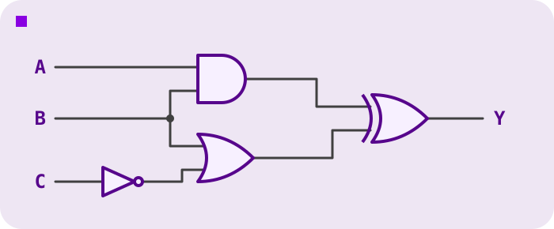

<h2 align=center>Week VII</h2>

<h1 align=center>Additional Practice Midterm</h1>

---

## Introduction

You may use these two handouts, open alongside this page: the [E15 Cheat Sheet](handout-e15-cheatsheet.pdf) and [Section 3 of the E20 Manual](handout-e20-manual-section3.pdf) (the instruction set). They are there so you don't need to memorise instruction encodings, so use them.

| Question | Topic | Points |
|---|---|---|
| 1 | Circuits and Verilog | 18 |
| 2 | Bits and two's complement | 14 |
| 3 | The E15 | 18 |
| 4 | Reading E20 programs | 18 |
| 5 | Writing an E20 program | 16 |
| 6 | Translating between E20 assembly and machine code | 16 |
| | **Total** | **100** |

## Questions

### 1. (18 points) Circuits and Verilog

Consider the following circuit.

<p align=center>
    
</p>

**(a)** (7 points) Write a combinational Verilog module named `testmodule` for this circuit. Its input ports are `A`, `B` and `C`, and its output port is `Y`. Use only Verilog's low-level bitwise operators (`|`, `&`, `^`, `~`). Your module starts like this:

```verilog
module testmodule (A, B, C, Y);
```

Declare your ports as `input` or `output`, declare any extra wires you need, and connect everything with `assign` statements. Your solution must be combinational: do not use `always`, `reg`, or sequential assignment.

**(b)** (5 points) Copy the truth table onto your paper and fill in the `Y` column for the circuit.

| A | B | C | Y |
|---|---|---|---|
| 0 | 0 | 0 |   |
| 0 | 0 | 1 |   |
| 0 | 1 | 0 |   |
| 0 | 1 | 1 |   |
| 1 | 0 | 0 |   |
| 1 | 0 | 1 |   |
| 1 | 1 | 0 |   |
| 1 | 1 | 1 |   |

**(c)** (6 points) A 4-bit register has a clock `clk`, a synchronous reset `rst`, an enable `en`, a 4-bit data input `d`, and a 4-bit output `q`. On each **rising clock edge**:

- if `rst` is 1, `q` becomes 0 (reset has priority over everything else);
- otherwise, if `en` is 1, `q` loads the value of `d`;
- otherwise, `q` keeps its current value.

Write the code that goes where the comment is, and use non-blocking assignment.

```verilog
module reg4 (clk, rst, en, d, q);
    input clk, rst, en;
    input [3:0] d;
    output reg [3:0] q;

    // YOUR CODE HERE

endmodule
```

### 2. (14 points) Bits and two's complement

**(a)** (6 points) Complete the following C function, which returns a value built from the **three least significant bits** of its parameter. In the return value, those three bits must sit in the **sixth, fifth and fourth** least significant positions (the most significant of the three goes in the sixth position), and every other bit of the return value must be 0. For example, `placebits(22)` should return `48`, because `22 = 10110` has `110` as its three least significant bits, and `110000 = 48`. For another example, `placebits(45)` should return `40`, because `45 = 101101` ends in `101`, and `101000 = 40`.

```c
unsigned int placebits(unsigned int x) {
    return YOUR CODE HERE;
}
```

Your solution should be one line. Use only the bit-twiddling operators `&`, `|`, `^`, `~`, and the shift operators `<<` and `>>`.

**(b)** (6 points) Assume the following are calculated using **5-bit two's complement** numbers. Give the resulting sum in decimal. Take into account the effect of possible overflow, and show your work.

 i. `9 + 8`

 ii. `-7 + -10`

**(c)** (2 points) Write `-38` as an **8-bit two's complement** number, in hexadecimal.

### 3. (18 points) The E15

**(a)** (12 points) Consider the following complete E15 program. Assume that all registers and the zero flag start at 0, and that the program has effectively finished once it reaches a `jmp` whose immediate is `0` (a jump to itself).

```verilog
myROM[0]  = {movi, RXX, Rg1, 4'b0000};
myROM[1]  = {movi, RXX, Rg2, 4'b0011};
myROM[2]  = {addi, RXX, Rg1, 4'b0111};
myROM[3]  = {subi, RXX, Rg2, 4'b0001};
myROM[4]  = {jnz,  RXX, RXX, 4'b1110};
myROM[5]  = {movi, RXX, Rg3, 4'b1001};
myROM[6]  = {jmp,  RXX, RXX, 4'b0000};
myROM[7]  = {jmp,  RXX, RXX, 4'b0000};
myROM[8]  = {jmp,  RXX, RXX, 4'b0000};
myROM[9]  = {jmp,  RXX, RXX, 4'b0000};
myROM[10] = {jmp,  RXX, RXX, 4'b0000};
myROM[11] = {jmp,  RXX, RXX, 4'b0000};
myROM[12] = {jmp,  RXX, RXX, 4'b0000};
myROM[13] = {jmp,  RXX, RXX, 4'b0000};
myROM[14] = {jmp,  RXX, RXX, 4'b0000};
myROM[15] = {jmp,  RXX, RXX, 4'b0000};
```

What final value will each of the following have? Give each as an unsigned decimal number. If a value cannot be determined (for example, if the program never ends), explain why.

 i. `Rg1` (4 points)

 ii. `Rg2` (4 points)

 iii. `pc` (4 points)

**(b)** (6 points) Interpret the following 12-bit number as an E15 instruction (use the E15 cheat sheet):

```
0011 00 00 1101
```

Write the instruction, including its opcode and arguments (use `RXX` for any register operand it ignores). Then state in prose what it does, specifically describing what it does to the program counter and when. If the instruction is at address 5, which address does it jump to?

### 4. (18 points) Reading E20 programs

Consider each of the following complete E20 assembly programs separately.

**(a)** (10 points)

```
        movi $1, 4
        movi $2, 0
top:    jeq  $1, $0, end
        add  $2, $2, $1
        addi $1, $1, -2
        j    top
end:    halt
```

 i. What is the final value of `$1`? Give your answer as an unsigned decimal number. If it cannot be determined, state why. (2 points)

 ii. What is the final value of `$2`? (3 points)

 iii. What is the final value of the program counter? (2 points)

 iv. What are the values of the labels `top` and `end`? (3 points)

**(b)** (4 points)

```
        movi $1, 1
        lw   $2, data($1)
        addi $2, $2, 3
        sw   $2, data($0)
        halt
data:   .fill 10
        .fill 20
```

What is the final value of `$2`? What is the final value of the memory cell labelled `data`? (2 points each)

**(c)** (4 points) Give the 16-bit machine code for the instruction `jeq $1, $0, end` in program (a). Write all 16 bits, and consult section 3 of the E20 manual. Note that the instruction's immediate is not the address of `end`.

### 5. (16 points) Writing an E20 program

Memory contains an array of **positive** integers beginning at the label `nums` and ending with a `0` that acts as a sentinel (the `0` is not part of the data). Write a complete E20 assembly program that counts how many of the numbers are **even** and stores that count into the memory cell labelled `evens`. Then the program halts.

Recall that an integer is even exactly when its least significant bit is 0. Your solution must use a loop. When you use a jump, specify its destination as a label, not as a number. Use correct E20 syntax, and write legibly, in neat rows.

You may assume that the data block below has been defined for you and that the labels `nums` and `evens` have values in the range 0 to 63, but your program must work for any array of positive integers that ends in a `0`. Provide everything else, above the data.

```
nums:   .fill 6
        .fill 3
        .fill 10
        .fill 7
        .fill 2
        .fill 0
evens:  .fill 0
```

### 6. (16 points) Translating between E20 assembly and machine code

Use section 3 of the E20 manual.

**(a)** (8 points) Interpret each of the following 16-bit numbers as an E20 instruction. Write the assembly instruction, including its opcode and arguments, and state in prose what it does, specifically which registers, memory cells and the program counter it modifies.

 i. `0000 1001 1001 0001`

 ii. `1010 0110 0111 1110`

**(b)** (8 points) Translate each of the following instructions into its 16-bit machine code. Write all 16 digits.

 i. `slti $5, $2, 20`

 ii. `lw $6, -3($7)`

<div style="height:80px"></div>
