<h2 align=center>Week VIII</h2>

<h1 align=center>Multicycle Implementation & The Pipelining Idea</h1>

---

## Sections

1. [**Why One Long Cycle Isn't Enough**](#1)
2. [**Five Stages, Followed on Real Instructions**](#2)
3. [**Five Registers: What Each Cycle Leaves Behind**](#3)
4. [**The State Register and the State Diagram**](#4)
5. [**A Sample Question, Solved**](#5)
6. [**What Multicycle Bought and Cost**](#6)
7. [**Pipelining: Overlap Instead of Reuse**](#7)
8. [**Where It Breaks: The RAW Hazard**](#8)
9. [**Two Fixes: Stall, or Forward**](#9)

---

To build the fastest processors in the world, hardware engineers first had to figure out how to make them **slower**. Yeah, I know. The whole history of this field feels like one long race toward higher clock speeds, and here we are, on purpose, slowing the thing down.

That paradox is what this week is about, and by the end of the lecture it will make complete sense.

Last week ended on a complaint. A single-cycle E20 does every instruction in exactly one clock cycle, and that cycle has to be long enough for the *slowest* instruction.

So a `j`, which is done in a sliver of the cycle, just sits there twiddling its thumbs. This week we fix that, and we fix it twice:

1. **Multicycle** (this half of the lecture): cut every instruction into small steps, one step per short cycle.
2. **Pipelining** (the second half): once the steps exist, a *different* instruction can sit in each step at the same time.

The second idea is the one the rest of the course is built on, and it is only possible *because* of the first. Before we start, I promise: **zero new hardware components this week.**

It's the same memory, register file, ALU and program counter you already know. We're rewiring how they interact across *time*, that's it.

---

<a id="1"></a>

## Why One Long Cycle Isn't Enough

Think of a convoy of cars. A convoy travels at the speed of its slowest vehicle, no exceptions: one guy in a minivan with a flat spare and everybody does 30 on the highway. Single-cycle is a convoy.

Here's why. A **clock cycle** is the time between two ticks of the processor's clock, and in single-cycle everything an instruction needs (fetching it, reading the registers, running the ALU, touching data memory, writing the result) has to finish inside *one* tick.

That's a problem because electricity isn't instant. Signals take real time to flow through memory, through muxes, through the ALU's gates, and different instructions need different amounts of that flowing. But the clock is a fixed interval, so the designer has no choice: **size the cycle for the worst path through the circuit.**

The slowest instruction sets the speed for everybody. In the E20, that instruction is `lw`.

Let's put numbers on it: (note: **these delays are invented.** They are not in the E20 manual. They're stand-ins with the right *shape*: memory is slow, the other parts are quick. Any numbers with that shape tell the same story)

| Step | Time it takes |
|---|---|
| Read or write memory | 2 time units |
| Read a register | 1 time unit |
| Do one ALU operation | 1 time unit |
| Write a register | 1 time unit |

Now walk `lw` through the machine. 

1. Fetch the instruction from memory: **2**. 
2. Decode it and read the base register: **1**. 
3. Push the base address through the ALU to add the offset and get the memory address: **1**. 
4. Access data memory with that address: **2** again. 
5. Write the loaded value into a register: **1**. 

That's 2 + 1 + 1 + 2 + 1 = **7 time units**, and so the single-cycle clock cycle can't be a hair shorter than 7, period.

Now compare an `add`. It fetches (2), reads *both* input registers at the same time (1), adds in the ALU (1) and writes the sum back (1): **5 units** of actual work. It never touches data memory, so it skips that big 2-unit delay entirely.

But the clock is welded at 7. So the `add` finishes at unit 5, and then the whole processor, fully powered up and doing absolutely nothing, waits two units for the clock to tick. Every instruction that does less work than `lw` pays that tax, and `j` pays the most.

<p align=center>
    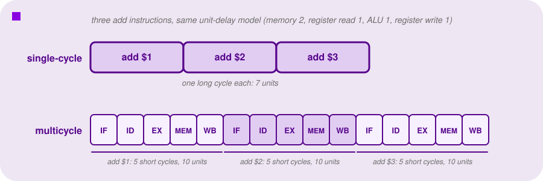
</p>
<p align=center><sub>Three <code>add</code> instructions. Single-cycle: three long cycles. Multicycle: each instruction is five short cycles.</sub></p>

So here's the proposal. 

- Stop sizing the clock for the whole instruction. 
- **Slice the instruction into small steps, and size the clock for the slowest *step*.** 

Looking at our delays, the slowest single step is a memory access: 2 units. So the clock cycle drops from 7 units to a very aggressive **2**, and every step of an instruction gets exactly one of those short cycles.

Which sounds fantastic, until you do the math. Take the `add` again. We cut it into five steps, and each step gets a 2-unit cycle: 5 × 2 = **10 units**.

In single-cycle the same `add` took 7. And `lw`? Also five steps of two units: 10, up from 7. **Multicycle makes every single instruction slower.**

That should bother you. Why would anyone, on purpose, adopt a design that makes every instruction slower? What on earth does it buy us?

Two things, and the second one is the whole point of the lecture.

- **Reuse across time.** In single-cycle everything happens inside one window, so the instruction fetch and a `lw`'s data access both need the memory *at the same time*. That takes a memory with two sets of ports, or two memories. Chop the instruction into steps and the two accesses land in different cycles: fetch in cycle 1, data access in cycle 4. They never overlap, so **one memory is enough**, just fed different addresses at different moments. Same economy for the ALU and the adders: last week's `jeq` needed a second adder for its branch target because the ALU was busy comparing. Now the ALU compares in one cycle and the PC adder finds the target in a later one. We're trading *time* for *space*.
- **Separation.** Once an instruction's work is cut into five independent standardised steps, nothing says the next instruction has to wait for all five of them to finish before it starts. That's **pipelining**, and it's where the speed-up finally shows up (Section 8).

So let's say it plainly: **multicycle is not a speed-up.** It's a restructuring that slows each instruction down so the hardware can be reused, and so we can overlap instructions later.


---

<a id="2"></a>

## Five Stages, Followed on Real Instructions

To cut an instruction into steps, we need to agree on what the steps are.

Take: 

```asm
add $3, $1, $2
```

Let's say `$1` holds 5, `$2` holds 9, and the program counter holds 10. The steps this instruction takes are the following:

1. **Find it.** Before any math, look at the `pc`, go to memory address 10, and pull out the 16-bit instruction. We call this **instruction fetch**, or `IF`.
2. **Understand it.** Read the bits: it's an `add`. Chop the instruction into its fields and read the two registers it names: `$1` gives 5, `$2` gives 9. This is **instruction decode**, `ID`.
3. **Math it.** Send 5 and 9 through the ALU. Out comes 14. This is **execute**, `EX`.
4. **Touch data.** Does an `add` need data memory? Nope, everything it needs was already in the registers. So this step does nothing. But we keep it in the timeline anyway, and it's called **memory access**, `MEM`. (it's going to matter later.)
5. **Save it.** Write 14 into `$3`, and set the `pc` to 11 so the next instruction is the one at address 11. This is **write-back**, `WB`.

<p align=center>
    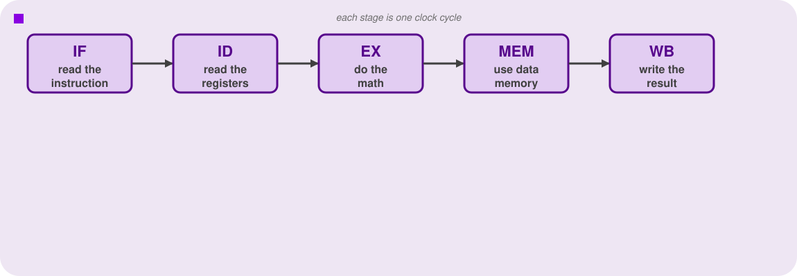
</p>
<p align=center><sub>The five stages. Every instruction passes through all five, in this order, one stage per clock cycle.</sub></p>

`IF`, `ID`, `EX`, `MEM`, `WB`. Five phases make up the life of an instruction, and every instruction goes through the same five, in the same order. Let's prove it with a different one: 

```asm
lw $1, 0($2)
```

...with `$2` holding 100, memory at address 100 holding 7, and the `pc` at 10.

1. **`IF`:** read memory at address 10, and get the `lw`.
2. **`ID`:** read the register that holds the base address, `$2`, and get 100.
3. **`EX`:** the ALU adds the 100 and the instruction's offset, 0, and gets 100.
4. **`MEM`:** this time we really use it. Send address 100 to data memory, and get 7.
5. **`WB`:** write 7 into `$1`, and set the `pc` to 11.

Same five stages, but look at what the ALU did in step 3. It didn't do "arithmetic" in the way it did for `add`. It computed an *address*.

The ALU is just a part that adds two numbers, and here the two numbers happen to be a base and an offset. The stage is named after what it does for *this* instruction.

**A note on register fields.** Every instruction has three register slots after the opcode, called **`reg1`, `reg2`, `reg3`** by position. The hardware knows slots, not "destinations": what a slot *means* depends on the instruction.

| Instruction | `reg1` | `reg2` | `reg3` |
|---|---|---|---|
| `add $3, $1, $2` | `$1`, first input | `$2`, second input | `$3`, the destination |
| `addi $2, $1, 5` | `$1`, the input | `$2`, the destination | not used |
| `lw $1, 0($2)` | `$2`, holds the address | `$1`, the destination | not used |
| `sw $1, 0($2)` | `$2`, holds the address | `$1`, the value to store | not used |
| `jeq $1, $2, ...` | `$1`, first to compare | `$2`, second to compare | not used |

In `lw`, the address register `$2` sits in slot 1 and the destination `$1` in slot 2: assembly order can mislead.


---

<a id="3"></a>

## Five Registers: What Each Cycle Leaves Behind

Now a physical reality that single-cycle let us ignore. In cycle 1, `IF`, the memory puts the instruction, say `add $3, $1, $2`, on its output wires. Nothing has copied it anywhere. It is simply there, on the wires.

<p align=center>
    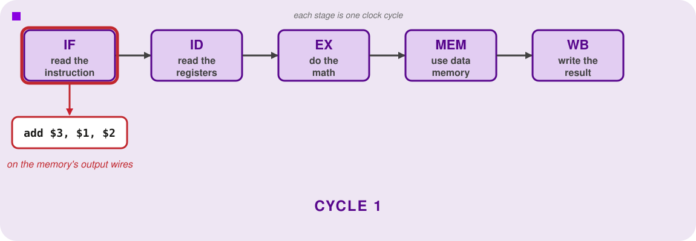
</p>
<p align=center><sub>Cycle 1, <code>IF</code>: the instruction is on the memory's output wires.</sub></p>

Does the instruction flow straight on into `ID` during the first clock cycle? **No.** In single-cycle, one long chain of wires carried it all the way through. Now `IF` fills cycle 1 on its own, and `ID` is a separate cycle, on the far side of a clock tick.

<p align=center>
    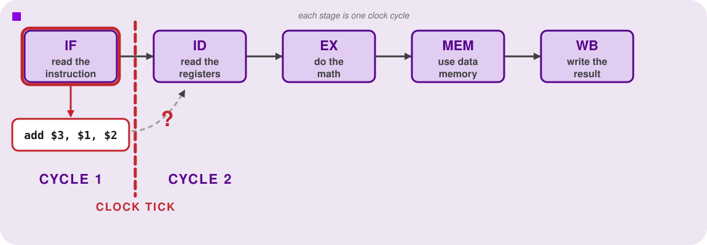
</p>
<p align=center><sub>The clock tick sits between <code>IF</code> and <code>ID</code>: the instruction does not simply flow across it.</sub></p>

In cycle 2, `ID`, across the tick, the memory is free to be asked for something else, so its output wires now carry whatever it answers. The instruction is gone, and `ID` has nothing to chop up.

<p align=center>
    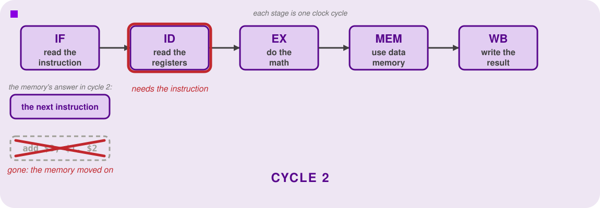
</p>
<p align=center><sub>Cycle 2, <code>ID</code>: the memory is answering something else, so the instruction is gone.</sub></p>

A wire only holds a value while something is driving it. The same goes for the two register values read in `ID`: if nothing keeps them, `EX` has nothing to add. Single-cycle never showed us this, because everything finished before the clock ticked.

<p align=center>
    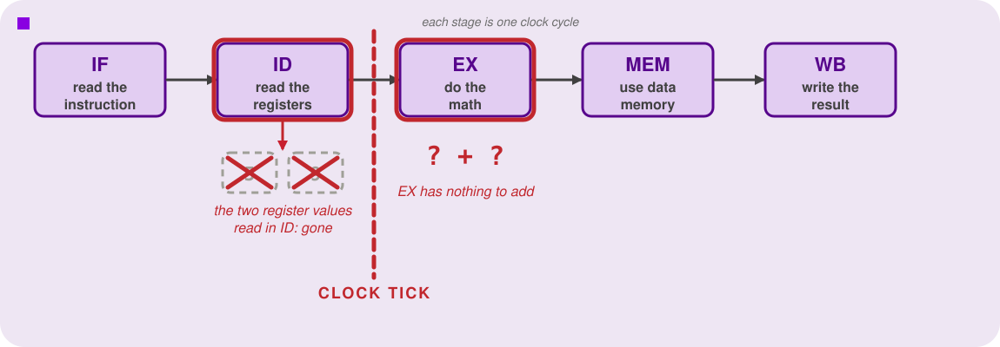
</p>
<p align=center><sub>The register values read in <code>ID</code> do not survive the tick either, so <code>EX</code> would have nothing to add.</sub></p>

So after each stage we put a **holding pen**: a register that catches the stage's result and keeps it steady until the next stage has used it. Start with `IF`. The memory puts the instruction on its wires, and a register called `IR` (instruction register) catches it.

<p align=center>
    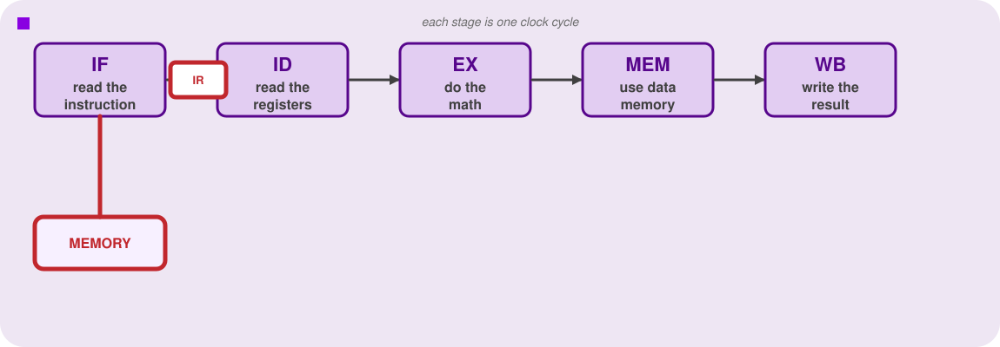
</p>
<p align=center><sub><code>IR</code> catches the instruction that the memory puts on its wires.</sub></p>

After `ID` we need two pens. The register file is asked for two registers, and two registers called `A` and `B` catch the two values it returns, the registers named by `reg1` and `reg2`.

<p align=center>
    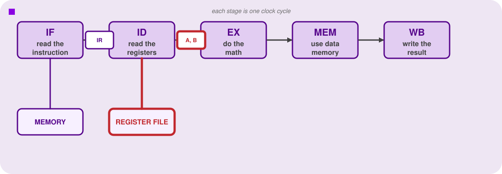
</p>
<p align=center><sub><code>A</code> and <code>B</code> catch the two values read from the register file.</sub></p>

`EX` hands two numbers to the ALU, and a register called `aluOut` catches its result: a sum, a comparison, or a memory address.

<p align=center>
    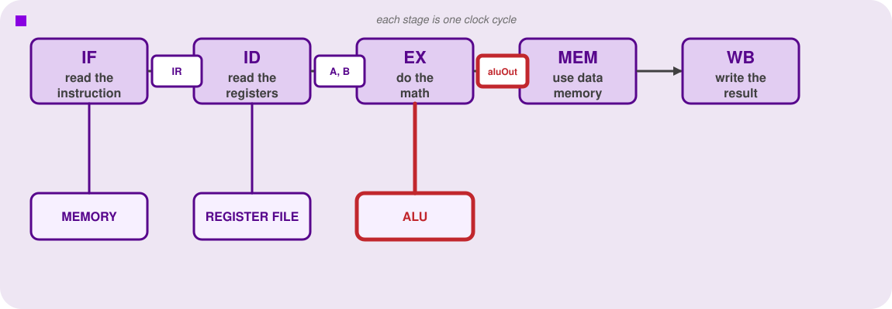
</p>
<p align=center><sub><code>aluOut</code> catches the ALU's result.</sub></p>

`MEM` goes back to the same memory that `IF` used, and a register called `MDR` (memory data register) catches the value that a load reads.

<p align=center>
    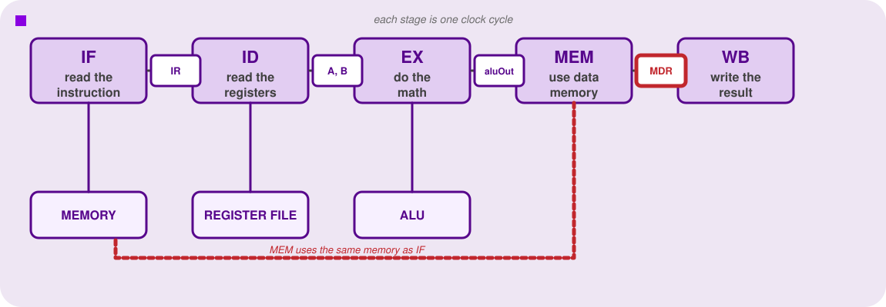
</p>
<p align=center><sub><code>MDR</code> catches the value a load reads. MEM uses the same memory as IF.</sub></p>

`WB` writes back into the same register file that `ID` read from. That is the whole machine: five stages, four kinds of holding pen, and three pieces of hardware reused across time. (You can never name these registers in assembly, which is why they're called *microarchitectural*: they exist in the machine, not in the instruction set.)

<p align=center>
    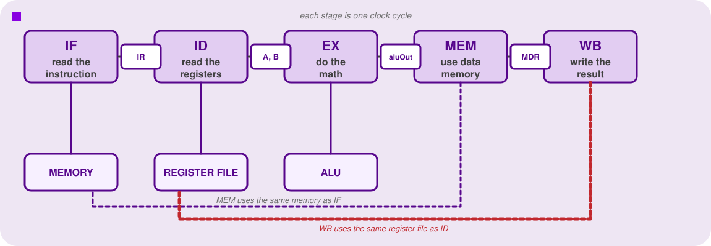
</p>
<p align=center><sub>The whole machine: WB uses the same register file as ID.</sub></p>

Let's watch them fill up, one cycle at a time, with the same `lw $1, 0($2)`. `$2` holds 100, memory at 100 holds 7, the old value of `$1` is 3 (junk we're about to overwrite), and the `pc` is 10. A blank cell means "not filled in yet by this instruction".

| Cycle | Stage | What happens | `IR` | `A` | `B` | `aluOut` | `MDR` |
|---|---|---|---|---|---|---|---|
| 1 | `IF` | read memory at the `pc` (10) | the `lw` | | | | |
| 2 | `ID` | `reg1` (`$2`) into `A`, `reg2` (`$1`) into `B` | the `lw` | 100 | 3 | | |
| 3 | `EX` | the ALU adds `A` and the offset 0 | the `lw` | 100 | 3 | 100 | |
| 4 | `MEM` | read memory at `aluOut` (100) | the `lw` | 100 | 3 | 100 | 7 |
| 5 | `WB` | `MDR` into `$1` (`reg2`); `pc` becomes 11 | the `lw` | 100 | 3 | 100 | 7 |

Two things in that table deserve a second look.

First, `B` grabbed the **old** value of `$1` (3) in cycle 2, and nobody ever used it. The `lw` is about to overwrite `$1`, so why read it? Because it's much cheaper to blindly read both registers on *every* instruction than to make the hardware stop, work out that this is a load, and cancel half the read. `B` holds a 3, we ignore it later, and nobody gets hurt.

Second, look at `IR`. For all five cycles the whole machine depends on `IR` still holding that `lw`. But here's the catch: registers naturally grab whatever is on their input wires every time the clock ticks.

And the `IR`'s input comes from memory's output. In cycle 4 memory is busy outputting the *data*, the number 7. If `IR` kept latching on every tick, it would catch that 7 in cycle 4, overwrite the `lw` with it, and the control module would suddenly see the bits of "7" and think it's a brand-new opcode in the middle of an instruction. Total chaos.

The fix is a **write-enable**: a one-bit control signal on every register. A 1 means "take the new value this tick". A 0 means "ignore your input and keep what you've got". The instruction register's is called `WEir`: the control module turns it on in cycle 1 to catch the instruction, then drives it to 0 for cycles 2 to 5 to protect it.

The others are `WEa`, `WEb` and `WEalu` (for `aluOut`), and control turns on only the one that belongs to the current stage.


---

<a id="4"></a>

## The State Register and the State Diagram

That write-enable story hides a bigger problem, and it's the biggest conceptual hurdle of the week. Think about what the control module has to do for our `lw`.

In cycle 1, the memory's address has to come from the `pc` (we're fetching). In cycle 4, the memory's address has to come from `aluOut` (we're loading data). The control module is looking at the **exact same instruction** in the exact same `IR` both times.

<p align=center>
    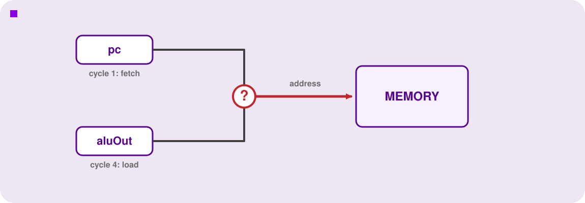
</p>
<p align=center><sub>One memory, one address input, two sources: the <code>pc</code> in cycle 1, <code>aluOut</code> in cycle 4.</sub></p>

<p align=center>
    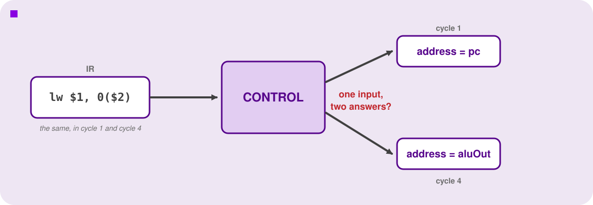
</p>
<p align=center><sub>The control module sees the same <code>lw</code> in <code>IR</code> both times, but it needs to give two different answers.</sub></p>

But a control module that's a pure truth table, opcode in and signals out, can't possibly give two different answers for the same input.

So what extra piece of information does it need? The thing that *differs* between the two cycles is **which cycle we're in**. Control needs to know where in the instruction's life we are.

<p align=center>
    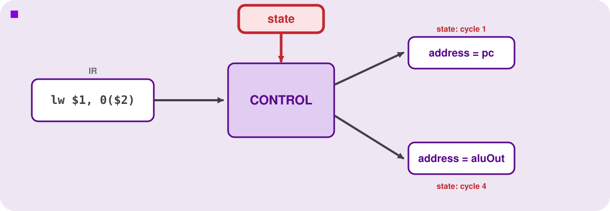
</p>
<p align=center><sub>A new input, the <strong>state</strong>, is what differs between the two cycles.</sub></p>

That's a **state**, and we keep it in one more register: the **state register**. (Think of it as the page number of a recipe: same recipe, but what you're doing depends on which page you're on.)

The control module now reads *two* inputs, the opcode and the current state, and produces *two* kinds of output: the control signals for this cycle (as before), and the **new state**, which gets stored on the next tick.

Nothing about the circuit became exotic. It's still a lookup table, with one more column on the input side. But a lookup table that feeds its own output back into a register is a **finite state machine**, and that's what the control module is now.

<p align=center>
    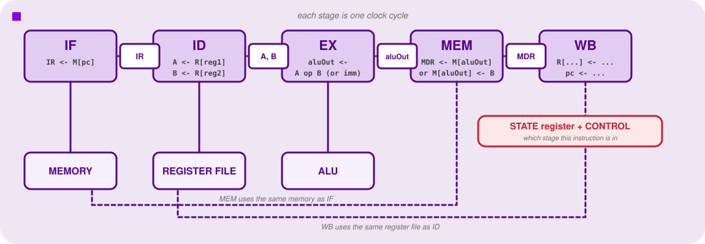
</p>
<p align=center><sub>The whole idea. The memory is used by two stages (IF and MEM), and so is the register file (ID and WB). Control reads the instruction and the state, and writes the next state.</sub></p>

So how many states do we need? The most natural answer is the one we already have: **one state for each stage**. Fetch is a state, decode is a state, then execute, memory and write-back: five states, one clock cycle each.

<p align=center>
    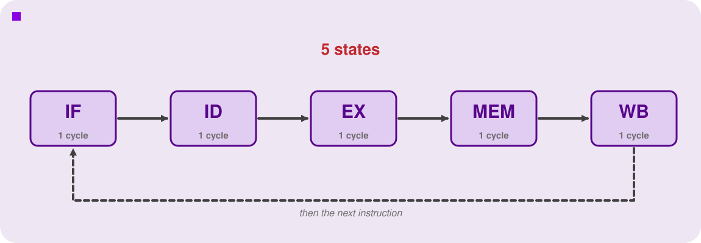
</p>
<p align=center><sub>Five states, one per stage, one clock cycle each.</sub></p>

That's an easy rule to remember, so let's start there and see whether it holds up. (Spoiler: almost, and the places where it breaks are the interesting part.)

<p align=center>
    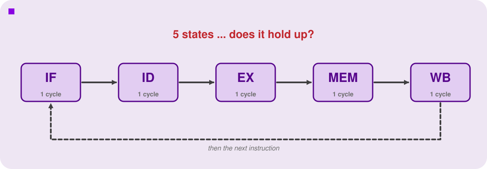
</p>
<p align=center><sub>Does the rule hold up?</sub></p>

To keep track of it, engineers draw a **state diagram**, which is just a flowchart of the machine's life. Each box is one state, which is one clock cycle.

<p align=center>
    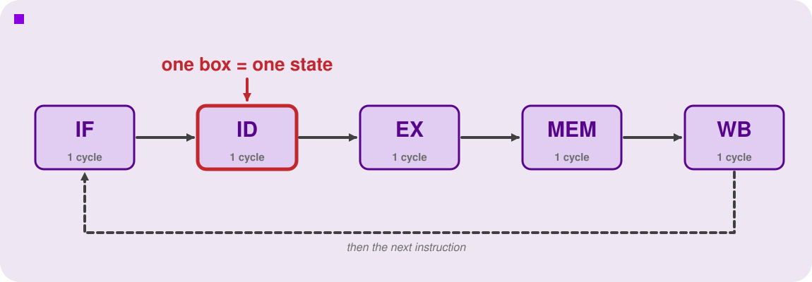
</p>
<p align=center><sub>One box is one state.</sub></p>

Each arrow says which state comes next, and the label on an arrow says which instructions take it. We'll build it one stage at a time, and every time something looks odd, we'll ask why.

<p align=center>
    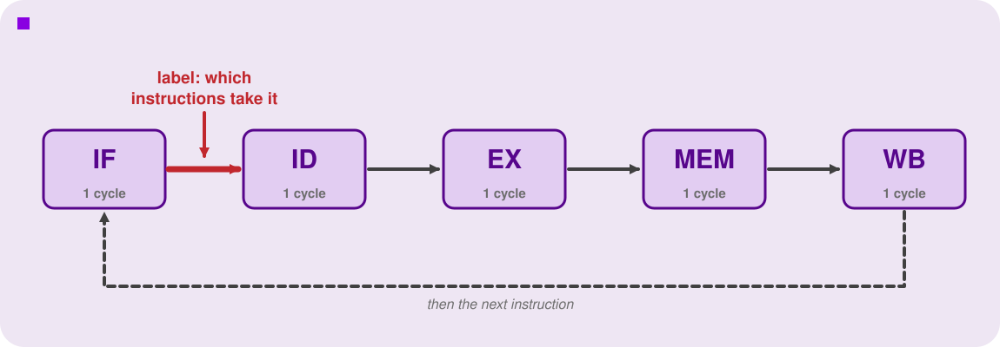
</p>
<p align=center><sub>Each arrow says which state comes next; its label says which instructions take it.</sub></p>

**`IF`: state 0.** Every instruction starts here: route the `pc` to the memory's address and turn on `WEir`. The notation `IR <- M[pc]` means "copy the memory at address `pc` into `IR`".

<p align=center>
    
</p>
<p align=center><sub>State 0: <code>IR &lt;- M[pc]</code>.</sub></p>

**`ID`: state 1** is the normal one. The values of `reg1` and `reg2` go into `A` and `B`.

<p align=center>
    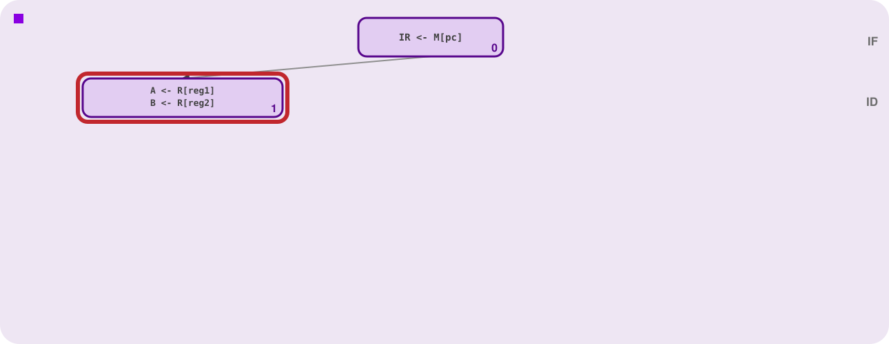
</p>
<p align=center><sub>State 1: the values of the registers named by <code>reg1</code> and <code>reg2</code> go into <code>A</code> and <code>B</code>.</sub></p>

But for the jumps, `j` and `jal`, we're not naming any registers at all. We just have our immediate: a raw 13-bit target, right inside the instruction. In `EX` we want that target to come out of the ALU as `aluOut`, so that write-back can just copy it into the `pc`. `A` and `B` are supposed to be the ALU's inputs, so what do we actually put into them?

<p align=center>
    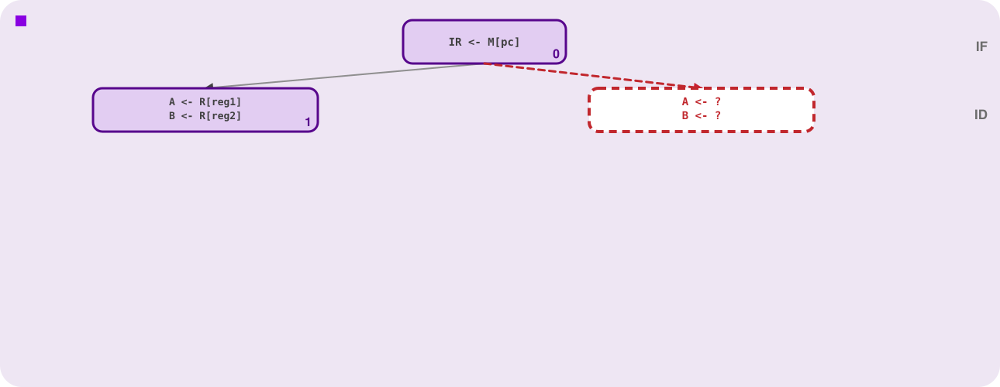
</p>
<p align=center><sub>For a jump, what do we put into <code>A</code> and <code>B</code>?</sub></p>

Two things that add up to the target: 0, and the target itself. **State 2**, exclusive to jumps, forces `A` to the constant register 0 (which is always 0) and loads `B` with the immediate, padded with zeros up to 16 bits (*zero-extended*).

<p align=center>
    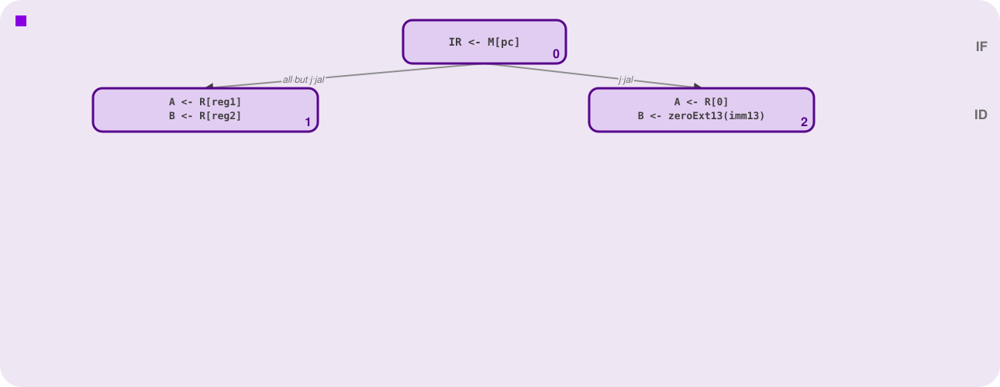
</p>
<p align=center><sub>State 1 reads registers into <code>A</code> and <code>B</code>; state 2 sets up the jump target.</sub></p>

Then `EX` computes `0 + target`, and the target passes through untouched. It's neat: no separate bypass wire around the ALU, just a different decode. So **state 1** is for instructions that name registers (`A <- R[reg1]`, `B <- R[reg2]`), **state 2** for `j` and `jal` (`A <- R[0]`, `B <- zeroExtend13(imm13)`).

Five stages, but we're already at three states, so "one state per stage" was only the starting point.

**`EX`: state 3** is for instructions with a small constant (a 7-bit *immediate*) baked in: `lw`, `sw`, `addi`, `slti`. It computes `A op signExtend7(imm7)`, where *sign-extending* means padding the 7-bit constant out to 16 bits in a way that keeps its sign, so that -3 stays -3.

<p align=center>
    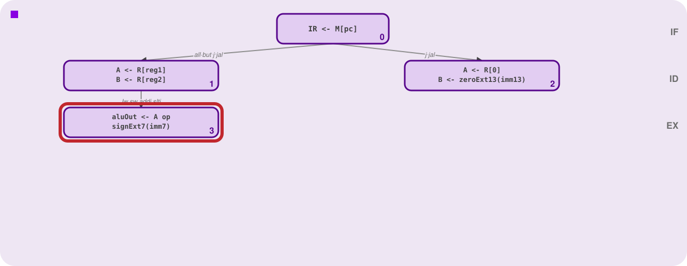
</p>
<p align=center><sub>State 3: <code>A op signExtend7(imm7)</code>, for instructions with a small constant.</sub></p>

**State 4** is for everything where both inputs are in registers (and for the jumps, with their target waiting in `B`): it computes `A op B`. "op" is whatever the instruction needs: `+` for `add`, `-` for `sub`, and so on. The ALU runs exactly once per instruction, in state 3 or in state 4.

<p align=center>
    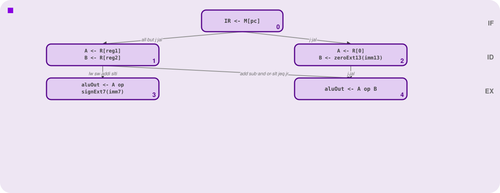
</p>
<p align=center><sub>The ALU runs exactly once per instruction, in state 3 or state 4.</sub></p>

**`MEM`**: `lw` reads memory into `MDR` (**state 5**: `MDR <- M[aluOut]`).

<p align=center>
    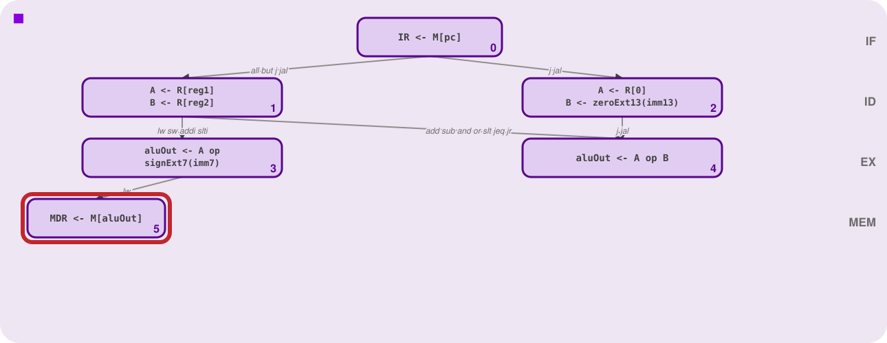
</p>
<p align=center><sub>State 5: <code>lw</code> reads memory into <code>MDR</code>.</sub></p>

And `sw` writes `B` into memory (**state 6**: `M[aluOut] <- B`). Now the second trap of the lecture, and it's a juicy one.

<p align=center>
    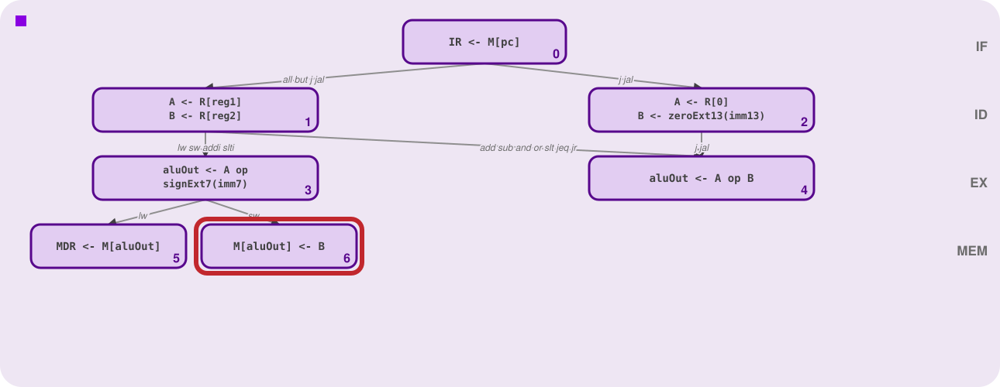
</p>
<p align=center><sub>State 6: <code>sw</code> writes <code>B</code> into memory.</sub></p>

Look at the diagram so far and ask: `add` finishes its math in state 4. It doesn't need memory. Why not draw an arrow from state 4 straight to write-back and skip `MEM`? `add` would take 4 cycles instead of 5, which sounds faster. Take a guess at what's wrong with that.

It *would* be faster for the `add`. But different instructions would then take different numbers of cycles, and the control module would have to keep track of who finishes when, which is a nightmare of extra logic.

A rigid rhythm is much simpler and, in hardware, simpler usually means faster and cheaper overall. So `add` gets routed through **state 7**, a `MEM` state that does absolutely nothing. It burns one tick just to keep everyone in step.

**Every instruction passes through every stage, so every instruction takes exactly five cycles**, whether or not it has real work to do in all of them. Simplicity beats local efficiency.

<p align=center>
    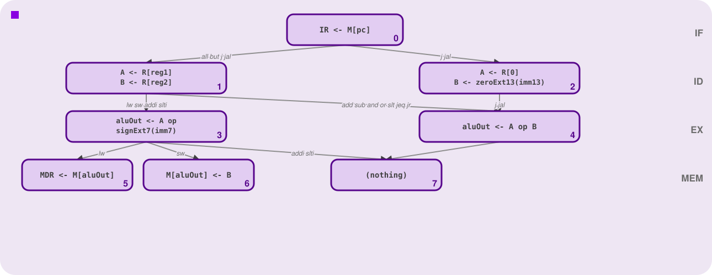
</p>
<p align=center><sub>State 7 is empty: it is the MEM stage for every instruction that doesn't use memory.</sub></p>

**`WB`**: each instruction ends by writing its result into a register (if it has one) and setting the `pc` for the next instruction. So there is one state for each kind of ending.

**State 8** is how a `lw` ends: the loaded value in `MDR` goes into register `reg2`, and the `pc` becomes `pc + 1`.

<p align=center>
    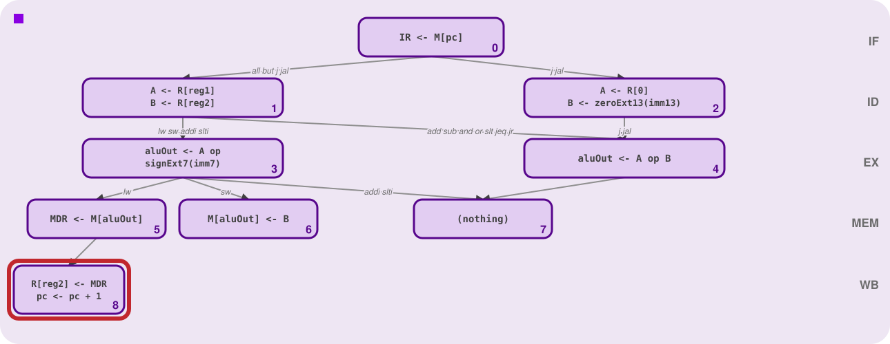
</p>
<p align=center><sub>State 8.</sub></p>

**State 9** is how a `sw` ends. The memory write already happened, so there is no register to write: the `pc` just becomes `pc + 1`.

<p align=center>
    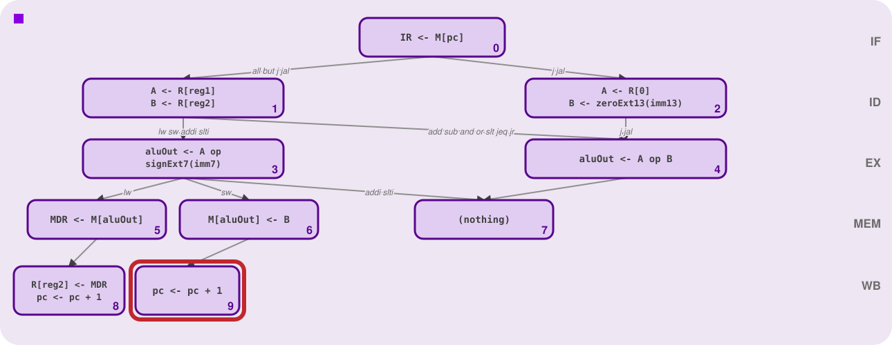
</p>
<p align=center><sub>State 9.</sub></p>

**State 10** is for `addi` and `slti`: the ALU's result goes into `reg2`, and the `pc` becomes `pc + 1`.

<p align=center>
    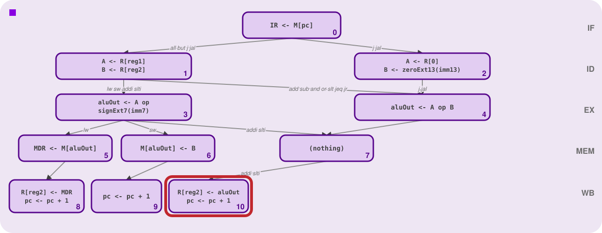
</p>
<p align=center><sub>State 10.</sub></p>

**State 11** is for `jeq`. No register is written, and the `pc` becomes `pc + 1`, plus `imm7` if the two registers were equal.

<p align=center>
    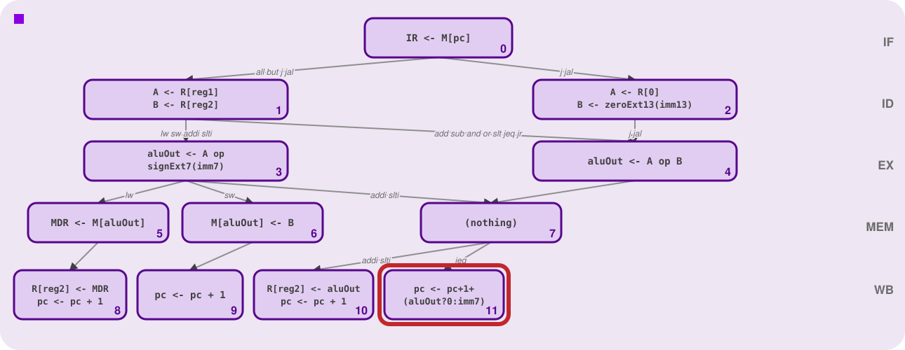
</p>
<p align=center><sub>State 11.</sub></p>

**State 12** is for `j` and `jr`: no register is written, and the `pc` becomes `aluOut`, the jump target.

<p align=center>
    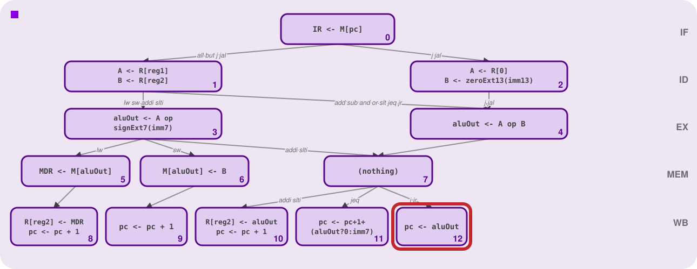
</p>
<p align=center><sub>State 12.</sub></p>

**State 13** is for `jal`: it writes `pc + 1` into register 7 as the way back, and the `pc` becomes `aluOut`.

<p align=center>
    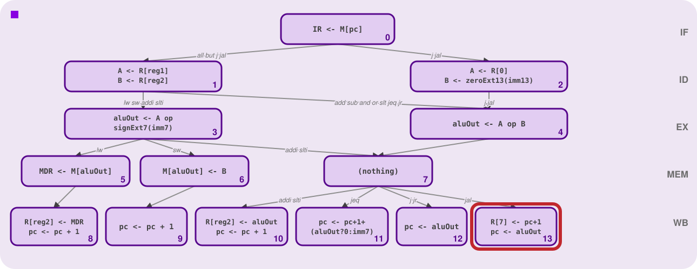
</p>
<p align=center><sub>State 13.</sub></p>

**State 14** is for `add`, `sub`, `and`, `or` and `slt`: the ALU's result goes into `reg3`, and the `pc` becomes `pc + 1`.

<p align=center>
    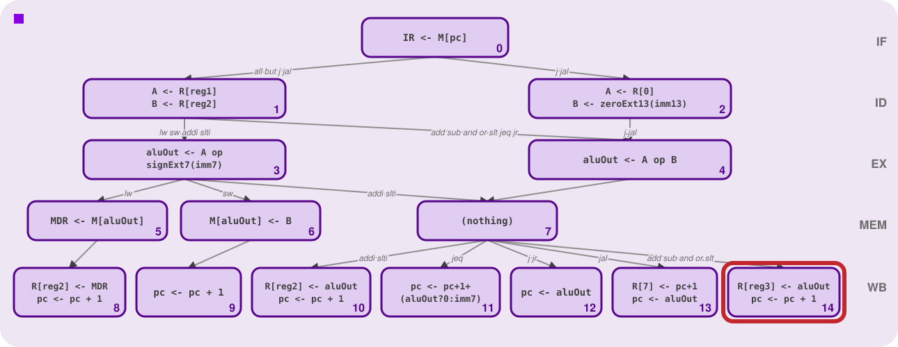
</p>
<p align=center><sub>State 14.</sub></p>

All of them lead back to state 0, ready to fetch the next instruction. That's the full diagram: fifteen states, 0 to 14.

<p align=center>
    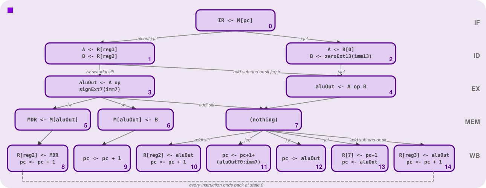
</p>
<p align=center><sub>The complete diagram. Every instruction starts at state 0 and ends back at it.</sub></p>

Now every instruction is just a path through the diagram:

| Instruction | States visited | Cycles |
|---|---|---|
| `add`, `sub`, `and`, `or`, `slt` | 0, 1, 4, 7, **14** | 5 |
| `addi`, `slti` | 0, 1, 3, 7, **10** | 5 |
| `lw` | 0, 1, 3, 5, **8** | 5 |
| `sw` | 0, 1, 3, 6, **9** | 5 |
| `jeq` | 0, 1, 4, 7, **11** | 5 |
| `jr` | 0, 1, 4, 7, **12** | 5 |
| `j` | 0, 2, 4, 7, **12** | 5 |
| `jal` | 0, 2, 4, 7, **13** | 5 |

Look down the last column. **Every row has five states.** `j` is no longer faster than `lw`: that's what you pay for the rigid rhythm.

<p align=center>
    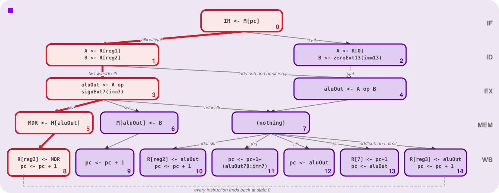
</p>
<p align=center><sub><code>lw</code>: fetch, read the registers, compute the address, read memory, write the loaded value back.</sub></p>

Here is that same trip on the manual's circuit (page 21), next to its state diagram (page 23). **Cycle 1, `IF` (state 0)**: the `pc` goes through `MUXaddr` to the memory's address input, and the instruction comes out of the memory into `IR`.

<p align=center>
    
</p>
<p align=center><sub>Cycle 1 of the <code>lw</code>: the circuit (page 21) and the state diagram (page 23) side by side. Light pink is the path so far; red is this cycle.</sub></p>

**Cycle 2, `ID` (state 1)**: the register fields of `IR` go through `MUXr1` into the register file, and the two values land in `A` and `B`.

<p align=center>
    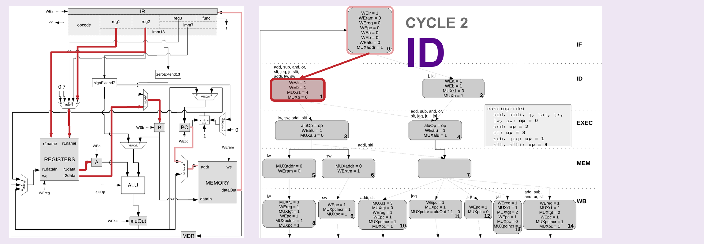
</p>
<p align=center><sub>Cycle 2 of the <code>lw</code>: the circuit (page 21) and the state diagram (page 23) side by side. Light pink is the path so far; red is this cycle.</sub></p>

**Cycle 3, `EX` (state 3)**: `A` and the sign-extended `imm7` go into the ALU, and `aluOut` catches the sum.

<p align=center>
    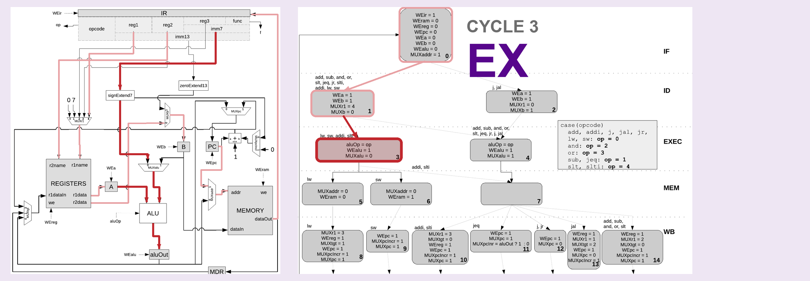
</p>
<p align=center><sub>Cycle 3 of the <code>lw</code>: the circuit (page 21) and the state diagram (page 23) side by side. Light pink is the path so far; red is this cycle.</sub></p>

**Cycle 4, `MEM` (state 5)**: `aluOut` goes through `MUXaddr` to the memory, and the loaded value lands in `MDR`.

<p align=center>
    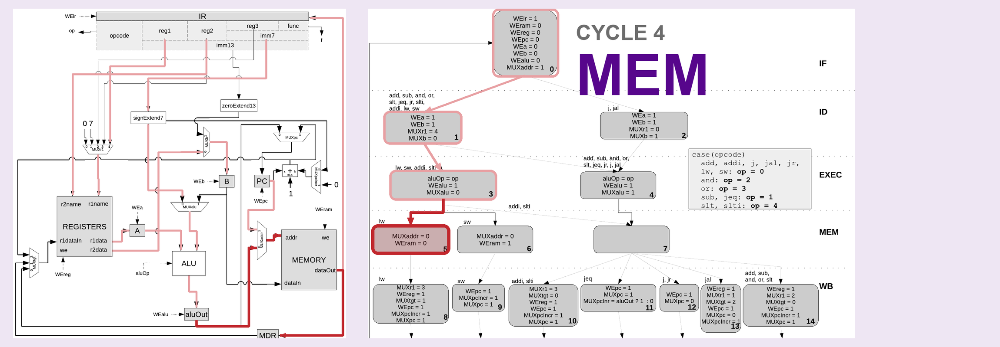
</p>
<p align=center><sub>Cycle 4 of the <code>lw</code>: the circuit (page 21) and the state diagram (page 23) side by side. Light pink is the path so far; red is this cycle.</sub></p>

**Cycle 5, `WB` (state 8)**: `MDR` goes through `MUXtgt` into the register file, and the `pc` moves on to `pc + 1`.

<p align=center>
    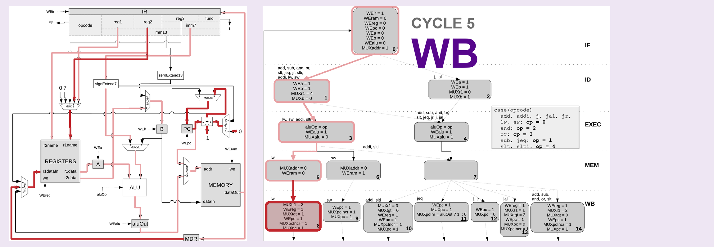
</p>
<p align=center><sub>Cycle 5 of the <code>lw</code>: the circuit (page 21) and the state diagram (page 23) side by side. Light pink is the path so far; red is this cycle.</sub></p>


<p align=center>
    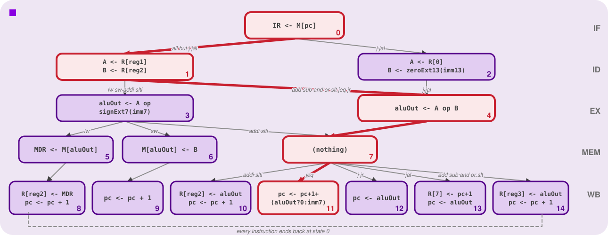
</p>
<p align=center><sub><code>jeq</code>: the ALU subtracts in state 4, and in state 11 whether <code>aluOut</code> is zero decides which way the <code>pc</code> goes.</sub></p>

To check you can read the diagram, trace `jr $3`. In state 1, `A` gets the value of `$3`, and because `jr` has its `reg2` field set to 0, `B` gets register 0, which is always 0.

State 4 computes `A + B`, which is just the value of `$3`, so `aluOut` is the target. State 7 does nothing. State 12 finishes with `pc <- aluOut`, so the program carries on from whatever address was in `$3`.


---

<a id="5"></a>

## A Sample Question, Solved

Here's the question this whole lecture has been building toward, and it's the one you will be asked on the homework and on the exam:

> **Add a new instruction to the multicycle E20. For each of the five stages, give the number of an existing state, or define a new state by its control signals.**

Our instruction is **`ret`**: jump to the address held in `$7`, the way you come back from a function call. You already have the circuit and the state diagram from the manual, so let's use them.

### The plan, in plain words

First, with no signals yet. `IF`: fetch the instruction, like every instruction. `ID`: `A` gets the value of register 7, because that's where we're jumping. `EX`: the ALU adds `A` and `B` to make the target (`B` is 0). `MEM`: nothing. `WB`: the `pc` takes the target, and no register is written. Now we turn each of those into a state.

<p align=center>
    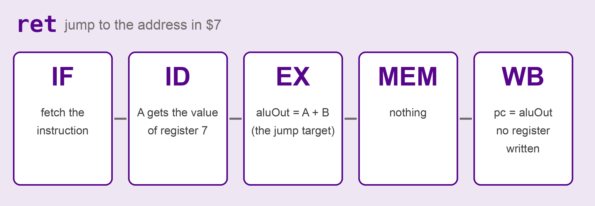
</p>
<p align=center><sub>What <code>ret</code> has to do in each stage.</sub></p>

### Stage by stage

**`IF`** is the easy one: state 0, the fetch, with `WEir = 1` and `MUXaddr = 1`. Every instruction starts there. Nothing to decide.

<p align=center>
    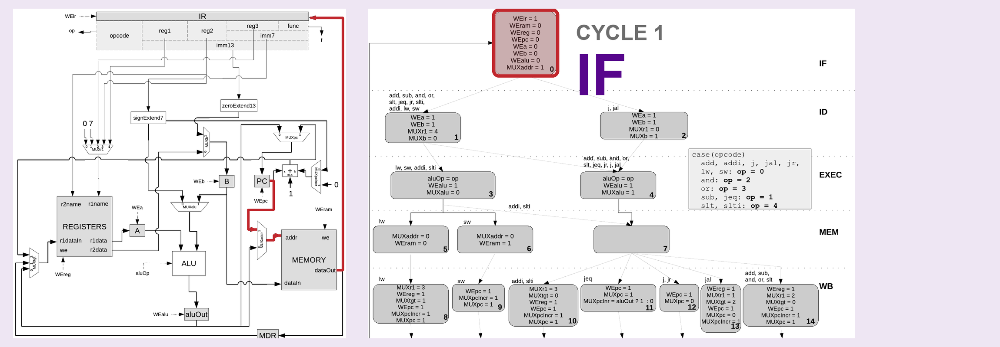
</p>
<p align=center><sub>IF: state 0.</sub></p>

**`ID`**: we need `A` to hold register 7. Two states load `A` and `B`: state 1 has `MUXr1 = 4` and state 2 has `MUXr1 = 0`. Which register does `MUXr1` pick?

<p align=center>
    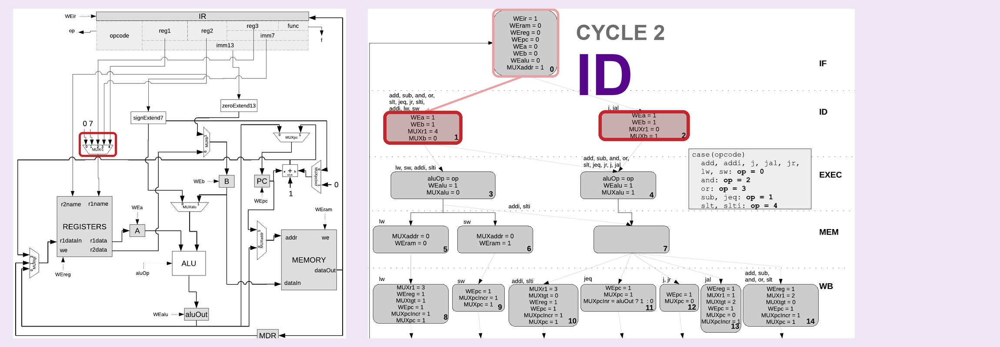
</p>
<p align=center><sub>Two ID states, and the mux that decides.</sub></p>

On the circuit, `MUXr1` sits in front of the register file, and its value says which register to read: 4 is `reg1`, 3 is `reg2`, 2 is `reg3`, 0 is the number 0, and 1 is the number 7. State 1 reads `reg1` and state 2 reads the number 0. **No existing state picks the number 7.**

<p align=center>
    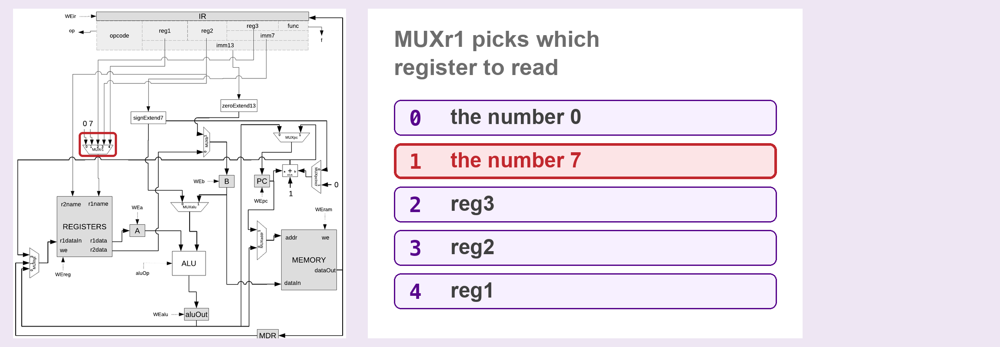
</p>
<p align=center><sub>What each value of <code>MUXr1</code> picks.</sub></p>

So we write a **new state**, and we don't write it from scratch. Start from the closest existing state, which is state 1 (it loads `A` and `B` from registers), and change only what differs. The only difference is which register `A` comes from: `MUXr1 = 1` instead of 4. Everything else stays as in state 1:

| Signal | State 1 | New state |
|---|---|---|
| `WEir` | 0 | 0 |
| `WEa`, `WEb` | 1, 1 | 1, 1 |
| `WEalu`, `WEram`, `WEreg`, `WEpc` | 0 | 0 |
| `MUXr1` | 4 (`reg1`) | **1** (the number 7) |
| `MUXb` | 0 (the register value) | 0 |
| everything else | don't care | don't care |

(`B` still loads `R[reg2]`; `ret` has no register fields, so they're 0, and `B` gets register 0, which is always 0. That's exactly what `EX` needs for `A + B`.)

So the new state is state 1 with `MUXr1 = 1`. On the circuit, the constant 7 goes through `MUXr1` into the register file, and the value of register 7 lands in `A`.

<p align=center>
    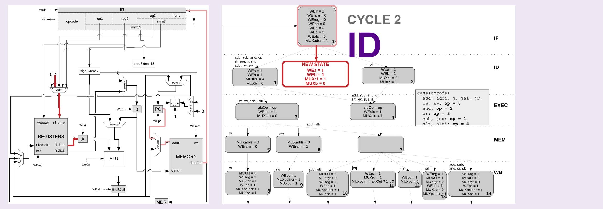
</p>
<p align=center><sub>The new state, and its path on the circuit.</sub></p>

**`EX`**: we need `aluOut = A + B`. Both `EX` states run the ALU; they differ in `MUXalu`, which picks the ALU's second input. State 3 takes the immediate, state 4 takes `B`. We want `B`, so **state 4**.

<p align=center>
    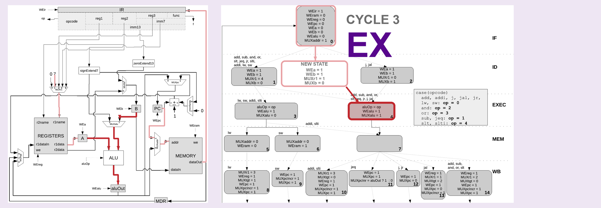
</p>
<p align=center><sub>EX: state 4.</sub></p>

**`MEM`**: we don't touch data memory, so we take **state 7**, the empty box that every instruction without a memory job passes through.

<p align=center>
    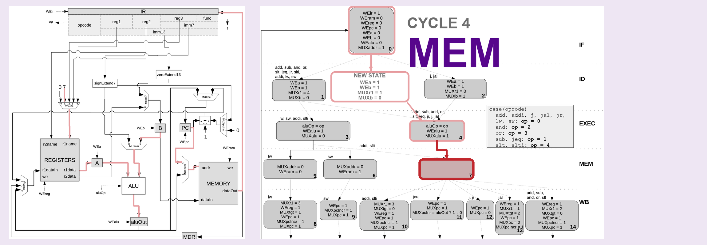
</p>
<p align=center><sub>MEM: state 7.</sub></p>

**`WB`**: the `pc` must take `aluOut` (`MUXpc = 0`, `WEpc = 1`), and no register is written: **state 12**, the ending `j` and `jr` use. State 13 also jumps, but it writes `$7` too (that's `jal`), so it's the wrong one.

<p align=center>
    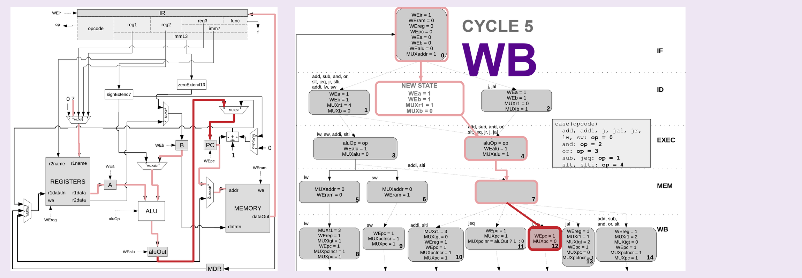
</p>
<p align=center><sub>WB: state 12.</sub></p>

### The answer

`IF`: state 0. `ID`: **a new state** (state 1 with `MUXr1 = 1`). `EX`: state 4. `MEM`: state 7. `WB`: state 12.

Look at what it took: reading boxes on page 23, and looking up *one* mux on page 21. One habit for when you write a new state yourself: list the write-enables that are on, and remember that an unlisted write-enable is 0 and an unlisted mux is "don't care". That is the general method, for the homework and for the exam: *for each stage, ask what must happen. If an existing state does it, name it. If none does, find the closest one, change only what differs, and fill in the rest: 0 for every write-enable that must stay off, and "don't care" for the muxes nobody is listening to.*

### Another question, where nothing new is needed

Here is a second question. Sometimes you can add an instruction **without changing any hardware**, just by choosing which states it uses. We want **`jalr $reg`**, "jump and link register": jump to the address held in a register (as `jr` does) *and* save the return address, `pc + 1`, into `$7` (as `jal` does). "Link" just means "remember where to come back to".

The E20 doesn't have this instruction, but I bet we can build it out of states that already exist. One stage at a time:

- **`IF`** is always state 0.
- **`ID`:** it needs exactly what `jr` needs: `A` holds the register's value (the target) and `B` holds 0. That's **state 1**.
- **`EX`:** add `A` and `B` to get the target into `aluOut`. That's **state 4**, with `aluOp = +`.
- **`MEM`:** it doesn't touch data memory, so it takes the empty **state 7**.
- **`WB`:** it must write `pc + 1` into `$7` *and* set the `pc` to `aluOut`. Is there a state that already does both? Yes: **state 13**, the one `jal` uses.

The path is **0, 1, 4, 7, 13**:

<p align=center>
    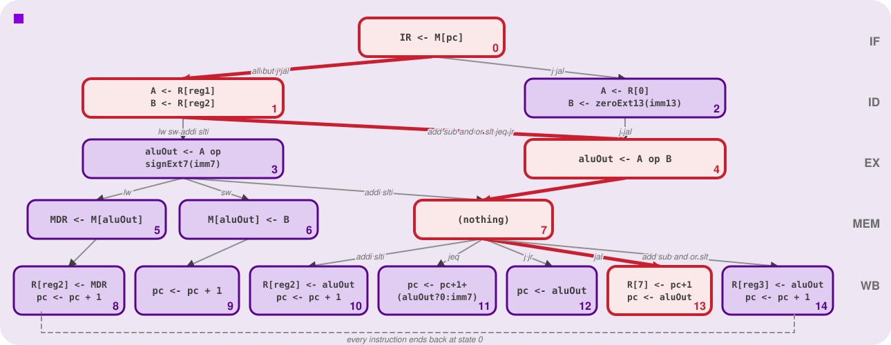
</p>
<p align=center><sub>No new hardware and no new states. Only the control logic changes: for <code>jalr</code>, <code>aluOp</code> is <code>+</code>, state 1 goes to state 4, and state 7 goes to state 13.</subls that turn this table into gates are allowed to pick whatever value for a "don't care" makes the logic simplest, and a smaller circuit is a cheaper and faster one.

---

<a id="6"></a>

## What Multicycle Bought and Cost

Performance has three factors, and every design trades them against each other:

> **Execution time = number of instructions × CPI × clock cycle length**

where **CPI** (cycles per instruction) is the average number of clock cycles one instruction takes. Let's run a program of 1000 instructions with the time units from Section 1.

| Design | Clock cycle | CPI | Time for 1000 instructions |
|---|---|---|---|
| Single-cycle | 7 units | 1 | 7000 units |
| Multicycle | 2 units | 5 | 10 000 units |
| Pipelined (Section 7) | 2 units | about 1 | about 2000 units |

Single-cycle: 1000 × 1 × 7 = 7000. Multicycle: we shrank the clock to 2, but the CPI jumped to 5, so 1000 × 5 × 2 = **10 000**. We said it back in Section 1, but here it is on paper, and it's worth letting it sink in: **10 000 is worse than 7000.**

Multicycle is definitively slower. (Although caveat: these are illustrative numbers. Real stages are rarely perfectly balanced, and balancing them is the first thing a processor designer works on.)

So was the whole exercise pointless? Not even close, and here's the one-sentence version of why: **pipelining keeps the short clock cycle *and* overlaps instructions, bringing the CPI back down to about 1.**


---

<a id="7"></a>

## Pipelining: Overlap Instead of Reuse

Think of four loads of laundry, each going through four steps (wash, dry, fold and store) of 30 minutes apiece. If you finish each load completely before starting the next, the whole job takes 4 loads × 4 steps × 30 minutes = 480 minutes.

If instead you move the first load into the dryer the moment the second goes into the washer, the washer is busy with load 2 while load 1 dries, then with load 3 while load 1 folds and load 2 dries, and so on. The whole schedule takes 7 slots, not 16. Load 1 can't finish before it has been through all 4 steps, so the first 4 slots belong to it. After that, each of the other 3 loads finishes one slot after the one before it: 3 more slots. Seven slots of 30 minutes is (4 + 3) × 30 = 210 minutes, against 480.

Nothing made any single load faster: a load still takes 2 hours. What changed is that every machine is busy most of the time. That is **pipelining**:

> **Pipelining is an implementation technique in which multiple instructions are overlapped in execution.**

The five stages are the same five stages from Section 2, each with its own hardware:

| Stage | What it does | Functional unit |
|---|---|---|
| IF | Read the instruction from memory | Memory |
| ID | Read operand values from the register file | Register file |
| EX | Perform the arithmetic operation | ALU |
| MEM | Read or write data in memory | Memory |
| WB | Write the result value into a register | Register file |

In multicycle, four of those five units are idle on any given cycle, because only one instruction is in the machine at a time. A pipeline lets the instruction behind it use them.

The registers between the stages (Section 3) now do double duty: instead of one machine remembering one instruction, **each stage's register holds a different instruction**.

Here is a stream of five `addi` instructions, one entering IF each cycle. Each row is one clock cycle, and each column is a stage.

<p align=center>
    
</p>
<p align=center><sub>Cycle 1: one instruction in the pipeline. Cycle 5: all five stages busy (the pipeline is <strong>saturated</strong>). The first instruction <strong>retires</strong> (finishes WB) in cycle 5, and one more retires every cycle after that.</sub></p>

Two words to learn. An instruction is **issued** when it enters IF, and it **retires** when it leaves WB. Each instruction still takes 5 cycles from issue to retirement, but once the pipeline is full, one retires every cycle.

**CPI, by hand.** Five instructions, retiring in cycles 5, 6, 7, 8 and 9: they take 9 cycles, so **CPI = 9 / 5 = 1.8**. Without pipelining the same five take 5 × 5 = 25 cycles: **CPI = 5**.

In general, `n` instructions through a `k`-stage pipeline take `k + (n - 1)` cycles, so CPI = `(k + n - 1) / n`, which approaches 1 as the program grows (the `k - 1` cycles of filling the pipe matter less and less).

A pipeline never gets below 1, but getting close to 1 is the whole point.

Notice that pipelining does not make an individual instruction finish sooner: it still takes 5 cycles. What it raises is **throughput**, the rate at which instructions retire.

**The same pipeline as a table.** This is the form you will meet on the homework and the exam. One row per clock cycle, one column per stage, and each cell names the instruction in that stage. Fill it in one row at a time: in cycle 1 the first `addi` is in `IF`; in cycle 2 it moves right into `ID` while the second enters `IF`; by cycle 5 every column is full and the first instruction reaches `WB`. From cycle 6 nothing new enters `IF`, so the pipeline drains, and in cycle 9 the last instruction writes back: nine rows, five instructions.

Read the table two ways. Along a **diagonal**, you get one instruction's journey: five cycles, one stage at a time. Along a **row**, you get a snapshot of the machine: in cycle 5, all five stages are working.


---

<a id="8"></a>

## Where It Breaks: The RAW Hazard

Consider two instructions back to back:

```
addi $1, $0, 1
addi $1, $1, 1
```

The first `addi` sets `$1` to 1, and the second adds 1 more, so `$1` should end up as **2**. Before either runs, `$1` holds 0.

Now look at when things happen. The second instruction reads `$1` in ID, in cycle 3. At that moment the first instruction has only just reached EX: the 1 is not even computed yet, so the register file still hands back **0**, and the second instruction computes `0 + 1 = 1`. In cycle 4 the 1 exists, in the first instruction's MEM stage, but it sits in a pipeline register and the register file still holds 0. Only in cycle 5 does WB write the 1 into `$1`. The read happened two cycles too early, and the program silently gets 1 where it meant 2.

<p align=center>
    
</p>
<p align=center><sub>The second instruction reads <code>$1</code> at the top red box, and the first instruction writes <code>$1</code> at the bottom red box.</sub></p>

This is a **RAW hazard** ("read after write"): an instruction reads a register before an earlier, still-in-flight instruction has finished writing it. Each instruction is correct on its own. The hazard exists only because the pipeline overlaps them.


---

<a id="9"></a>

## Two Fixes: Stall, or Forward

**Fix one: stall, by inserting a bubble.** Detect the dependency, and hold the second instruction back until the first has written `$1`. The second instruction waits in IF. In the meantime, the stages behind the first instruction receive a **bubble**: an empty slot (effectively a `nop`).

<p align=center>
    
</p>
<p align=center><sub>The second <code>addi</code> sits in IF for cycles 2 to 5, and reaches ID only in cycle 6, after the first has written <code>$1</code>. Every bubble is a stage doing no useful work.</sub></p>

Until cycle 5, `$1` still holds 0, so the second instruction waits. Once WB writes the 1, it reads `$1 = 1`, computes `1 + 1 = 2`, and writes the 2 back in cycle 9: the right answer. Here is the same stall as a table. The second `addi` stays in IF through cycle 5, and a `nop` bubble enters ID in its place; the bubbles then drift down the pipeline, one stage per cycle, and the second `addi` finally enters ID in cycle 6. Every dashed cell is a stage doing no useful work, and the pair finishes in cycle 9.

| Time | IF | ID | EX | MEM | WB |
|:-:|---|---|---|---|---|
| 1 | `addi $1,$0,1` | | | | |
| 2 | `addi $1,$1,1` | `addi $1,$0,1` | | | |
| 3 | `addi $1,$1,1` | *bubble* | `addi $1,$0,1` | | |
| 4 | `addi $1,$1,1` | *bubble* | *bubble* | `addi $1,$0,1` | |
| 5 | `addi $1,$1,1` | *bubble* | *bubble* | *bubble* | `addi $1,$0,1` |
| 6 | | `addi $1,$1,1` | *bubble* | *bubble* | *bubble* |
| 7 | | | `addi $1,$1,1` | *bubble* | *bubble* |
| 8 | | | | `addi $1,$1,1` | *bubble* |
| 9 | | | | | `addi $1,$1,1` |

Stalling is *always correct*, since the reader can never see a stale value. But every bubble is a cycle with idle hardware, so CPI creeps back up from 1.

**Fix two: forward.** The new value of `$1` already exists: the ALU computed it in cycle 3, at the end of the first instruction's EX stage. Instead of waiting for it to travel to WB and then be read back out of the register file, **route it directly** from where it is to where it is needed.

Follow the value, and watch what the register file says. In cycle 3 the 1 exists, but `$1` in the register file still holds 0. In cycle 4 the 1 sits in the pipeline register at the end of the first instruction's stage, and `$1` *still* holds 0. A wire carries the 1 around the register file and into the ALU input of the second instruction, which computes `1 + 1 = 2` with the right value. The register file only catches up in cycle 5, and the second `addi` writes the 2 in cycle 6: the pair finishes in cycle 6, where stalling needed cycle 9.

<p align=center>
    
</p>
<p align=center><sub><strong>EX-to-EX forwarding:</strong> the sum leaves the ALU in cycle 3 and goes straight into the next instruction's ALU in cycle 4. No stall at all.</sub></p>

If there is an instruction in between, the value is needed one cycle later: with `movi $2, 1` in the middle, the dependent `addi` reaches ID in cycle 4, and the 1 is forwarded there. Again the register file still holds 0 at that moment, and the dependent instruction uses the forwarded 1 anyway:

<p align=center>
    
</p>
<p align=center><sub><strong>EX-to-ID forwarding:</strong> with <code>movi $2, 1</code> in between, the value from the first <code>addi</code>'s EX (cycle 3) is delivered to the third instruction's ID (cycle 4).</sub></p>

Forwarding needs extra wiring, plus comparison logic to detect when a forward is needed and where from, but it recovers almost all of the lost cycles. **Not every hazard can be forwarded**, though.

A `lw`'s value first exists in MEM, after memory has been read, and an `addi` right behind it needs that value in EX, which would be one cycle *before* it exists. Even forwarding can't send a value backwards in time.

<p align=center>
    
</p>
<p align=center><sub><strong>MEM-to-EX forwarding:</strong> the value leaves MEM in cycle 4 and reaches the <code>addi</code>'s EX in cycle 5. The <code>addi</code> had to wait one extra cycle in ID: even with forwarding, a <code>lw</code> followed by an instruction that uses its result costs one stall.</sub></p>

So the whole picture: stalling is simple and always correct but slow; forwarding recovers most of the speed; and the load-use case still costs one cycle. Next week asks what happens when the problem is not a *value* but a *decision*: a branch whose outcome isn't known yet (a **control hazard**), and when two instructions want the same hardware at once (a **structural hazard**).

> Looking ahead: the same "many small, simple, uniform units, all kept busy at once" instinct that motivates a five-stage pipeline is the seed of why a GPU looks nothing like a single powerful CPU core. A GPU doesn't deepen its pipeline further. It takes the *width* approach: thousands of simple ALUs, each running the same instruction on different data, trading the hazard bookkeeping above for sheer replication. Both are answers to "how do I finish more instructions per second without shrinking the clock period further".

---

## Appendix: What Each Mux Input Means

Not a section to study: a reference to keep next to page 21 of the manual. A mux's value is the number of the input it picks.

| Signal | Value | Meaning |
|---|---|---|
| `MUXaddr` | 0 / 1 | the memory's address comes from `aluOut` / the `pc` |
| `MUXr1` | 0 / 1 | the register file's first port reads the number 0 / the number 7 |
| `MUXr1` | 2 / 3 / 4 | it reads `reg3` / `reg2` / `reg1` (in `WB`, it names the register to *write*) |
| `MUXb` | 0 / 1 | `B` gets the register value / `zeroExtend13(imm13)` |
| `MUXalu` | 0 / 1 | the ALU's second input is `signExtend7(imm7)` / `B` |
| `MUXtgt` | 0 / 1 / 2 | the value written to a register is `aluOut` / `MDR` / `pc + 1` |
| `MUXpc` | 0 / 1 | the new `pc` is `aluOut` / the PC adder's answer |
| `MUXpcIncr` | 0 / 1 | the PC adder adds `imm7` / nothing |
| `aluOp` | 0 to 4 | `+`, `-`, `&`, `|`, `<` |

Write-enables (`WEir`, `WEa`, `WEb`, `WEalu`, `WEram`, `WEreg`, `WEpc`) are always a definite 0 or 1. In the manual's state boxes, an unlisted write-enable is 0 and an unlisted mux is "don't care".

---

<sub>**Previous: [Midterm Review](/lectures/08-midterm-review)** || **Next: [Pipelining (cont'd) & Caching](/lectures/10-pipelining-and-caching)**</sub>
