<h2 align=center>Week IX</h2>

<h1 align=center>Pipelining, Concluded & The Case for Caching</h1>

---

## Sections

1. [**Recap: One Hazard Down, Three to Go**](#1)
2. [**Who Can Interfere? RAW, WAR, WAW, RAR**](#2)
3. [**Reordering: When It's Safe, When It Isn't**](#3)
4. [**Control Hazards: When the Pipeline Doesn't Know What Comes Next**](#4)
5. [**Branch Prediction: Guess, Then Check**](#5)
6. [**Structural Hazards: When Two Instructions Want the Same Hardware**](#6)
7. [**The Memory Wall**](#7)
8. [**Where Does a Cell Go? Rows, Tags, and the Valid Bit**](#8)
9. [**Blocks: Locality Is a Bet, Not a Guarantee**](#9)
10. [**Decoding an Address: Tag, Index, Offset**](#10)
11. [**Tracing a Cache: A Worked Example**](#11)
12. [**Sizing a Cache**](#12)
13. [**What a Cache Is Worth: Hit Ratio and Average Time**](#13)

---

Week VIII ended with one hazard fully worked out, RAW, and a promise that not every hazard is a data hazard. This week keeps that promise. Sections 1 to 6 finish the hazard story: the data hazards get a rule for reordering, control hazards turn out to be a RAW on the program counter, and structural hazards show up in a deliberately cheaper variant of the E20.

Then Section 7 changes subject to a number from the first slide of the course: memory is slow, and getting slower relative to the processor every year. Caching is the answer, and direct-mapped caching, its simplest version, is this week's second half.

---

<a id="1"></a>

## Recap: One Hazard Down, Three to Go

Quick reminder of last week's snag. Two `addi` instructions back to back, `addi $1, $0, 1` and `addi $1, $1, 1`: the second one reads `$1` in `ID`, two cycles before the first one writes it in `WB`. The register file hands back a stale value.

We found two fixes. **Stall** is always correct and always costs cycles: the second `addi` waits in IF while bubbles flow behind the first, and the pair finishes in cycle 9. **Forward** recovers most of those cycles by routing a value straight from where it is produced to where it is needed, skipping the register file. Forwarding finishes the same pair in cycle 6, with no bubbles at all. That is the RAW hazard, fully solved.

But RAW has siblings, and not every hazard is about a register. Today we find out which data hazards are real, ask whether we can dodge a stall by reordering, and then find out what happens when the thing being fought over is the `pc`. Last, we meet a hazard that is not about data at all.


---

<a id="2"></a>

## Who Can Interfere? RAW, WAR, WAW, RAR

Let's see what happens when two instructions sit close together in the pipeline. Take these two, back to back:

```
movi $1, 5
add  $2, $1, $1
```

Both instructions touch `$1`: `movi` writes it, and `add` reads it.

Whether that is a problem depends on *when* each of those two things happens, and one fact about our pipeline settles it: an instruction **reads** its registers early, in `ID`, and **writes** its result late, in `WB`. `add` is one cycle behind `movi`, so:

| | 1 | 2 | 3 | 4 | 5 | 6 |
|---|---|---|---|---|---|---|
| `movi $1, 5` | IF | ID | EX | MEM | **WB: writes `$1`** | |
| `add $2, $1, $1` | | IF | **ID: reads `$1`** | EX | MEM | WB |

`add` reads `$1` in cycle 3, and `movi` writes it two cycles later, in cycle 5.

So what does `add` actually see in cycle 3? The *old* value of `$1`, because the new one has not been written yet. That is a **RAW hazard** (read after write), the one from last week. The fact that the two instructions share `$1`, with one of them writing it, is called a **conflict**.

Now flip it. The first instruction reads, the second one overwrites:

```
addi $1, $2, 1
addi $2, $3, 1
```

| | 1 | 2 | 3 | 4 | 5 | 6 |
|---|---|---|---|---|---|---|
| `addi $1, $2, 1` | IF | **ID: reads `$2`** | EX | MEM | WB | |
| `addi $2, $3, 1` | | IF | ID | EX | MEM | **WB: writes `$2`** |

Can the first instruction ever see a wrong value here? No. It reads `$2` in cycle 2, and the overwrite does not land until cycle 6, so the read is long over. This pattern is called **WAR** (write after read). It is a conflict, because they share `$2` and one of them writes it, but it is *not* a hazard.

So there are two words to keep apart:

- A **conflict** is two instructions sharing a register (or memory cell) where at least one of them writes it. The patterns are RAW, WAR and WAW.
- A **hazard** is a conflict that can actually give a wrong answer in the pipeline we are running.

You might wonder why anyone would swap two instructions in the first place. The reason is that hazards cost cycles: when a RAW hazard forces a stall, the pipeline fills the wait with empty bubbles, each one a cycle of idle hardware.

A programmer, a compiler, or a fancy processor can sometimes shuffle the program so that an *independent* instruction sits in that gap instead. Same answer, fewer wasted cycles (the next section saves one). The catch is that the shuffle must never change the answer, so we need a rule for which swaps are safe.

But does "no hazard" make a swap safe? It does not. Swap that WAR pair, so the overwrite of `$2` comes first, and the `addi $1, $2, 1` sees the overwritten value. The pair caused no hazard in its original order, yet swapping it changes the answer. So the test for "is it safe to swap these two?" is whether there is any **conflict** between them, hazard or not. The next section applies exactly that rule.

The remaining two patterns follow the same recipe:

- **WAW** (write after write): both write `$1`, say `addi $1, $2, 1` then `addi $1, $3, 1`. The writes land in cycles 5 and 6, in order, so the later write lands last and nothing goes wrong. It is a conflict, not a hazard, and swapping the pair would leave the wrong final value.
- **RAR** (read after read): both only read `$2`. Reading destroys nothing, so there is nothing to fight over. It is not even a conflict, and the pair can be swapped freely.

| Name | Pattern | Example | Conflict? | Hazard in order? |
|---|---|---|---|---|
| **RAW** (read after write) | 2 reads what 1 writes | `movi $1, 0` then `add $2, $2, $1` | yes | **yes** |
| **WAR** (write after read) | 2 writes what 1 reads | `addi $1, $2, 1` then `addi $2, $3, 1` | yes | no |
| **WAW** (write after write) | both write the same register | `addi $1, $2, 1` then `addi $1, $3, 1` | yes | no |
| **RAR** (read after read) | both read the same value | `addi $1, $2, 1` then `addi $3, $2, 1` | no | never |

So on the E20 **only RAW can go wrong**, because reads are early, writes are late, and instructions finish in the order they started. WAR and WAW matter the moment we start *moving instructions around*, which is the next section. (A processor that lets instructions finish out of order would have to worry about them too.)


---

<a id="3"></a>

## Reordering: When It's Safe, When It Isn't

Stalling costs cycles. One way to win some back without any forwarding hardware is to reorder the instructions themselves: move an independent instruction into the gap that a stall would otherwise waste. A programmer can do it by hand, a compiler can do it automatically, and fancy processors do it at run time.

Here is the original order:

```
movi $1, 5
add  $2, $2, $1
add  $3, $3, $3
```

The second instruction needs `$1`, so with stalling it waits for the `movi` to write it back. Three bubbles flow through the pipeline while it waits, and the whole sequence finishes in **10 cycles**.

Here is the original order as a pipeline table (a row per clock cycle, a column per stage). The three bubbles are the stalled `add` waiting for `$1`:

| Time | IF | ID | EX | MEM | WB |
|:-:|---|---|---|---|---|
| 1 | `movi $1,5` |  |  |  |  |
| 2 | `add $2,$2,$1` | `movi $1,5` |  |  |  |
| 3 | `add $2,$2,$1` | *bubble* | `movi $1,5` |  |  |
| 4 | `add $2,$2,$1` | *bubble* | *bubble* | `movi $1,5` |  |
| 5 | `add $2,$2,$1` | *bubble* | *bubble* | *bubble* | `movi $1,5` |
| 6 | `add $3,$3,$3` | `add $2,$2,$1` | *bubble* | *bubble* | *bubble* |
| 7 |  | `add $3,$3,$3` | `add $2,$2,$1` | *bubble* | *bubble* |
| 8 |  |  | `add $3,$3,$3` | `add $2,$2,$1` | *bubble* |
| 9 |  |  |  | `add $3,$3,$3` | `add $2,$2,$1` |
| 10 |  |  |  |  | `add $3,$3,$3` |

Now swap the second and third instructions:

```
movi $1, 5
add  $3, $3, $3
add  $2, $2, $1
```

The conflict between `movi` and `add $2, $2, $1` is still there, so we still stall. But `add $3, $3, $3` does not depend on `$1` at all, so it uses a slot that used to be a bubble. Two bubbles instead of three: the sequence finishes in **9 cycles**, one sooner, and the program computes exactly the same thing.

| Time | IF | ID | EX | MEM | WB |
|:-:|---|---|---|---|---|
| 1 | `movi $1,5` |  |  |  |  |
| 2 | `add $3,$3,$3` | `movi $1,5` |  |  |  |
| 3 | `add $2,$2,$1` | `add $3,$3,$3` | `movi $1,5` |  |  |
| 4 | `add $2,$2,$1` | *bubble* | `add $3,$3,$3` | `movi $1,5` |  |
| 5 | `add $2,$2,$1` | *bubble* | *bubble* | `add $3,$3,$3` | `movi $1,5` |
| 6 |  | `add $2,$2,$1` | *bubble* | *bubble* | `add $3,$3,$3` |
| 7 |  |  | `add $2,$2,$1` | *bubble* | *bubble* |
| 8 |  |  |  | `add $2,$2,$1` | *bubble* |
| 9 |  |  |  |  | `add $2,$2,$1` |

The rule that makes this safe is narrow: **never change the relative order of two instructions that have a conflict**, whether it is RAW, WAR or WAW. A valid reordering only moves instructions that have no conflict with each other.

It is tempting to swap `movi $1, 5` and `add $2, $2, $1` directly, to dodge the RAW stall entirely. It does eliminate the hazard, but it also changes the answer: the `add` now reads the *old* value of `$1`. That violates the dependency instead of respecting it. A different program, not a faster one.

One more subtlety. A WAR or WAW pair, left in its original order, causes no hazard in an in-order pipeline. That does not make it safe to swap. Swap a WAR pair and the read now sees a value that has already been overwritten. For reordering, the right test is *conflict*, not hazard.


To see the rule at work, take these three instructions:

```
1  addi $1, $2, 1
2  add  $3, $3, $3
3  add  $2, $1, $1
```

Instructions 1 and 3 conflict, twice over: a RAW on `$1` (1 writes it, 3 reads it) and a WAR on `$2` (1 reads it, 3 overwrites it). Instruction 2 touches `$3` only, so it conflicts with neither. The rule says 1 must stay before 3, and instruction 2 can go anywhere. So the valid orderings are **1, 2, 3**, **1, 3, 2** and **2, 1, 3**. (The original order always counts.)


---

<a id="4"></a>

## Control Hazards: When the Pipeline Doesn't Know What Comes Next

Start with an ordinary instruction at address 5:

```
5:  add $1, $2, $3
```

The next `pc` will be 6, and the pipeline knows that the moment it fetches the `add`: `add` always goes to `pc + 1`, which is known at fetch.

Now a branch at address 5:

```
5:  jeq $1, $0, 20
```

A `jeq` is different. There are two possible values of the `pc` after it: `pc + 1` (not taken) or `pc + 1 + imm` (taken). Can the pipeline know which one the moment it fetches the `jeq`? It cannot. It depends on whether `$1` equals `$0`, and that is only worked out in `EX`.

<p align=center>
    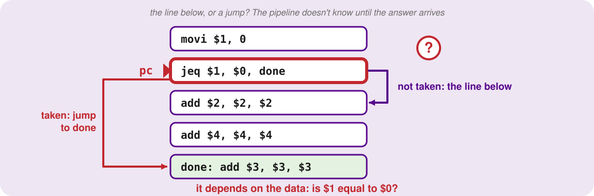
</p>
<p align=center><sub>The <code>jeq</code> forks the program. Not taken: the line below. Taken: a jump to <code>done</code>. The answer depends on the data.</sub></p>


So what does the pipeline do in the meantime? It cannot wait, because it fetches an instruction every single cycle. `jeq` is in `IF` in cycle 1 and reaches `EX`, where the answer arrives, in cycle 3. By then the pipeline has fetched **two** instructions behind it, in cycles 2 and 3, guessing that the line below is next.

Now suppose the branch turns out to be **taken**. Those two instructions came from the wrong place, so they have to be thrown away. That is called **flushing**, and only then can the real target enter `IF`, in cycle 4:

<p align=center>
    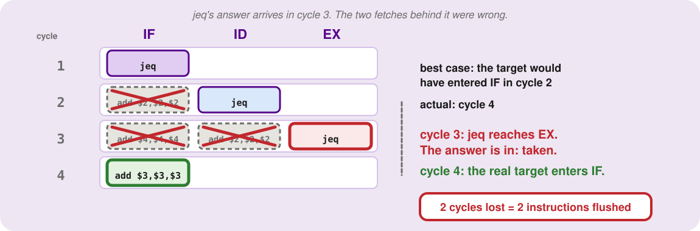
</p>
<p align=center><sub>Cycles 1 to 4. In cycle 3 <code>jeq</code> reaches <code>EX</code> and the answer arrives. The two crossed-out fetches are thrown away, and the real target only enters <code>IF</code> in cycle 4: two cycles lost.</sub></p>


| Time | IF | ID | EX | MEM | WB |
|:-:|---|---|---|---|---|
| 1 | `jeq` |  |  |  |  |
| 2 | *add $2,$2,$2 (flushed)* | `jeq` |  |  |  |
| 3 | *add $4,$4,$4 (flushed)* | *add $2,$2,$2 (flushed)* | `jeq` |  |  |
| 4 | `add $3,$3,$3` |  |  | `jeq` |  |
| 5 |  | `add $3,$3,$3` |  |  | `jeq` |
| 6 |  |  | `add $3,$3,$3` |  |  |
| 7 |  |  |  | `add $3,$3,$3` |  |
| 8 |  |  |  |  | `add $3,$3,$3` |

Count the damage. If the pipeline had known the answer when `jeq` was fetched, the target would have entered `IF` in cycle 2. It entered in cycle 4, so we lost **2 cycles**: exactly the two instructions we threw away.

Look at which register is involved. The pipeline reads the `pc` every cycle to know what to fetch, and `jeq` writes it late: `IF` reads it before `jeq` has written it. That is the **RAW** pattern from section 2, with the `pc` playing the part of `$1`. A control hazard is exactly that: the next `pc` is not known by the time the pipeline needs it, so the instructions fetched meanwhile may be the wrong ones.

Not every instruction can cause this. To find out which ones can, ask the same thing of each: what is `IF` fetching while this instruction is being decoded?

- **`add`, `addi` and the rest:** the next `pc` is always `pc + 1`, known at fetch. No hazard.
- **`jeq`:** as above, the answer arrives in `EX`, two wrong instructions behind it.
- **`jr $3`:** it jumps to whatever `$3` holds. While it sits in `ID`, `IF` is already fetching the line below it, and `jr` *never* falls through, so that fetch is always wrong. A control hazard, and a worse one for another reason: its target could be any address, not one of two candidates.
- **`j` and `jal`:** the target is written inside the instruction. If it is only recognised when decoded in `ID`, one wrong instruction is already behind it, one fewer than `jeq`, so it is still a hazard but a cheaper one. If the hardware could spot a `j` in `IF` itself, it would cost nothing. That is why the lecture calls them "maybe".

| Opcode | Control hazard? |
|---|---|
| `addi`, `add`, and the rest | no: the next `pc` is always `pc + 1`, known at fetch |
| `jeq` | **yes**: the target is `pc + 1` or `pc + 1 + imm7`, and which one waits until `EX` (2 wrong fetches) |
| `jr` | **yes**: the target is a register's value, and the line below is always wrong |
| `j` | **maybe**: the target is in `imm13`; decoded in `ID` it costs 1 wrong fetch, spotted in `IF` it costs none |
| `jal` | **maybe**: same as `j` |


---

<a id="5"></a>

## Branch Prediction: Guess, Then Check

Waiting for a branch's answer would stall on every branch, which is exactly the cost a pipeline exists to avoid. So the pipeline **guesses**, keeps going, and fixes the mistake if the guess was wrong. Let's see what that bet costs.

The simplest guess is **not taken**: keep fetching the line below.

<p align=center>
    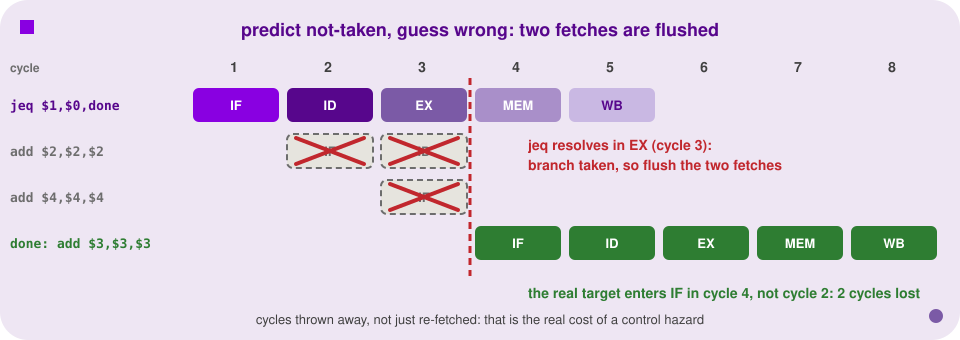
</p>
<p align=center><sub>When <code>jeq</code>'s <code>EX</code> stage reveals the branch was taken, every instruction fetched down the wrong path (already sitting in the early stages) is flushed.</sub></p>

A right guess costs **nothing**: the instructions already in flight were the right ones, so the pipeline never stalled. A wrong guess costs **2 cycles**: the two instructions behind the `jeq` are flushed and the real target is fetched late, exactly as in the last section.

**Now put numbers on it.** A branch runs 100 times and is taken 90 of them. Guessing "not taken" is wrong 90 times, so the penalty is 90 x 2 = **180 cycles**. Simply stalling on every execution would cost 100 x 2 = **200**, so guessing saved only 10%: barely worth it. For a branch taken only 10 times in 100, guessing "not taken" costs 10 x 2 = **20 cycles**, ten times better than stalling. A guess only pays when it is usually right.

<p align=center>
    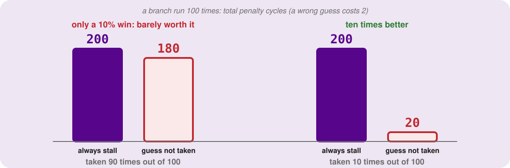
</p>
<p align=center><sub>Total penalty over 100 executions. Taken 90 times: stalling costs 200, guessing "not taken" 180, barely better. Taken 10 times: 200 against 20.</sub></p>


For a branch like that, **taken** would have been the better guess, and the kind of code that behaves this way is a **loop**: its back-edge jumps to the top almost every time, so "taken" is the better bet. An error check near the top of a function almost never fires, so there "not taken" wins. The best fixed guess depends on the branch.

But a fixed guess is wrong for the opposite kind of branch, so the processor needs something smarter, using only what it has already seen. The natural thing is to remember. If a branch has just done taken, taken, taken, taken, the best guess for its next execution is **taken**, because that is its history. Guessing "the same as last time" is the simplest version of **dynamic branch prediction**, and real processors keep that history for each branch separately.

Try it on a loop branch that runs twice (T = taken, N = not taken):

```
T T T T N   T T T T N
```

Guess "same as last time", starting from "not taken" for the very first one. It is wrong at the first outcome, at the loop exit, at the first outcome of the second run, and at the second exit: **4 wrong out of 10**. The fixed guess "always not taken" is wrong at every T: **8 wrong out of 10**. "Same as last time" is wrong only when the branch changes its mind, and one policy for every branch is always wrong for some of them.

<p align=center>
    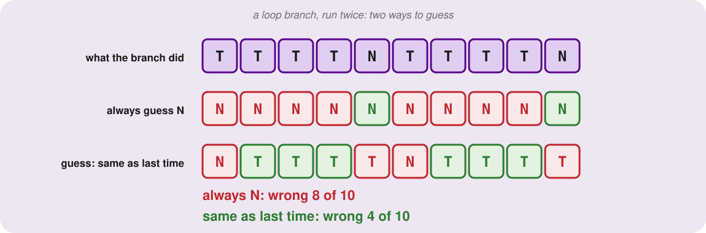
</p>
<p align=center><sub>A loop branch run twice. "Always not taken" is wrong 8 times out of 10; "same as last time" only 4.</sub></p>


---

<a id="6"></a>

## Structural Hazards: When Two Instructions Want the Same Hardware

The last hazard is not about data or the `pc`.

Take the register file. An instruction in `ID` uses it to read, and an instruction in `WB` uses it to write: the same piece of hardware. And in a full pipeline that happens in *every* cycle, because every cycle has one instruction decoding and another writing back.

The real E20 handles this with separate doors: its register file has **two read ports and one write port**, so a read and a write happen at once, with no problem. The E20 has no structural hazards, on purpose.

**Now imagine a cheaper register file with a single door that reads and writes have to share.** Four independent `add` instructions in a row:

```
add $1, $1, $1
add $2, $2, $2
add $3, $3, $3
add $4, $4, $4
```

Now look at cycle 5. The first instruction needs the door to write its result in `WB`, and the fourth needs the same door to read in `ID`. One door, two instructions. In the pipeline table it is one row with two cells fighting over the one door:

<p align=center>
    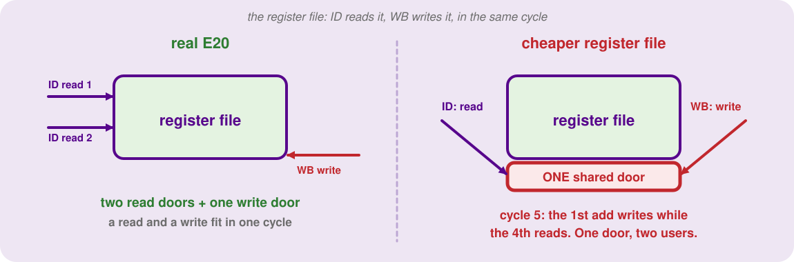
</p>
<p align=center><sub>Left: the real E20, two read doors and one write door, so a read and a write fit in one cycle. Right: one shared door, and in cycle 5 both <code>ID</code> and <code>WB</code> want it.</sub></p>


| Time | IF | ID | EX | MEM | WB |
|:-:|---|---|---|---|---|
| 1 | `add $1,$1,$1` |  |  |  |  |
| 2 | `add $2,$2,$2` | `add $1,$1,$1` |  |  |  |
| 3 | `add $3,$3,$3` | `add $2,$2,$2` | `add $1,$1,$1` |  |  |
| 4 | `add $4,$4,$4` | `add $3,$3,$3` | `add $2,$2,$2` | `add $1,$1,$1` |  |
| 5 |  | `add $4,$4,$4` | `add $3,$3,$3` | `add $2,$2,$2` | `add $1,$1,$1` |
| 6 |  |  | `add $4,$4,$4` | `add $3,$3,$3` | `add $2,$2,$2` |
| 7 |  |  |  | `add $4,$4,$4` | `add $3,$3,$3` |
| 8 |  |  |  |  | `add $4,$4,$4` |

So one of them has to wait: stall one, just as for a data hazard. With the cheap register file that would happen in *every* cycle, since every cycle has a write-back and a decode, so it would never get near one instruction per cycle.

The other fix is to **build more doors**, which is what the E20 does, a *deliberate design decision* that does not come for free when you pipeline. A **structural hazard** is exactly this: two instructions wanting the same hardware in the same cycle, with no data dependency at all.

So here are all three families side by side:

| Hazard | The conflict | The fix |
|---|---|---|
| data (RAW) | a later instruction reads too early | stall, forward, or reorder |
| control | the next `pc` is not known until a branch resolves | guess, then flush if wrong |
| structural | two instructions want the same hardware | stall one, or build more ports |

A pipeline in perfect health finishes one instruction per cycle. But a `lw` has to go to memory, and memory is not remotely that fast. That has nothing to do with hazards, and everything to do with a number from the first slide of this course. It is the other half of the lecture.


---

<a id="7"></a>

## The Memory Wall

So far we have treated `lw` as one polite `MEM` box, one cycle, done. That is a polite fiction, and this is where it falls apart. A computer is fast, memory is inside the computer, therefore memory is fast: that is the story the pipeline diagrams have been telling.

The physical reality is brutally different. An L1 cache reference, the fast memory built right onto the processor, takes roughly half a nanosecond. Main memory, the DRAM sitting a few inches away on the motherboard, takes about 100: **roughly 200 times slower.** A nanosecond means nothing to a human, so scale it up.

Let the half-nanosecond L1 access be one heartbeat, half a second. Then a trip to main memory is 200 heartbeats: 100 seconds, a minute and a half. That is long enough for the processor to walk to the bathroom, brush its teeth and walk back, just to fetch one integer.

A pipeline built to retire one instruction per cycle (last week's whole argument), stalling for that long on every `lw`, is practically paralysed. This is the **memory wall**: the processor is incredibly fast, and starving for data.

| Technology | Price / GB | Access time | Bandwidth |
|---|---|---|---|
| SRAM (cache) | ~$10,000 | ~1 ns | 25+ GB/s |
| DRAM (main memory) | ~$10 | 10 to 50 ns | ~10 GB/s |
| SSD | ~$1 | ~100,000 ns | ~0.5 GB/s |
| HDD | ~$0.1 | ~10,000,000 ns | ~0.1 GB/s |

Read that table as a trade: the fast technology is expensive and small, the slow one is cheap and enormous, and none is both. (On the E20 a `lw` or `sw` may stall a few cycles. On real machines the penalty can be fifty cycles or more.)

Picture a student writing a research paper. They do not walk across campus to the library for every fact, read one sentence, and walk back. They make one trip, check out a stack of books, and keep them on the desk. The desk is tiny compared with the library, but anything on it is instantly within reach. The desk is the **cache**; the library is main memory.

When the processor looks for something and finds it on the desk, that is a **hit**. When it is not there and the student has to put on a coat and walk to the library, that is a **miss**. The fraction of the time you find what you need on the desk is the **hit ratio**: ask for 10 values, find 9 on the desk, and the hit ratio is 90 percent.

<p align=center>
    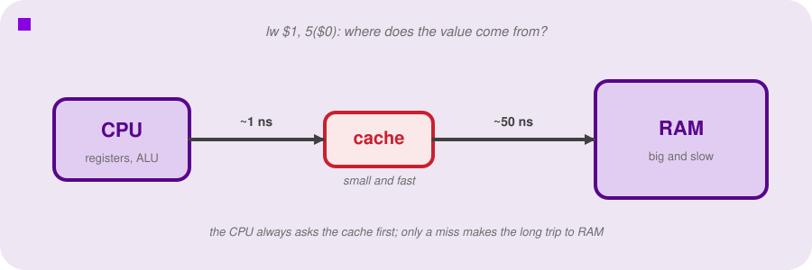
</p>
<p align=center><sub>The CPU always asks the cache first. Only when the cache doesn't have the answer does the request make the long trip to RAM.</sub></p>

The obvious objection: if the desk is so fast, why not build one big enough to hold everything? There are two reasons. The first is money and space: fast memory (SRAM) needs more transistors per bit, so it is expensive and takes up a lot of silicon.

The second is physics. A cache as big as your RAM would be just as slow as your RAM. You can have small and blazing fast, or enormous and sluggish, but not both. So the desk stays tiny.

A tiny desk creates a logistics problem, and every cache designer has to answer three questions:

1. When I bring a book back from the library, *where* on the desk do I put it?
2. When I look at the desk later, *how do I know* it is the book I want?
3. The desk is small, so *what do I throw on the floor* to make room for a new one?

The simplest answer to all three is a **direct-mapped cache**. We will not hand you the finished blueprint. We will build the dumbest thing that could possibly work, watch it fail, and fix it, four times.


---

<a id="8"></a>

## Where Does a Cell Go? Rows, Tags, and the Valid Bit

Keep the numbers small so you can follow them in your head. Our cache has four **rows**, which are slots that each hold one memory value. In main memory, address 42 holds the value 17, and address 10 holds the value 33.

**Attempt one: split by remainder.** We need a rule that decides which row a value goes into, and the cheapest routing logic in the world is the remainder: `row = address % 4`. The processor asks for address 42. Divide by 4: 10 with a remainder of 2, so row 2. We copy 17 from main memory into row 2. So far so good.

<p align=center>
    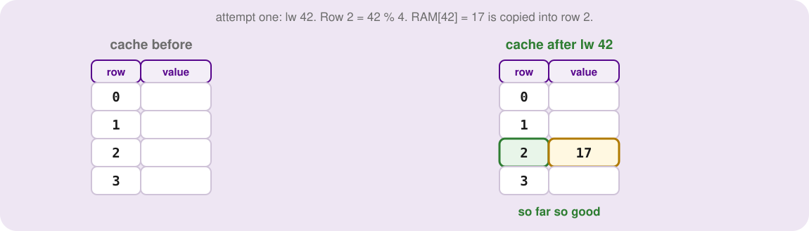
</p>
<p align=center><sub>Attempt one, step one: lw 42 puts 17 into row 2.</sub></p>

A few cycles later the processor asks for address 10. `10 % 4` is also 2, so the cache goes to row 2, finds a value sitting there, and hands back 17. But the real value of address 10 is 33. The cache just *confidently lied*. A slow computer is annoying; a computer that returns the wrong answer at the speed of light is useless.

<p align=center>
    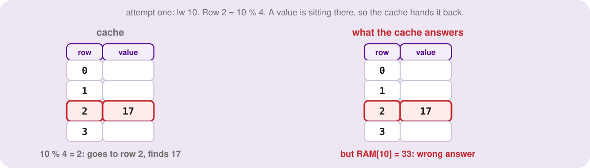
</p>
<p align=center><sub>Attempt one, step two: lw 10 lands on row 2 and gets the wrong value.</sub></p>

The problem is that with four rows, a quarter of all addresses (2, 6, 10, 14, 42, 100, and so on) are forced into row 2, and the cache has no way to tell them apart. It is a single mailbox for a whole apartment building where each letter has only the apartment number on it, not the name of the resident: whoever opens the box takes whatever is inside.

<p align=center>
    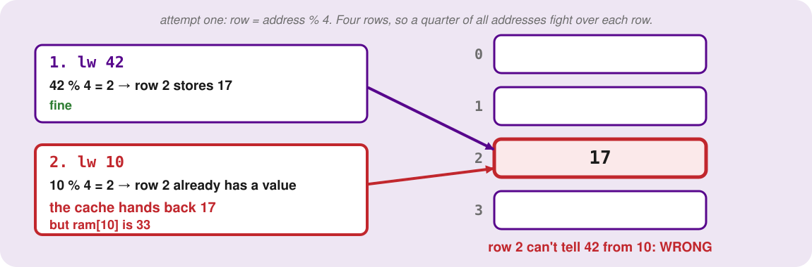
</p>
<p align=center><sub>Attempt one: <code>42 % 4</code> and <code>10 % 4</code> are both 2. The cache hands back 17 for address 10, whose real value is 33.</sub></p>

**Attempt two: store the address too.** The fix is obvious once you have seen the failure: write the resident's name on the letter. Next to each value, store the address it came from, so row 2 holds the pair `(42, 17)`.

<p align=center>
    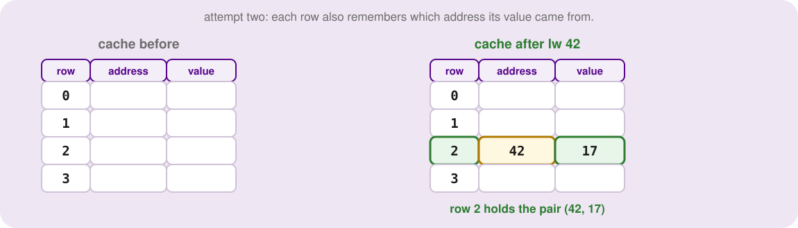
</p>
<p align=center><sub>Attempt two: row 2 now holds the pair (42, 17).</sub></p>

Run it again. The processor asks for address 10, the cache goes to row 2, and now it does not grab blindly. It compares the stored address (42) with the requested one (10). They are not equal, so this is not the data it is looking for: a **miss**.

The cache goes to main memory, fetches the real value (33), and has to put it somewhere. Row 2 is the only place it can go, so it overwrites `(42, 17)` with `(10, 33)`. Throwing out a perfectly good entry to make room for a new one is called an **eviction**, and since the desk is tiny it is a constant, unavoidable fact of life.

<p align=center>
    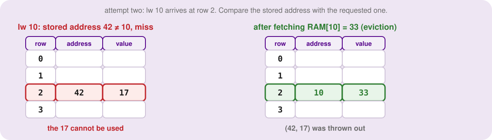
</p>
<p align=center><sub>Attempt two: the address check catches the conflict, and the new value evicts the old.</sub></p>

We have fixed the lying. But we have created an inefficiency: every row now stores a whole address (32 or 64 bits) next to a tiny piece of data. That is a lot of wasted transistors.

<p align=center>
    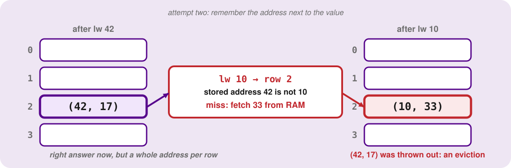
</p>
<p align=center><sub>Attempt two: the stored address (42) does not match the requested one (10), so it is a miss. The old entry is evicted and row 2 now holds <code>(10, 33)</code>.</sub></p>

**Attempt three: store only what we don't already know.** Look at how address 42 got to row 2: we took `42 % 4`, the remainder. So the row number already tells us something about the address. If you are standing in front of row 2, you know with certainty that whatever is inside came from an address that leaves remainder 2 when divided by 4.

You do not need to write that part down. It is the hotel floor: standing on the fifth floor, a room label of "12" is enough, because being on the fifth floor already tells you the first part.

What is left to store is how many times 4 went into the address before the remainder: `address // 4`. Write each address as `4 × something + remainder`: `42 = 4 × 10 + 2` and `10 = 4 × 2 + 2`. The remainder (2) is the row; the multiplier (10, or 2) is what the row cannot tell us.

It is called the **tag**. So row 2 stores a tag of 10 next to the value 17, instead of the whole 42. When address 10 arrives, it computes row 2 and tag 2, compares the stored tag (10) with 2, and misses.

<p align=center>
    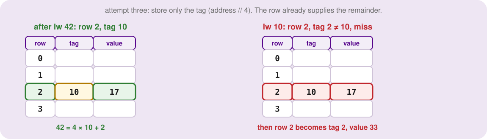
</p>
<p align=center><sub>Attempt three: row 2 holds tag 10, and address 10 arrives with tag 2.</sub></p>

A lookup is now: compute the row and the tag from the address, go to the row, and compare the stored tag with the computed one. A match is a hit; otherwise it is a miss, so fetch and evict.

**Untangling the vocabulary.** These two are easy to mix up. The **index** is just another word for the row number: it tells you *where* the data lives, like an apartment number. The **tag** tells you *who* is currently living in that apartment. You need both. The index gets the electrical signals to the right door on the chip, and the tag checks the ID of whoever is inside. **Index is where, tag is who.**

<p align=center>
    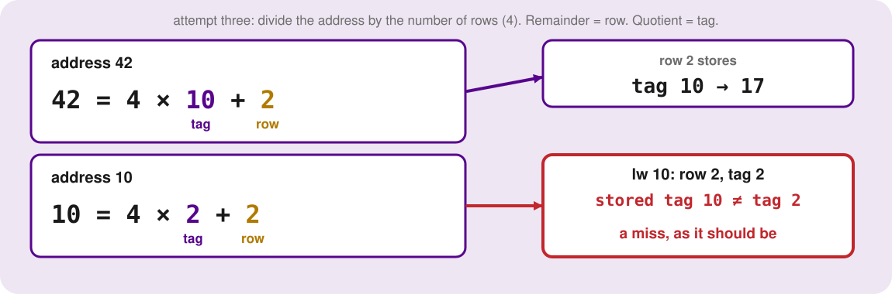
</p>
<p align=center><sub>Attempt three: divide by 4. The remainder is the row, the quotient is the tag. Address 42 is row 2, tag 10. Address 10 is row 2, tag 2, so the stored tag does not match and it is a miss.</sub></p>

**Attempt four: the power-on problem.** What is in row 1 of the cache the instant you press the power button? The intuitive answer is "nothing", but in hardware empty does not exist. A wire always holds some voltage, which the logic reads as a 0 or a 1. When the machine powers on, the cache is full of meaningless static. Say, by chance, row 1 powers up holding all zeros, tag included.

The operating system boots and the first instruction asks for address 1. `1 % 4 = 1`, so row 1, and the tag is `1 // 4 = 0`. The stored tag is a leftover 0, so the comparator says *match*, the cache says *hit*, and hands the processor a handful of garbage it never loaded. It hallucinated a hit from static electricity.

<p align=center>
    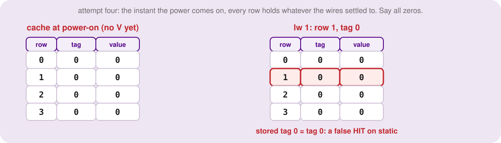
</p>
<p align=center><sub>Attempt four, the problem: power-on static looks exactly like a real entry.</sub></p>

We need a master on-off switch for each row, a way to say: this row has never been written by a real program, ignore whatever is in it. That is one extra bit per row, the **valid bit** `V`. If `V = 1`, real data lives here, so go ahead and check the tag. If `V = 0`, the hardware declares a miss without even looking at the tag.

<p align=center>
    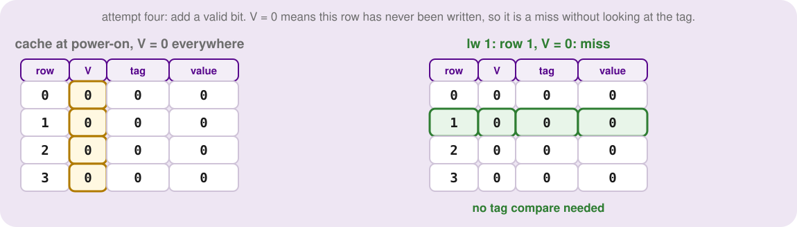
</p>
<p align=center><sub>Attempt four, the fix: V = 0 forces a miss.</sub></p>

A second vocabulary collision to head off: the valid bit is not the tag. The valid bit asks an existential question: *is this data real?* The tag asks an identity question: *which real address is it?* A row yields a hit only if `V = 1` **and** the tags match.

<p align=center>
    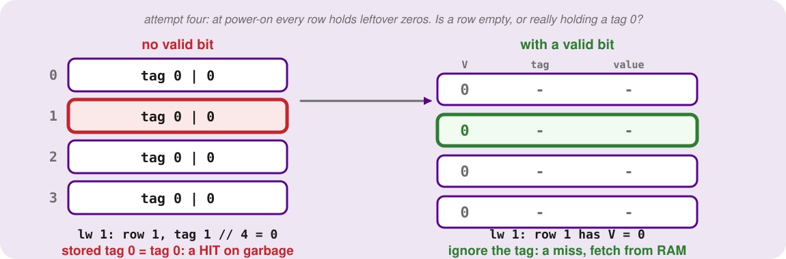
</p>
<p align=center><sub>Attempt four: at power-on every row holds leftover zeros, so without a valid bit address 1 (tag 0) falsely hits. With <code>V = 0</code> it is a miss.</sub></p>

<p align=center>
    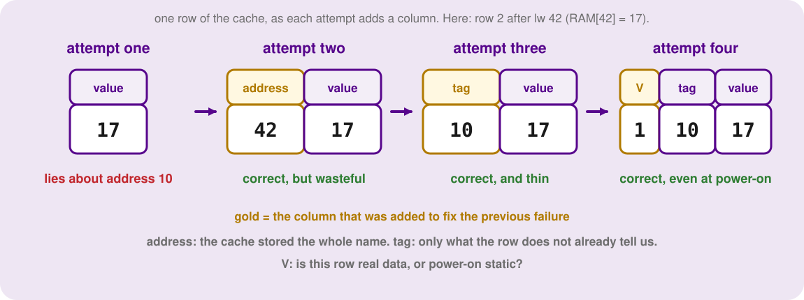
</p>
<p align=center><sub>The same row after each attempt. Each gold column was added to fix the failure before it.</sub></p>

So, the journey in four steps: pure remainder lied to us; storing the whole address wasted silicon; storing just the tag fixed that; and the valid bit stopped the power-on hallucination. Put together, every row has three parts:

| Row | V | Tag | Value |
|---|---|---|---|
| 0 | 0 | | |
| 1 | 0 | | |
| 2 | 1 | 10 | 17 |
| 3 | 0 | | |

<p align=center>
    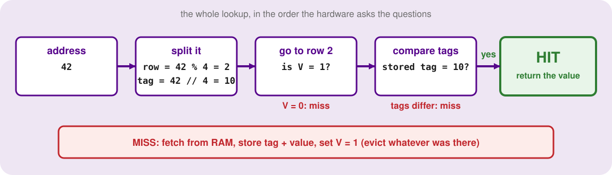
</p>
<p align=center><sub>The whole lookup in the order the hardware asks its questions.</sub></p>

To look up an address, compute `row = address % numberOfRows` and `tag = address // numberOfRows`. Go to that row. It is a **hit** only if `V = 1` and the stored tag equals the computed tag.

Otherwise it is a **miss**: fetch from RAM, store the new tag and value, set `V = 1` (evicting whatever was there), and return the value. On the table above: address 42 is a hit; address 10 is a miss (a tag mismatch); address 1 is a miss (`V = 0`). Two different kinds of miss.

<p align=center>
    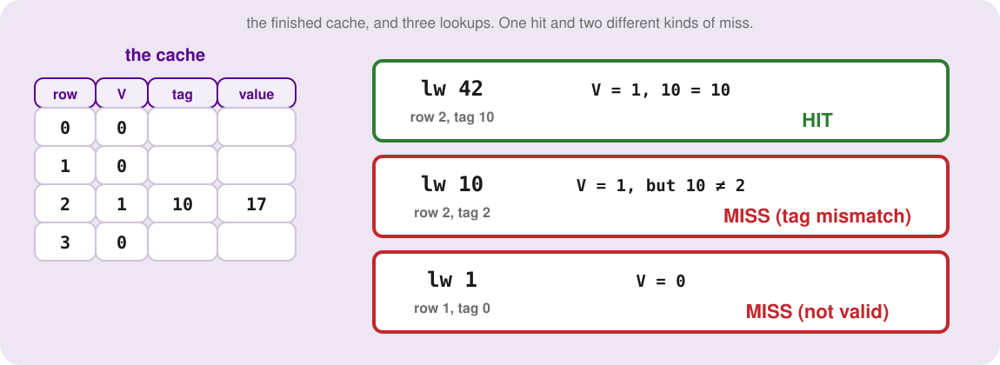
</p>
<p align=center><sub>The finished cache and three lookups: one hit, and two different kinds of miss.</sub></p>


---

<a id="9"></a>

## Blocks: Locality Is a Bet, Not a Guarantee

That is a working cache, and in the 1970s we could stop here. But software does not behave the way our tiny cache assumes. Think like a programmer: you are almost never fetching one isolated variable. You are running a loop over a big array, summing salaries or processing an image pixel by pixel:

```c
int my_array[1024];
int sum = 0;
for (int i = 0; i < 1024; i++)
    sum += my_array[i];
```

Every iteration asks for a brand new address, the one right after the last. With one value per row, every step is a guaranteed miss (100 ns each). Our cache is useless for arrays.

<p align=center>
    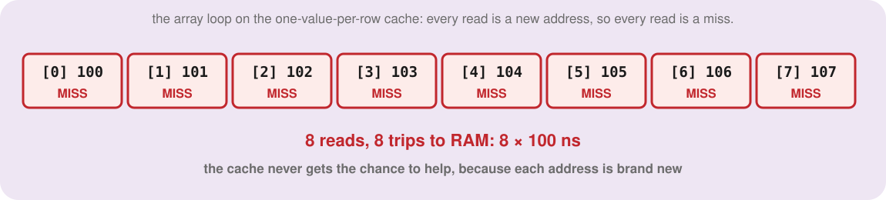
</p>
<p align=center><sub>Without blocks, every read of the array loop is a miss.</sub></p>

There are two kinds of locality, and our design only gets one. **Temporal locality** means that if you use an address once, you will probably use it again soon: the loop counter `i` is read every iteration, and after the first miss it sits in the cache for free hits.

**Spatial locality** means that if you touch an address, you will very likely touch its neighbours next: the array. Our one-value-per-row cache ignores it completely.

<p align=center>
    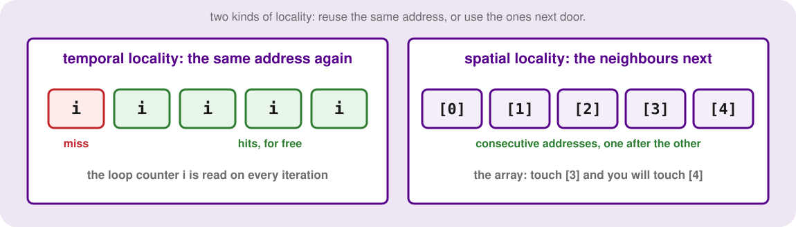
</p>
<p align=center><sub>Temporal locality reuses an address; spatial locality uses the ones next door.</sub></p>

Back to the library. If you walk across campus and find the history book you need, it is wasteful to walk back with only that book. Grab the whole shelf, because you will probably want the one next to it in five minutes. A cache does the same.

Divide memory into **blocks**: fixed chunks of consecutive cells, a power of two such as 8, 16 or 64. When the processor asks for one cell and misses, the cache fetches the *entire* block containing it and loads it into a row all at once.

Keep the four rows, and make the block size 8. The program asks for address 53. We have to find the block first: `53 // 8 = 6`, so address 53 is somewhere in block 6, which covers cells 48 to 55.

Now the critical shift. Where does block 6 go? We use the same remainder routing as before, but **on the block number, not on the raw address**: `6 % 4 = 2`, so row 2. The tag is the block number divided by the rows, `6 // 4 = 1`. Row 2 gets tag 1, `V = 1`, and a data slot holding eight cells, 48 to 55.

<p align=center>
    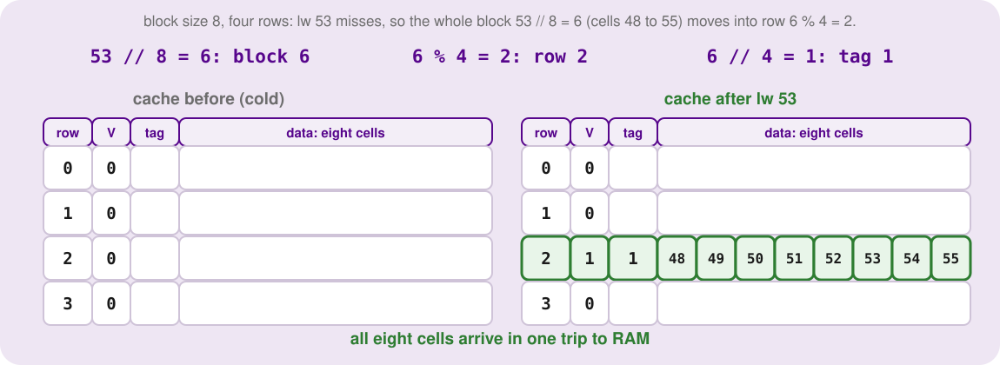
</p>
<p align=center><sub>A miss on 53 loads all of block 6 (cells 48 to 55) into row 2, tag 1.</sub></p>

<p align=center>
    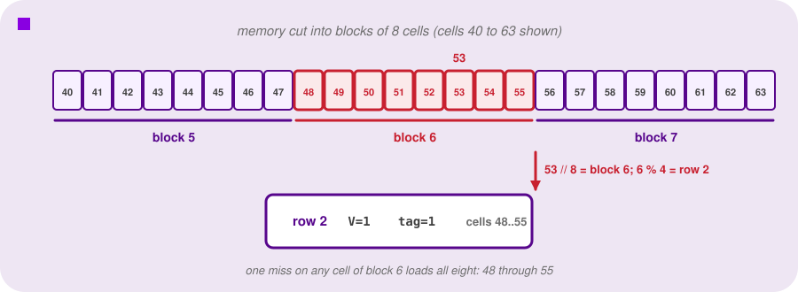
</p>
<p align=center><sub>A request for address 53 loads all of block 6, cells 48 to 55, into cache row 2 at once.</sub></p>

Now watch it pay off. The loop moves on to address 54. It is in block 6, which lives in row 2; the tag matches; address 54 is already there: a hit. Then 55: another hit. We have turned a series of 100 ns misses into free hits just by hauling the whole shelf. Across the eight reads of addresses 48 to 55, the first is a miss and the other seven are hits, where without blocks all eight missed.

<p align=center>
    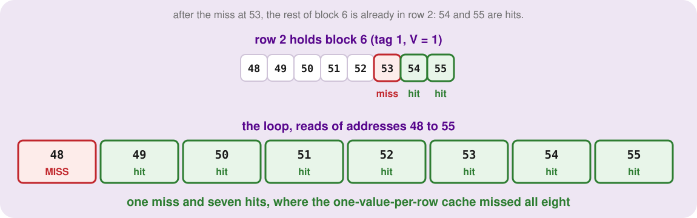
</p>
<p align=center><sub>After the miss, the rest of the block is already there: one miss, seven hits.</sub></p>

**It is a bet.** The cache is betting that your code has spatial locality. It dragged seven extra cells across the motherboard, burning energy and bus time and taking space in the row, on the hope that you would use them. If your code jumps all over memory, say through a linked list, never touching a neighbour, the cache loses the bet: it paid to carry cells that sit unused until they are evicted.

<p align=center>
    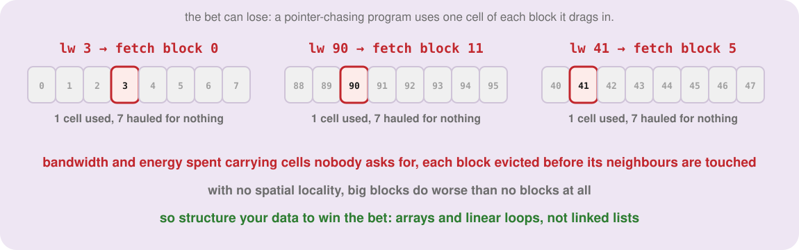
</p>
<p align=center><sub>When the bet loses: seven of every eight cells carried are never used.</sub></p>

With no spatial locality, big blocks do worse than no blocks at all. The hardware is not magic. It makes assumptions about how you write software, and **if you want your code to be fast, you structure your data to win the bet**: array-heavy, linear code.


---

<a id="10"></a>

## Decoding an Address: Tag, Index, Offset

Because the cache now deals in blocks, the processor's address has to be sliced into three parts, read from the right (least significant bits) to the left. Each answers one question:

- **Offset**, the rightmost slice: where *inside* the block is my cell? A block of 8 cells needs `log2(8) = 3` bits to point at one of them. Think of it as the house number on a street.
- **Index**, the middle slice: which cache row is this block assigned to? Four rows need `log2(4) = 2` bits. It is the street name.
- **Tag**, everything left over at the top: out of all the blocks in memory that share this row, which one is parked here right now? It is the city and state.

In arithmetic form, which is the form you will use on exams, write these four steps down in this order:

| Step | Question | Formula |
|---|---|---|
| 1 | block | `address // blockSize` |
| 2 | offset | `address % blockSize` |
| 3 | row (index) | `block % numberOfRows` |
| 4 | tag | `block // numberOfRows` |

**Worked example.** A system has 10-bit addresses, a block size of 4, and 8 cache rows. Decode address 181. First the widths: block size 4 needs 2 offset bits; 8 rows need 3 index bits; that leaves `10 - 2 - 3 = 5` bits for the tag. In binary, 181 is `0010110101`:

<p align=center>
    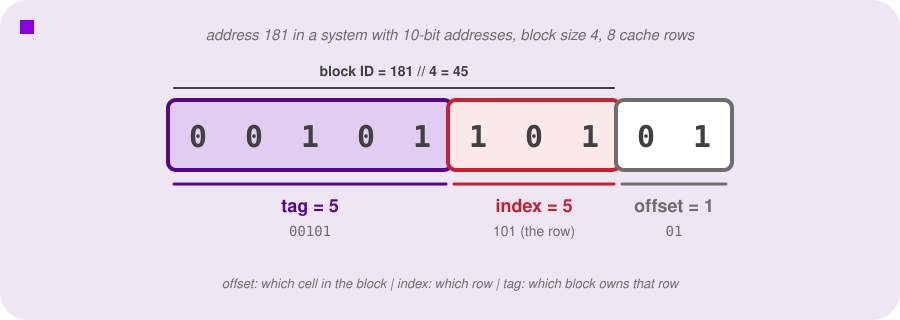
</p>
<p align=center><sub>Offset <code>01</code> = 1, index <code>101</code> = 5, tag <code>00101</code> = 5. Together, tag and index make the block ID: 45.</sub></p>

Now the arithmetic. Step 1: `181 // 4 = 45`, so block 45. Step 2: `181 % 4 = 1`, so offset 1.

Step 3 is where nearly everyone slips: the row. The tempting move is to take the raw address, `181 % 8`, just as we did in attempt one. **Don't.** In attempt one there were no blocks. Once blocks exist, the raw address no longer decides the row; the block does.

If rows came from raw addresses, then 180, 181 and 182, which are all in block 45 and have to travel together, would land in rows 4, 5 and 6: you would scatter one block across the cache and wreck the whole design. (Here the wrong rule happens to give row 5 by luck. It will not in general, and for the tag it gives `181 // 8 = 22` where the right answer is 5.)

> **The golden rule: always write the block first.** Compute the block number before any other math. The row comes from the block. The tag comes from the block. Once you have the block and the offset, pretend the raw address does not exist.

So: row `45 % 8 = 5`, tag `45 // 8 = 5`. Address 181 decodes to **offset 1, row 5, tag 5**. In binary it is exactly the slices: tag `00101`, index `101`, offset `01`.

On the four-row, block-size-8 cache we will trace next: address 53 is block 6, offset 5, row 2, tag 1; address 100 is block 12, offset 4, row 0, tag 3 (not 25, which is `100 // 4`, the tag from the old one-value-per-row cache); address 77 is block 9, offset 5, row 1, tag 2. And a last warning: for 54, both `54 // 8` and `54 % 8` happen to be 6. The first is the block, the second the offset; 53 tells them apart.


---

<a id="11"></a>

## Tracing a Cache: A Worked Example

This is the skill you will be tested on, so go through it in slow motion. The cache has four rows and a block size of 8, and it starts cold: every valid bit is 0. The processor makes ten `lw` accesses, in this order:

`52, 53, 92, 55, 20, 54, 60, 53, 29, 28`

For each one, say out loud the block, the row, the tag and the result.

| Address | Block | Row | Tag | Result | Why |
|---|---|---|---|---|---|
| 52 | 6 | 2 | 1 | MISS | row 2 is empty (`V = 0`); load block 6 |
| 53 | 6 | 2 | 1 | **HIT** | same block as 52: spatial locality paying off |
| 92 | 11 | 3 | 2 | MISS | row 3 is empty; load block 11 |
| 55 | 6 | 2 | 1 | **HIT** | block 6 is still in row 2 |
| 20 | 2 | 2 | 0 | MISS | row 2 holds tag 1 (block 6); 0 is not 1, so **evict** block 6 |
| 54 | 6 | 2 | 1 | MISS | row 2 now holds tag 0 (block 2); evict it, and block 6 comes back |
| 60 | 7 | 3 | 1 | MISS | row 3 holds tag 2 (block 11); 1 is not 2, so evict |
| 53 | 6 | 2 | 1 | **HIT** | block 6 was reloaded two steps ago |
| 29 | 3 | 3 | 0 | MISS | row 3 holds tag 1 (block 7); evict |
| 28 | 3 | 3 | 0 | **HIT** | same block as 29 |

**52:** block 6, row 2, tag 1. Row 2 is invalid, so a miss: block 6 (cells 48 to 55) loads into row 2. **53:** block 6 again, row 2, tag 1. `V = 1` and the tags match: a hit. That is the bet paying off: 53 rode in on the coattails of 52. **92** is a miss in the empty row 3, and **55** is another hit on block 6.

**20:** block 2, row 2, tag 0. Row 2 is valid, but it holds tag 1, which is block 6, and our computed tag is 0. No match: a miss, and the hardware evicts block 6 to load block 2.

**54: stop and trace this one yourself before reading on.** It is block 6, row 2, tag 1. But row 2 now holds tag 0, because we loaded block 2 a moment ago. A miss: block 2 is evicted and block 6 is hauled all the way back from memory. That is a **conflict**: two blocks that have nothing to do with each other in the software just happen to map to the same physical row, and they keep forcing each other out.

Rows 0 and 1 are completely empty, so why couldn't block 2 just park there? Because a direct-mapped cache is a parking lot with mathematically assigned spaces. Block 2 is permanently assigned to space 2, and is forbidden to use space 0 or 1. If block 6 is in space 2, block 6 gets towed. Conflicts come from mathematical coincidence, not from running out of room.

The rest follows the same recipe: **60** evicts block 11 from row 3; **53** is a hit (block 6 was reloaded two accesses ago); **29** evicts block 7; and **28** is a hit on block 3. Four hits in ten accesses: a hit ratio of 40 percent. The cache ends up looking like this:

<p align=center>
    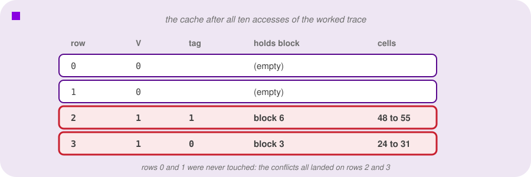
</p>
<p align=center><sub>Rows 0 and 1 were never touched. All the action, and all the damage, happened on rows 2 and 3.</sub></p>

Rows 0 and 1 were ghost towns. Every eviction and every conflict happened on rows 2 and 3, which makes the cache feel fragile: how well it does depends on exactly where things land in memory.

Make that concrete with two contrasting programs. First, a well-behaved one that walks memory in order: `50, 51, 52, ..., 69` (twenty accesses). It only misses when it crosses into a new block, at addresses 50, 56 and 64: three misses and seventeen hits, a hit ratio of **17/20**, from the very same hardware, because the access pattern matches the bet the cache makes.

Then the nightmare: `16, 80, 17, 81, 18, 82`. Addresses 16 to 18 are in block 2, and 80 to 82 in block 10, and `2 % 4 = 10 % 4 = 2`, so both blocks want row 2. Every access evicts the block the next access needs: six accesses, six misses, a hit ratio of **0**, while rows 0, 1 and 3 sit idle.

Is the cache broken? No. It did not fail because it was too small; it failed because of where two blocks happened to land. A program's speed can fall off a cliff just because two unrelated arrays sit a certain distance apart in RAM. Next lecture's associative caches exist to relax exactly that.


---

<a id="12"></a>

## Sizing a Cache

When the box says "128-byte L1 cache", you assume it holds 128 bytes of your data. It does, but the hardware inside is bigger, because the cache has to store more than data. We have to separate the **data capacity** (the bytes of your program it can hold) from the **total hardware size** (every transistor needed to make it work). The tags and valid bits are not free:

```
total size (bits) = numberOfRows × (1 + tagSizeInBits + blockSizeInBits)
                                     ↑          ↑              ↑
                                valid bit     the tag     the data, blockSize × 8 for byte-sized cells
```

Worked example: a system with 12-bit addresses, a cache with 8 rows, and 16-byte blocks. Sixteen bytes means `log2(16) = 4` offset bits, and 8 rows means `log2(8) = 3` index bits, so the tag gets `12 - 4 - 3 = 5` bits. One row is a valid bit (1), a tag (5) and a block of `16 × 8 = 128` bits of data: **134 bits**. The whole cache is `8 × 134 = 1072` bits, or 134 bytes.

But it only holds `8 × 16 = 128` bytes of data. The other 6 bytes are pure administration: about a **5 percent metadata tax** for the privilege of knowing where your data came from and whether it is valid.

Why not use tiny blocks, say one byte, so you never haul useless data? Now you can show why not. To keep the same 128 bytes of data with 1-byte blocks you need 128 rows, which means 128 valid bits and 128 tags instead of 8.

Each row costs `1 + 5 + 8 = 14` bits, so the cache is `128 × 14 = 1792` bits to hold 1024 bits of data: the tax jumps from about 5 percent to about 75 percent. Larger blocks let more data share the cost of one tag and one valid bit, which is one reason designers do not shrink blocks toward zero.


---

<a id="13"></a>

## What a Cache Is Worth: Hit Ratio and Average Time

After paying the silicon tax, what is the payoff? To find out, we need the protocol between the processor, the cache and memory. The standard convention: **every access checks the cache first**, hit or miss, so every access pays the cache's short time. Only on a miss does it pay the long trip to memory, on top of that. That gives:

```
average time = cache time + (1 - hit ratio) × memory time
```

Take a cache access of 2 ns and a memory trip of 60 ns (invented numbers, with the right shape). At a 90 percent hit ratio the average is `2 + 0.1 × 60 = 8 ns`. With no cache every access would cost 60 ns, so the cache made the average access **7.5 times faster.**

Now see how sensitive the formula is. Optimise your arrays to get the hit ratio up to 99 percent: `2 + 0.01 × 60 = 2.6 ns`, almost three times faster again. Or write slightly sloppy code and slip to 80 percent: `2 + 0.2 × 60 = 14 ns`.

A drop of only ten points of hit ratio nearly doubled the average. The trip to memory is so punishingly slow that even a small fraction of misses acts like an anchor on the whole system: the misses dominate the average.

This lands directly on the pipeline. A cache miss is a physical stall in the `MEM` stage: every `lw` that misses injects stall cycles, so a falling hit ratio makes CPI balloon, however fast the ALU is.


---

<sub>**Previous: [Multicycle Implementation & The Pipelining Idea](/lectures/09-multicycle-and-pipelining)** || **Next: [Associative Caching & Virtual Memory](/lectures/11-associative-caching-and-virtual-memory)**</sub>
