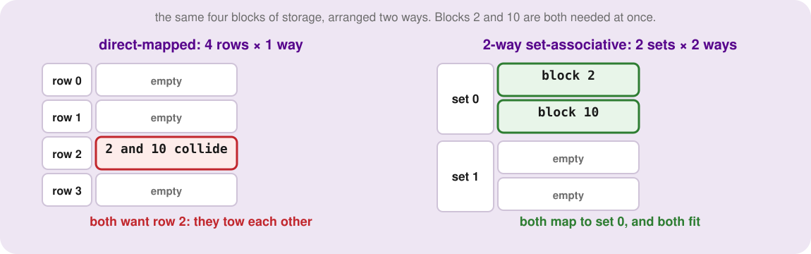
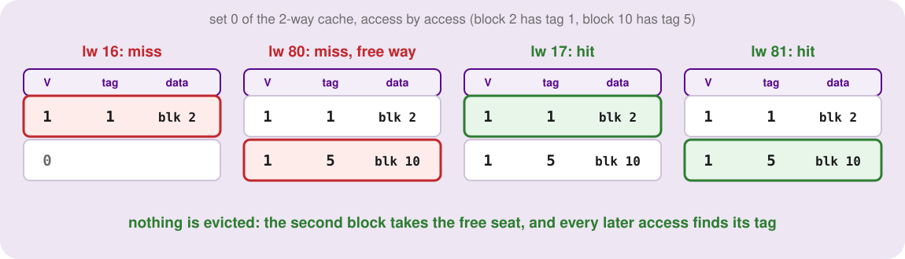
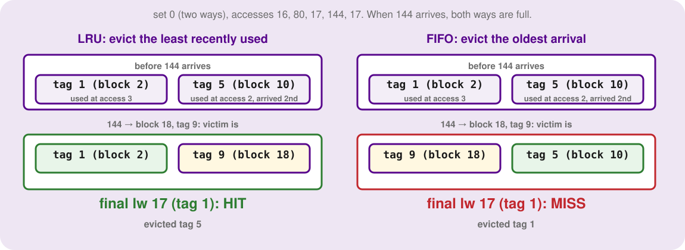
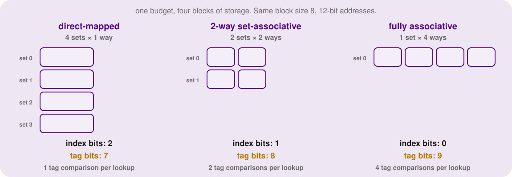
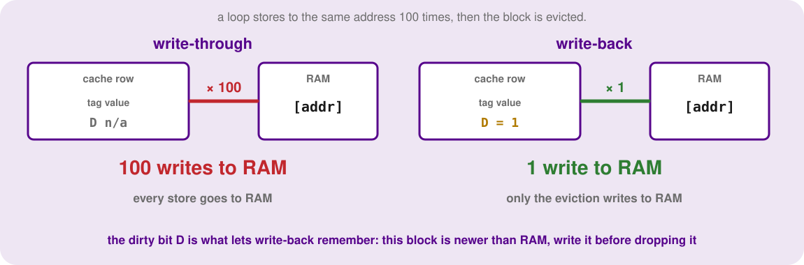

<h2 align=center>Week X</h2>

<h1 align=center>Associative Caches, Writes & What Is Left of the Memory Problem</h1>

---

## Sections

1. [**Recap: The Cache That Got Towed**](#1)
2. [**Two Seats per Row: Set-Associative Caches**](#2)
3. [**Who Gets Evicted? Replacement Policies**](#3)
4. [**Decoding an Address, Again**](#4)
5. [**A Dial, Not a Switch: From Direct-Mapped to Fully Associative**](#5)
6. [**Tracing the Same Ten Accesses**](#6)
7. [**Why Did It Miss? The Three Cs**](#7)
8. [**Is It Worth It? Associativity Against Speed**](#8)
9. [**Writes: When the Cache and Memory Disagree**](#9)
10. [**Write-Through and Write-Back**](#10)
11. [**What About a Write Miss?**](#11)
12. [**What Is Still Wrong: The Bridge to Virtual Memory**](#12)

---

Last week ended with a problem: a cache that threw away its own data because two blocks happened to land on the same row, even with three rows sitting empty. This week fixes that, then deals with the other thing we pretended away: so far the processor has only ever *read* from memory.

Sections 1 to 8 are about where a block may live, and what to do when a row is full. Sections 9 to 11 are about `sw`. Section 12 is the last thing a cache cannot fix, and the reason the next topic exists.

---

<a id="1"></a>

## Recap: The Cache That Got Towed

Four rows, a block size of 8, and a program that reads these addresses in order: `16, 80, 17, 81, 18, 82`. Addresses 16 to 18 sit in block 2, and 80 to 82 in block 10. Both blocks leave remainder 2 when divided by 4, so both belong in row 2.

Walk through it. 16 misses and block 2 loads into row 2. 80 misses, finds block 2 there with the wrong tag, and evicts it. 17 wants block 2 back: miss, and block 10 is evicted. And so on, six accesses, six misses, a hit ratio of zero, while rows 0, 1 and 3 never saw a single block.

We called this a **conflict**, and noted the cache did not fail because it was small. It failed because a direct-mapped cache gives every block exactly one place to live. If two blocks you need at the same time share that place, they take turns being thrown out.

The question for today: what if a block had more than one place to go?

---

<a id="2"></a>

## Two Seats per Row: Set-Associative Caches

Take the same budget, four blocks of storage in total, and arrange it differently. Instead of four rows with one block each, make **two rows with two blocks each**. A block now maps to a row as before, but within that row it may sit in either of two seats.

A row that holds several blocks is called a **set**, and each seat in it is a **way**. This arrangement is a **2-way set-associative cache**. Direct-mapped is the special case of one seat per set, a 1-way cache.

<p align=center>
    
</p>
<p align=center><sub>The same four blocks of storage. Left: blocks 2 and 10 both map to row 2 and tow each other. Right: with two sets of two ways, both blocks map to set 0, and both fit.</sub></p>

The routing rule only changes in one place. The set comes from the block number: `set = block % numberOfSets`. With two sets, block 2 gives `2 % 2 = 0` and block 10 gives `10 % 2 = 0`. Both land in set 0, and that is fine, because set 0 has two seats.

Now a lookup has one extra step. Go to the set, then **compare the tag against every way in it** (in hardware, all at once). A hit is any way that is valid and whose tag matches. A miss means none did.

Redo the recap trace. 16 is block 2, set 0, tag 1: miss, goes in the first free way. 80 is block 10, set 0, tag 5: miss, and the other way is still free, so *nothing is evicted*. Now 17 asks for set 0, tag 1 and finds it: hit. 81 hits (tag 5), 18 hits, 82 hits.

<p align=center>
    
</p>
<p align=center><sub>Set 0 of the 2-way cache as the trace runs. Both blocks stay, so the last four accesses are hits.</sub></p>

Four hits out of six, from a cache with exactly the same number of blocks. We did not buy more storage. We only relaxed the rule about where a block may go.

---

<a id="3"></a>

## Who Gets Evicted? Replacement Policies

More seats per set creates a new problem. When a block arrives and every seat in its set is taken, someone has to go, and now there is a *choice*. A direct-mapped cache never had to decide: there was exactly one block to throw out.

There are a few reasonable policies:

- **Random:** pick a seat at random. Simple, and surprisingly not terrible.
- **FIFO** (first in, first out): evict the block that has been there longest, regardless of use.
- **LRU** (least recently used): evict the block whose last use is furthest in the past.

LRU is the usual choice because it bets on temporal locality, the same bet blocks make on spatial locality. If you have not touched a block in a while, you probably will not soon.

Here is where they disagree. Same 2-way cache, set 0, with a third block competing: `16, 80, 17, 144, 17`. Address 144 is block 18, set 0, tag 9. After 16 and 80 both seats are full (tags 1 and 5), and 17 refreshes the tag-1 block. Now 144 arrives.

- **LRU** looks at last use. Tag 1 was used at 17, tag 5 at 80, so tag 5 is the stale one. It evicts tag 5, and the final access to 17 hits.
- **FIFO** looks at arrival. Tag 1 came in first, so it goes, even though it was just used. The final access to 17 misses.

<p align=center>
    
</p>
<p align=center><sub>Same accesses, same cache, different victims. LRU keeps the block the program just used.</sub></p>

Two hits against one, from nothing but the choice of victim. The price is bookkeeping: LRU has to remember the order of use in every set. For 2 ways that is a single bit per set, and for more ways it grows. On exams, unless told otherwise, assume LRU, and track it with a small list per set ordered from least to most recently used.

---

<a id="4"></a>

## Decoding an Address, Again

Last week an address split into offset, index and tag, and the golden rule was *write the block first*. That rule survives, and so does the whole recipe. The only word that changes is **index**: it now picks a *set*, not a row of one block.

| Step | Question | Formula |
|---|---|---|
| 1 | block | `address // blockSize` |
| 2 | offset | `address % blockSize` |
| 3 | set (index) | `block % numberOfSets` |
| 4 | tag | `block // numberOfSets` |

The number of index bits is `log2(numberOfSets)`, **not** the number of blocks. Fewer sets means fewer index bits, so more of the block number is left over for the tag. This is the trade: the tag gets longer.

Worked example, 12-bit addresses, a 4-way cache with 2 sets, block size 16. Offset: `log2(16) = 4` bits. Index: `log2(2) = 1` bit. Tag: `12 - 4 - 1 = 7` bits. Take address 1234: block `1234 // 16 = 77`, offset `1234 % 16 = 2`, set `77 % 2 = 1`, tag `77 // 2 = 38`.

And the size formula gets one factor:

```
total size (bits) = numberOfSets × ways × (1 + tagSizeInBits + blockSizeInBits)
```

(plus the LRU bookkeeping bits, which exam questions normally ignore unless they ask for them).

---

<a id="5"></a>

## A Dial, Not a Switch: From Direct-Mapped to Fully Associative

Fix the budget at four blocks of storage and block size 8, and turn one knob, the number of ways.

<p align=center>
    
</p>
<p align=center><sub>One budget, three layouts. More ways means fewer sets, fewer index bits, and a longer tag.</sub></p>

| Layout | Name | Index bits | Tag bits (12-bit address, block 8) | Tag comparisons per lookup |
|---|---|---|---|---|
| 4 sets × 1 way | direct-mapped | 2 | 7 | 1 |
| 2 sets × 2 ways | 2-way set-associative | 1 | 8 | 2 |
| 1 set × 4 ways | **fully associative** | 0 | 9 | 4 |

At the far end, one set holds everything. A block may go in **any** seat, there are zero index bits, and the entire block number is the tag. That is a **fully associative cache**. It never suffers a conflict: the only reason to evict is that every seat is genuinely full.

So why is not everything fully associative? Because every lookup must compare the tag against *every* seat in parallel. Each comparison is a comparator circuit and a wire, and the comparisons all have to finish before the hit can be declared. More ways means more hardware, more energy and a slower hit. Direct-mapped is fast and cheap but conflict-prone; fully associative never conflicts but is slow and expensive. Real caches live in the middle, usually 2-way to 8-way.

---

<a id="6"></a>

## Tracing the Same Ten Accesses

Time to run last week's trace again: `52, 53, 92, 55, 20, 54, 60, 53, 29, 28`, block size 8, four blocks of storage, starting empty. Last week, direct-mapped got **4 hits**, and the miss at 54 was a conflict (block 2 had evicted block 6 from row 2). Here it is on the 2-way cache (2 sets), with `set = block % 2` and `tag = block // 2`:

| Address | Block | Set | Tag | Result | Why |
|---|---|---|---|---|---|
| 52 | 6 | 0 | 3 | MISS | set 0 is empty |
| 53 | 6 | 0 | 3 | HIT | same block as 52 |
| 92 | 11 | 1 | 5 | MISS | set 1 is empty |
| 55 | 6 | 0 | 3 | HIT | still there |
| 20 | 2 | 0 | 1 | MISS | set 0 has a free way: **no eviction** |
| 54 | 6 | 0 | 3 | **HIT** | block 6 is still in set 0 |
| 60 | 7 | 1 | 3 | MISS | set 1 has a free way |
| 53 | 6 | 0 | 3 | HIT | |
| 29 | 3 | 1 | 1 | MISS | set 1 is full (tags 5, 3): LRU evicts tag 5 (block 11) |
| 28 | 3 | 1 | 1 | HIT | same block as 29 |

That makes five hits in ten, one better than direct-mapped, and the extra hit is exactly 54, the conflict. The five misses are all first-time visits to a block. If you try the fully associative version (one set, four ways) you also get five hits: nothing more to gain, because the remaining misses were never about conflicts.

---

<a id="7"></a>

## Why Did It Miss? The Three Cs

That last observation deserves a name. Every cache miss falls into one of three categories, and associativity only helps with one of them:

1. **Compulsory** miss: the first time a block is touched. The cache cannot have it, because it has never seen it. A cold cache starts with all of these. Only bigger blocks (fetching neighbours early) reduce them.
2. **Capacity** miss: the program uses more blocks than the cache can hold, so earlier blocks fall out and then are needed again. Only a bigger cache helps.
3. **Conflict** miss: a block was evicted even though the cache as a whole had space, because of where blocks were allowed to go. Associativity cures these.

Classify last week's misses. 52, 92, 20, 60 and 29 were compulsory, because each was a block's first visit. The miss at 54 was a conflict: block 6 had been in the cache and got towed by block 2 with rows 0 and 1 empty. The 2-way cache removed that one and nothing else, which is why it went from four hits to five.

A practical rule for diagnosing a trace: if a *re-reference* to a block missed while some other row or way was empty, it was a conflict miss.

---

<a id="8"></a>

## Is It Worth It? Associativity Against Speed

Fewer misses are only half the story, because the extra comparators slow down every hit. Use last lecture's formula, `average time = cache time + (1 - hit ratio) × memory time`, with a memory trip of 60 ns.

Suppose a direct-mapped cache hits in 2 ns and gets an 80 percent hit ratio on some program: `2 + 0.2 × 60 = 14 ns`. A 4-way cache with the same total size takes 2.2 ns for a hit (the extra comparators and the mux) but reaches 90 percent: `2.2 + 0.1 × 60 = 8.2 ns`. The associative cache wins by a wide margin, because a miss is so much more expensive than a slightly slower hit.

It does not always win. If associativity only moved the hit ratio from 80 to 81 percent, the gain would be tiny: `2.2 + 0.19 × 60 = 13.6 ns` against `14 ns`, which a slightly slower hit time would wipe out entirely, and the chip is bigger on top. Designers measure real programs and stop adding ways when the returns shrink. That is why the practical range is 2 to 8 ways, not 64.

---

<a id="9"></a>

## Writes: When the Cache and Memory Disagree

Everything so far was about `lw`. Now the processor executes `sw`, and something awkward happens: the cache holds a *copy* of memory, and a store changes one of them.

Suppose a direct-mapped cache holds the block containing address 20, and the program runs:

```
movi $1, 5
movi $7, 20
sw   $1, 0($7)      # write 5 to address 20
```

If the `sw` updates **only the cache**, the cache says address 20 holds 5 and RAM still holds the old value. Nothing is wrong yet, because the processor reads the cache first. But now the block gets evicted by some other access, the cache lets it go, and RAM still has the stale value. The next `lw` of address 20 fetches the *old* number. The store has vanished.

Writing to the cache alone is therefore a bug waiting for an eviction. The cache and RAM have to be reconciled eventually, and the only question is *when*. There are two answers.

---

<a id="10"></a>

## Write-Through and Write-Back

With **write-through**, every store updates the cache and RAM immediately. RAM is never stale, so evictions are trivial: just drop the block. The price is that every `sw` pays a trip to memory, 100 ns, which is the very cost the cache was meant to avoid. (Real machines hide some of it with a small **write buffer** that lets the processor carry on while the write drains in the background.)

With **write-back**, a store updates only the cache, and the row is marked **dirty** with one extra bit, `D`. RAM is allowed to be stale, and only when a dirty block is evicted is it written back to RAM. Clean blocks are simply dropped.

<p align=center>
    
</p>
<p align=center><sub>A loop that stores to the same address a hundred times. Write-through pays the memory trip every time; write-back pays it once, at eviction.</sub></p>

The rule for a row is now `V` (is it real?), `D` (is it newer than RAM?), a tag and the data. In the hit/miss logic nothing changes: a hit still needs `V = 1` and matching tags. The dirty bit only matters on eviction:

| Policy | A store hit goes to | Extra bit | Evicting a block | Strength | Weakness |
|---|---|---|---|---|---|
| Write-through | cache and RAM | none | just drop it | simple, RAM always current | every store pays memory time |
| Write-back | cache only | dirty bit | if dirty, write it to RAM first | repeated stores are free | more logic, RAM can be stale |

Count the difference. A loop adds to a running total, updating the same address 100 times. Write-through makes 100 memory writes. Write-back makes **one**, when the block is finally evicted. That is why almost every real cache above L1 is write-back, and why dirty-bit bookkeeping is worth the complexity.

---

<a id="11"></a>

## What About a Write Miss?

One case left: the program stores to an address whose block is **not** in the cache. Two choices, independent of the write-hit policy above:

- **Write-allocate:** fetch the block into the cache first, then write to it as if it were a hit. It bets that you will read or write nearby soon (spatial locality again).
- **Write-around** (no-write-allocate): skip the cache and write straight to RAM. It bets the data will not be touched again soon.

They pair naturally with the hit policies:

| Hit policy | Usual partner for misses | Why |
|---|---|---|
| Write-back | write-allocate | the block has to come into the cache so the dirty bit can track it |
| Write-through | write-around | writing RAM anyway, so caching the block adds nothing |

So the full description of a cache's write behaviour has two parts, one for hits and one for misses, and exams will ask for both: "write-back with write-allocate" or "write-through with write-around".

A worked sequence: a 4-row direct-mapped cache with block size 1, write-back and write-allocate, starting empty. `lw $5, 0($7)` with `$7 = 20` loads address 20 into row 0. `sw $1, 0($7)` is a write hit: row 0 gets the new value and is marked dirty, and RAM is untouched. `lw $2, 0($7)` is a read hit and returns the new value. `lw $3, 4($7)` reads address 24, which also maps to row 0 (`24 % 4 = 0`): a miss, and the dirty block is **first written back to RAM**, then address 24 is loaded. A final `lw $2, 0($7)` misses and fetches the value from RAM, which is now the updated one. Nothing was lost.

---

<a id="12"></a>

## What Is Still Wrong: The Bridge to Virtual Memory

Taking stock. With caches the processor sees something close to a fast memory most of the time. But we have quietly assumed a few things that are not true.

First, that the memory is as big as the addresses. A 32-bit address can name 4 GiB of cells, and few machines have that much RAM. Second, that the program owns the memory. A real computer runs dozens of programs at once, and each is written as if its code and data start at the same low addresses. Two programs both storing to address 100 cannot share the same physical cell. Third, that nothing misbehaves: a program with a bug that writes to someone else's address can corrupt it.

And notice the thought we left hanging last week: what happens when two unrelated programs share one cache? Even the best cache cannot help with *which programs get which memory in the first place*.

The idea that solves all three problems is the same one this lecture used on blocks and rows, one level up: put a layer between the address a program uses and the cell it actually gets, and let that layer decide. Next time, that layer has a name: **virtual memory**.

---

<sub>**Previous: [Pipelining, Concluded & The Case for Caching](/lectures/10-pipelining-and-caching)**</sub>
