<h2 align=center>Week X</h2>

<h1 align=center>Caching: Direct-Mapped, Associative & Writes</h1>

---

## Sections

1. [**The Memory Wall**](#1)
2. [**Where Does a Cell Go? Rows, Tags, and the Valid Bit**](#2)
3. [**Blocks: Locality Is a Bet, Not a Guarantee**](#3)
4. [**Decoding an Address: Tag, Index, Offset**](#4)
5. [**Tracing a Cache: A Worked Example**](#5)
6. [**Sizing a Cache**](#6)
7. [**What a Cache Is Worth: Hit Ratio and Average Time**](#7)
8. [**Recap: The Cache That Got Towed**](#8)
9. [**Two Seats per Row: Set-Associative Caches**](#9)
10. [**Who Gets Evicted? Replacement Policies**](#10)
11. [**Decoding an Address, Again**](#11)
12. [**A Dial, Not a Switch: From Direct-Mapped to Fully Associative**](#12)
13. [**Tracing the Same Ten Accesses**](#13)
14. [**Why Did It Miss? The Three Cs**](#14)
15. [**Is It Worth It? Associativity Against Speed**](#15)
16. [**Writes: When the Cache and Memory Disagree**](#16)
17. [**Write-Through and Write-Back**](#17)
18. [**What About a Write Miss?**](#18)
19. [**What Is Still Wrong: The Bridge to Virtual Memory**](#19)

---

Memory is slow, and getting slower relative to the processor every year. Caching is the answer: a small, fast copy of the part of memory you are using. This lecture builds one from nothing and then fixes everything wrong with the first attempt.

Sections 1 to 7 are direct-mapped caching, the simplest version: where a memory cell goes, blocks, decoding an address, tracing a cache, sizing it, and what it is worth. Sections 8 to 15 give a block more than one place to live and decide who gets evicted when a set is full. Sections 16 to 18 are about `sw`, because so far the processor has only ever *read* from memory. Section 19 is the last thing a cache cannot fix, and the reason virtual memory exists. That one is the next lecture.

---

<a id="1"></a>

## The Memory Wall

So far we have treated `lw` as one polite `MEM` box, one cycle, done. That is a polite fiction, and this is where it falls apart. A computer is fast, memory is inside the computer, therefore memory is fast: that is the story the pipeline diagrams have been telling.

The physical reality is brutally different. An L1 cache reference, the fast memory built right onto the processor, takes roughly half a nanosecond. Main memory, the DRAM sitting a few inches away on the motherboard, takes about 100: **roughly 200 times slower.** A nanosecond means nothing to a human, so scale it up.

Let the half-nanosecond L1 access be one heartbeat, half a second. Then a trip to main memory is 200 heartbeats: 100 seconds, a minute and a half. That is long enough for the processor to walk to the bathroom, brush its teeth and walk back, just to fetch one integer.

A pipeline built to retire one instruction per cycle (the whole argument of the pipelining lectures), stalling for that long on every `lw`, is practically paralysed. This is the **memory wall**: the processor is incredibly fast, and starving for data.

| Technology | Price / GB | Access time | Bandwidth |
|---|---|---|---|
| SRAM (cache) | ~$10,000 | ~1 ns | 25+ GB/s |
| DRAM (main memory) | ~$10 | 10 to 50 ns | ~10 GB/s |
| SSD | ~$1 | ~100,000 ns | ~0.5 GB/s |
| HDD | ~$0.1 | ~10,000,000 ns | ~0.1 GB/s |

Read that table as a trade: the fast technology is expensive and small, the slow one is cheap and enormous, and none is both. (On the E20 a `lw` or `sw` may stall a few cycles. On real machines the penalty can be fifty cycles or more.)

Picture a student writing a research paper. They do not walk across campus to the library for every fact, read one sentence, and walk back. They make one trip, check out a stack of books, and keep them on the desk. The desk is tiny compared with the library, but anything on it is instantly within reach. The desk is the **cache**; the library is main memory.

When the processor looks for something and finds it on the desk, that is a **hit**. When it is not there and the student has to put on a coat and walk to the library, that is a **miss**. The fraction of the time you find what you need on the desk is the **hit ratio**: ask for 10 values, find 9 on the desk, and the hit ratio is 90 percent.

<p align=center>
    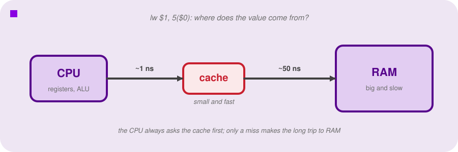
</p>
<p align=center><sub>The CPU always asks the cache first. Only when the cache doesn't have the answer does the request make the long trip to RAM.</sub></p>

The obvious objection: if the desk is so fast, why not build one big enough to hold everything? There are two reasons. The first is money and space: fast memory (SRAM) needs more transistors per bit, so it is expensive and takes up a lot of silicon.

The second is physics. A cache as big as your RAM would be just as slow as your RAM. You can have small and blazing fast, or enormous and sluggish, but not both. So the desk stays tiny.

A tiny desk creates a logistics problem, and every cache designer has to answer three questions:

1. When I bring a book back from the library, *where* on the desk do I put it?
2. When I look at the desk later, *how do I know* it is the book I want?
3. The desk is small, so *what do I throw on the floor* to make room for a new one?

The simplest answer to all three is a **direct-mapped cache**. We will not hand you the finished blueprint. We will build the dumbest thing that could possibly work, watch it fail, and fix it, four times.

---

<a id="2"></a>

## Where Does a Cell Go? Rows, Tags, and the Valid Bit

Keep the numbers small so you can follow them in your head. Our cache has four **rows**, which are slots that each hold one memory value. In main memory, address 42 holds the value 17, and address 10 holds the value 33.

We need a rule that decides which row a value goes into, and the cheapest routing logic in the world is the remainder: `row = address % 4`. The processor asks for address 42. Divide by 4: 10 with a remainder of 2, so row 2. We copy 17 from main memory into row 2. So far so good.

<p align=center>
    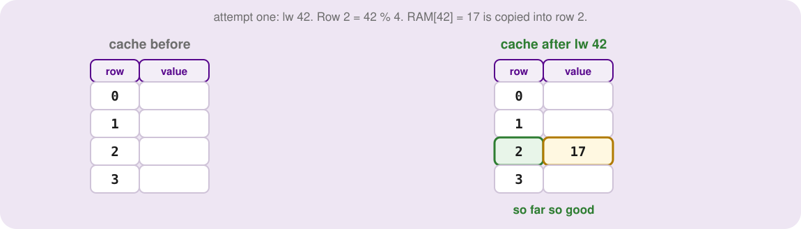
</p>
<p align=center><sub>Attempt one, step one: lw 42 puts 17 into row 2.</sub></p>

A few cycles later the processor asks for address 10. `10 % 4` is also 2, so the cache goes to row 2, finds a value sitting there, and hands back 17. But the real value of address 10 is 33. The cache just *confidently lied*. A slow computer is annoying; a computer that returns the wrong answer at the speed of light is useless.

<p align=center>
    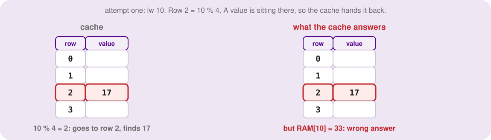
</p>
<p align=center><sub>Attempt one, step two: lw 10 lands on row 2 and gets the wrong value.</sub></p>

The problem is that with four rows, a quarter of all addresses (2, 6, 10, 14, 42, 100, and so on) are forced into row 2, and the cache has no way to tell them apart. It is a single mailbox for a whole apartment building where each letter has only the apartment number on it, not the name of the resident: whoever opens the box takes whatever is inside.

<p align=center>
    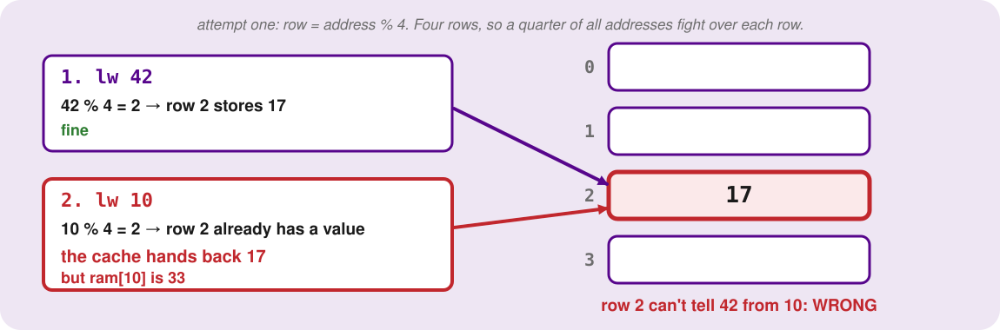
</p>
<p align=center><sub>Attempt one: <code>42 % 4</code> and <code>10 % 4</code> are both 2. The cache hands back 17 for address 10, whose real value is 33.</sub></p>

The fix is obvious once you have seen the failure: write the resident's name on the letter. Next to each value, store the address it came from, so row 2 holds the pair `(42, 17)`.

<p align=center>
    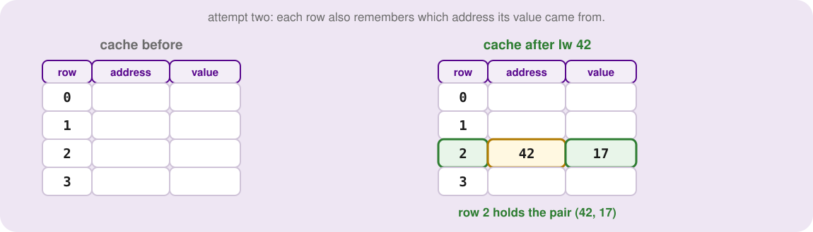
</p>
<p align=center><sub>Attempt two: row 2 now holds the pair (42, 17).</sub></p>

Run it again. The processor asks for address 10, the cache goes to row 2, and now it does not grab blindly. It compares the stored address (42) with the requested one (10). They are not equal, so this is not the data it is looking for: a **miss**.

The cache goes to main memory, fetches the real value (33), and has to put it somewhere. Row 2 is the only place it can go, so it overwrites `(42, 17)` with `(10, 33)`. Throwing out a perfectly good entry to make room for a new one is called an **eviction**, and since the desk is tiny it is a constant, unavoidable fact of life.

<p align=center>
    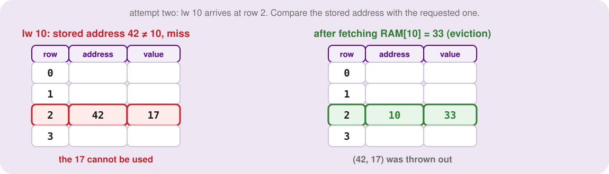
</p>
<p align=center><sub>Attempt two: the address check catches the conflict, and the new value evicts the old.</sub></p>

We have fixed the lying. But we have created an inefficiency: every row now stores a whole address (32 or 64 bits) next to a tiny piece of data. That is a lot of wasted transistors.

<p align=center>
    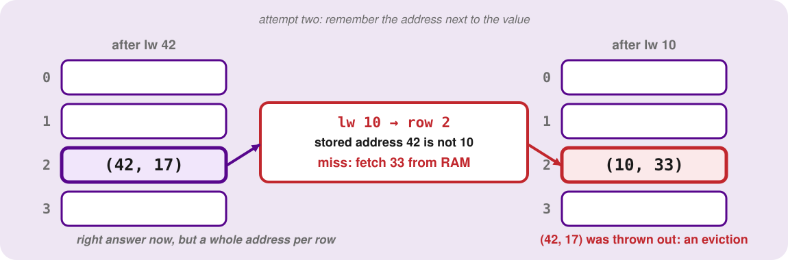
</p>
<p align=center><sub>Attempt two: the stored address (42) does not match the requested one (10), so it is a miss. The old entry is evicted and row 2 now holds <code>(10, 33)</code>.</sub></p>

Look at how address 42 got to row 2: we took `42 % 4`, the remainder. So the row number already tells us something about the address. If you are standing in front of row 2, you know with certainty that whatever is inside came from an address that leaves remainder 2 when divided by 4.

You do not need to write that part down. It is the hotel floor: standing on the fifth floor, a room label of "12" is enough, because being on the fifth floor already tells you the first part.

What is left to store is how many times 4 went into the address before the remainder: `address // 4`. Write each address as `4 × something + remainder`: `42 = 4 × 10 + 2` and `10 = 4 × 2 + 2`. The remainder (2) is the row; the multiplier (10, or 2) is what the row cannot tell us.

It is called the **tag**. So row 2 stores a tag of 10 next to the value 17, instead of the whole 42. When address 10 arrives, it computes row 2 and tag 2, compares the stored tag (10) with 2, and misses.

<p align=center>
    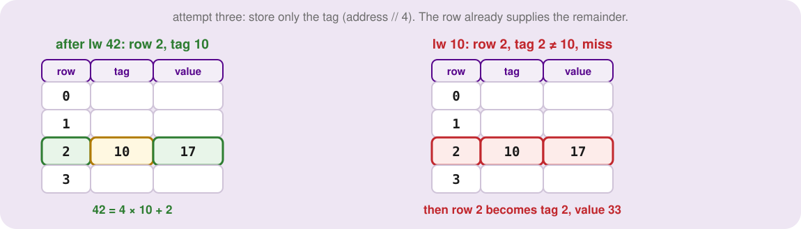
</p>
<p align=center><sub>Attempt three: row 2 holds tag 10, and address 10 arrives with tag 2.</sub></p>

A lookup is now: compute the row and the tag from the address, go to the row, and compare the stored tag with the computed one. A match is a hit; otherwise it is a miss, so fetch and evict.

These two are easy to mix up. The **index** is just another word for the row number: it tells you *where* the data lives, like an apartment number. The **tag** tells you *who* is currently living in that apartment. You need both. The index gets the electrical signals to the right door on the chip, and the tag checks the ID of whoever is inside. **Index is where, tag is who.**

<p align=center>
    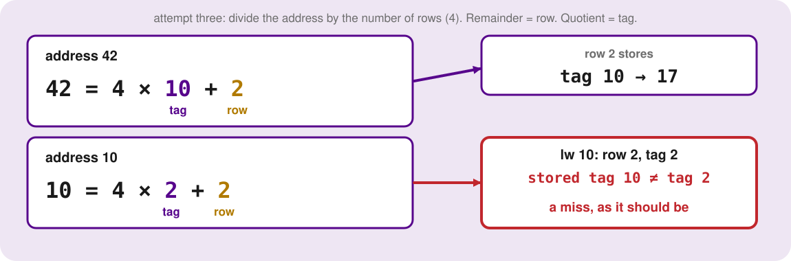
</p>
<p align=center><sub>Attempt three: divide by 4. The remainder is the row, the quotient is the tag. Address 42 is row 2, tag 10. Address 10 is row 2, tag 2, so the stored tag does not match and it is a miss.</sub></p>

What is in row 1 of the cache the instant you press the power button? The intuitive answer is "nothing", but in hardware empty does not exist. A wire always holds some voltage, which the logic reads as a 0 or a 1. When the machine powers on, the cache is full of meaningless static. Say, by chance, row 1 powers up holding all zeros, tag included.

The operating system boots and the first instruction asks for address 1. `1 % 4 = 1`, so row 1, and the tag is `1 // 4 = 0`. The stored tag is a leftover 0, so the comparator says *match*, the cache says *hit*, and hands the processor a handful of garbage it never loaded. It hallucinated a hit from static electricity.

<p align=center>
    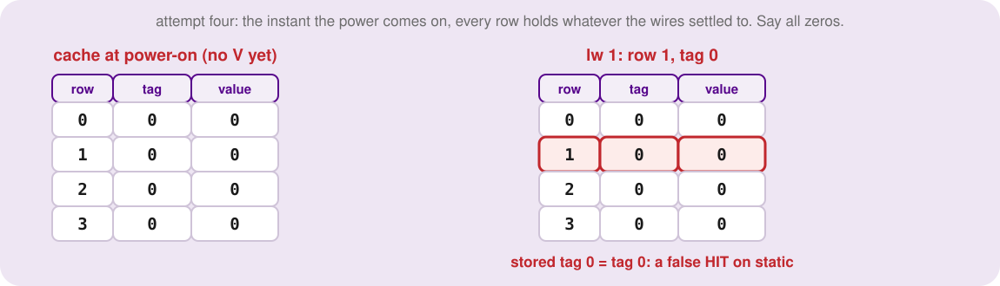
</p>
<p align=center><sub>Attempt four, the problem: power-on static looks exactly like a real entry.</sub></p>

We need a master on-off switch for each row, a way to say: this row has never been written by a real program, ignore whatever is in it. That is one extra bit per row, the **valid bit** `V`. If `V = 1`, real data lives here, so go ahead and check the tag. If `V = 0`, the hardware declares a miss without even looking at the tag.

<p align=center>
    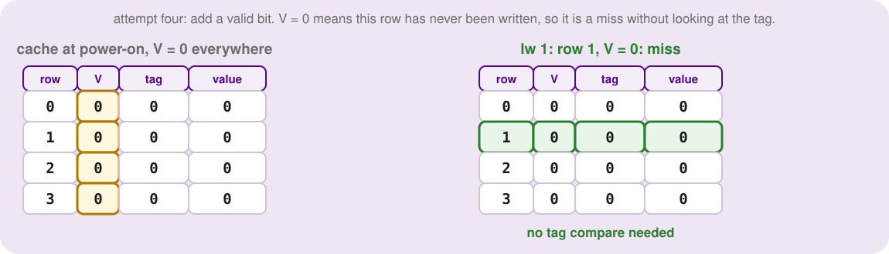
</p>
<p align=center><sub>Attempt four, the fix: V = 0 forces a miss.</sub></p>

A second vocabulary collision to head off: the valid bit is not the tag. The valid bit asks an existential question: *is this data real?* The tag asks an identity question: *which real address is it?* A row yields a hit only if `V = 1` **and** the tags match.

<p align=center>
    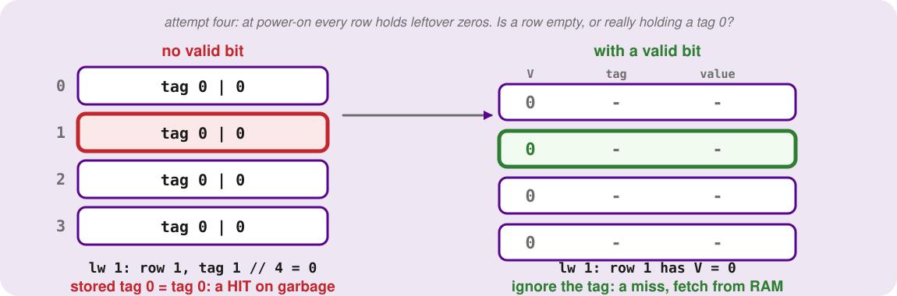
</p>
<p align=center><sub>Attempt four: at power-on every row holds leftover zeros, so without a valid bit address 1 (tag 0) falsely hits. With <code>V = 0</code> it is a miss.</sub></p>

<p align=center>
    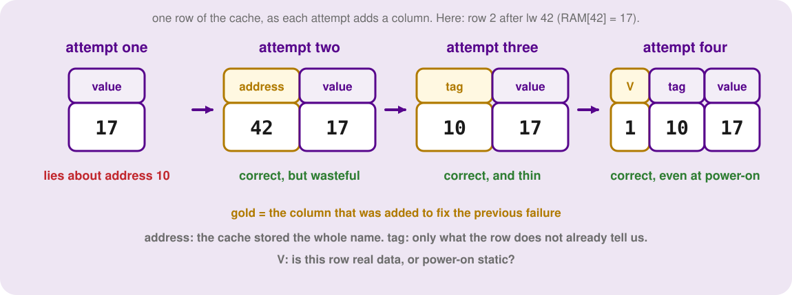
</p>
<p align=center><sub>The same row after each attempt. Each gold column was added to fix the failure before it.</sub></p>

So, the journey in four steps: pure remainder lied to us; storing the whole address wasted silicon; storing just the tag fixed that; and the valid bit stopped the power-on hallucination. Put together, every row has three parts:

| Row | V | Tag | Value |
|---|---|---|---|
| 0 | 0 | | |
| 1 | 0 | | |
| 2 | 1 | 10 | 17 |
| 3 | 0 | | |

<p align=center>
    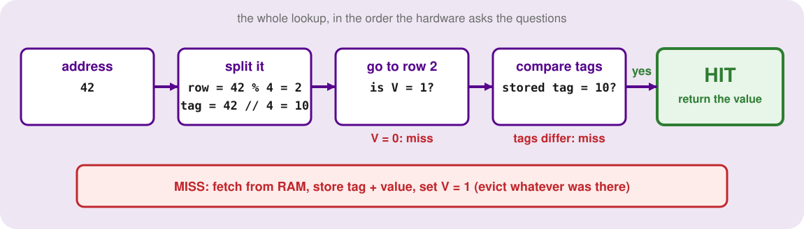
</p>
<p align=center><sub>The whole lookup in the order the hardware asks its questions.</sub></p>

To look up an address, compute `row = address % numberOfRows` and `tag = address // numberOfRows`. Go to that row. It is a **hit** only if `V = 1` and the stored tag equals the computed tag.

Otherwise it is a **miss**: fetch from RAM, store the new tag and value, set `V = 1` (evicting whatever was there), and return the value. On the table above: address 42 is a hit; address 10 is a miss (a tag mismatch); address 1 is a miss (`V = 0`). Two different kinds of miss.

<p align=center>
    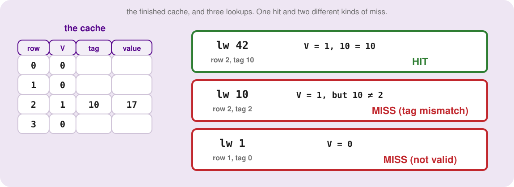
</p>
<p align=center><sub>The finished cache and three lookups: one hit, and two different kinds of miss.</sub></p>

---

<a id="3"></a>

## Blocks: Locality Is a Bet, Not a Guarantee

That is a working cache, and in the 1970s we could stop here. But software does not behave the way our tiny cache assumes. Think like a programmer: you are almost never fetching one isolated variable. You are running a loop over a big array, summing salaries or processing an image pixel by pixel:

```c
int my_array[1024];
int sum = 0;
for (int i = 0; i < 1024; i++)
    sum += my_array[i];
```

Every iteration asks for a brand new address, the one right after the last. With one value per row, every step is a guaranteed miss (100 ns each). Our cache is useless for arrays.

<p align=center>
    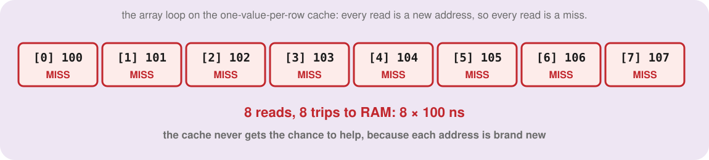
</p>
<p align=center><sub>Without blocks, every read of the array loop is a miss.</sub></p>

There are two kinds of locality, and our design only gets one. **Temporal locality** means that if you use an address once, you will probably use it again soon: the loop counter `i` is read every iteration, and after the first miss it sits in the cache for free hits.

The other kind, **spatial locality**, means that if you touch an address, you will very likely touch its neighbours next: the array. Our one-value-per-row cache ignores it completely.

<p align=center>
    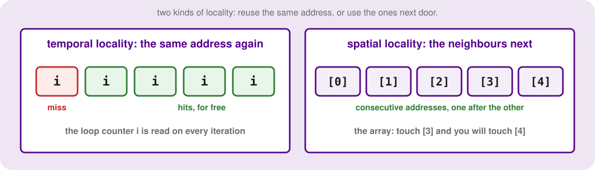
</p>
<p align=center><sub>Temporal locality reuses an address; spatial locality uses the ones next door.</sub></p>

Back to the library. If you walk across campus and find the history book you need, it is wasteful to walk back with only that book. Grab the whole shelf, because you will probably want the one next to it in five minutes. A cache does the same.

Divide memory into **blocks**: fixed chunks of consecutive cells, a power of two such as 8, 16 or 64. When the processor asks for one cell and misses, the cache fetches the *entire* block containing it and loads it into a row all at once.

Keep the four rows, and make the block size 8. The program asks for address 53. We have to find the block first: `53 // 8 = 6`, so address 53 is somewhere in block 6, which covers cells 48 to 55.

Now the critical shift. Where does block 6 go? We use the same remainder routing as before, but **on the block number, not on the raw address**: `6 % 4 = 2`, so row 2. The tag is the block number divided by the rows, `6 // 4 = 1`. Row 2 gets tag 1, `V = 1`, and a data slot holding eight cells, 48 to 55.

<p align=center>
    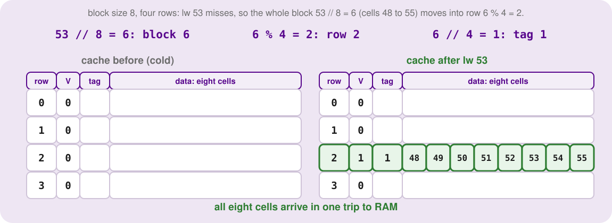
</p>
<p align=center><sub>A miss on 53 loads all of block 6 (cells 48 to 55) into row 2, tag 1.</sub></p>

<p align=center>
    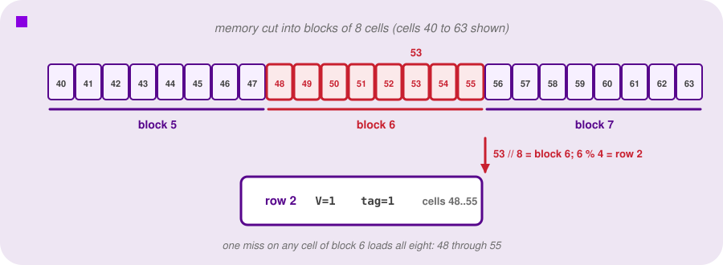
</p>
<p align=center><sub>A request for address 53 loads all of block 6, cells 48 to 55, into cache row 2 at once.</sub></p>

Now watch it pay off. The loop moves on to address 54. It is in block 6, which lives in row 2; the tag matches; address 54 is already there: a hit. Then 55: another hit. We have turned a series of 100 ns misses into free hits just by hauling the whole shelf. Across the eight reads of addresses 48 to 55, the first is a miss and the other seven are hits, where without blocks all eight missed.

<p align=center>
    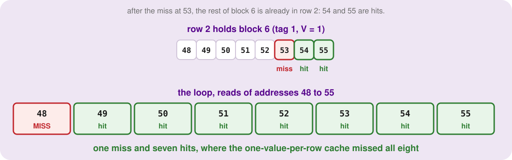
</p>
<p align=center><sub>After the miss, the rest of the block is already there: one miss, seven hits.</sub></p>

The cache is betting that your code has spatial locality. It dragged seven extra cells across the motherboard, burning energy and bus time and taking space in the row, on the hope that you would use them. If your code jumps all over memory, say through a linked list, never touching a neighbour, the cache loses the bet: it paid to carry cells that sit unused until they are evicted.

<p align=center>
    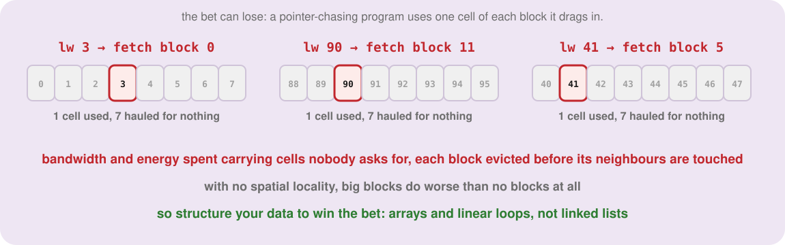
</p>
<p align=center><sub>When the bet loses: seven of every eight cells carried are never used.</sub></p>

With no spatial locality, big blocks do worse than no blocks at all. The hardware is not magic. It makes assumptions about how you write software, and **if you want your code to be fast, you structure your data to win the bet**: array-heavy, linear code.

---

<a id="4"></a>

## Decoding an Address: Tag, Index, Offset

Because the cache now deals in blocks, the processor's address has to be sliced into three parts, read from the right (least significant bits) to the left. Each answers one question:

- **Offset**, the rightmost slice: where *inside* the block is my cell? A block of 8 cells needs `log2(8) = 3` bits to point at one of them. Think of it as the house number on a street.
- **Index**, the middle slice: which cache row is this block assigned to? Four rows need `log2(4) = 2` bits. It is the street name.
- **Tag**, everything left over at the top: out of all the blocks in memory that share this row, which one is parked here right now? It is the city and state.

In arithmetic form, which is the form you will use on exams, write these four steps down in this order:

| Step | Question | Formula |
|---|---|---|
| 1 | block | `address // blockSize` |
| 2 | offset | `address % blockSize` |
| 3 | row (index) | `block % numberOfRows` |
| 4 | tag | `block // numberOfRows` |

Take a worked example: a system has 10-bit addresses, a block size of 4, and 8 cache rows. Decode address 181. First the widths: block size 4 needs 2 offset bits; 8 rows need 3 index bits; that leaves `10 - 2 - 3 = 5` bits for the tag. In binary, 181 is `0010110101`:

<p align=center>
    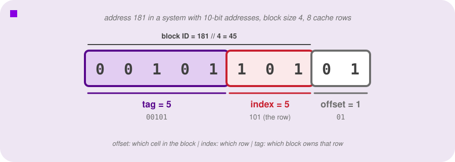
</p>
<p align=center><sub>Offset <code>01</code> = 1, index <code>101</code> = 5, tag <code>00101</code> = 5. Together, tag and index make the block ID: 45.</sub></p>

Now the arithmetic. Step 1: `181 // 4 = 45`, so block 45. Step 2: `181 % 4 = 1`, so offset 1.

Step 3 is where nearly everyone slips: the row. The tempting move is to take the raw address, `181 % 8`, just as we did in attempt one. **Don't.** In attempt one there were no blocks. Once blocks exist, the raw address no longer decides the row; the block does.

If rows came from raw addresses, then 180, 181 and 182, which are all in block 45 and have to travel together, would land in rows 4, 5 and 6: you would scatter one block across the cache and wreck the whole design. (Here the wrong rule happens to give row 5 by luck. It will not in general, and for the tag it gives `181 // 8 = 22` where the right answer is 5.)

> **The golden rule: always write the block first.** Compute the block number before any other math. The row comes from the block. The tag comes from the block. Once you have the block and the offset, pretend the raw address does not exist.

So: row `45 % 8 = 5`, tag `45 // 8 = 5`. Address 181 decodes to **offset 1, row 5, tag 5**. In binary it is exactly the slices: tag `00101`, index `101`, offset `01`.

On the four-row, block-size-8 cache we will trace next: address 53 is block 6, offset 5, row 2, tag 1; address 100 is block 12, offset 4, row 0, tag 3 (not 25, which is `100 // 4`, the tag from the old one-value-per-row cache); address 77 is block 9, offset 5, row 1, tag 2. And a last warning: for 54, both `54 // 8` and `54 % 8` happen to be 6. The first is the block, the second the offset; 53 tells them apart.

---

<a id="5"></a>

## Tracing a Cache: A Worked Example

This is the skill you will be tested on, so go through it in slow motion. The cache has four rows and a block size of 8, and it starts cold: every valid bit is 0. The processor makes ten `lw` accesses, in this order:

`52, 53, 92, 55, 20, 54, 60, 53, 29, 28`

For each one, say out loud the block, the row, the tag and the result.

| Address | Block | Row | Tag | Result | Why |
|---|---|---|---|---|---|
| 52 | 6 | 2 | 1 | MISS | row 2 is empty (`V = 0`); load block 6 |
| 53 | 6 | 2 | 1 | **HIT** | same block as 52: spatial locality paying off |
| 92 | 11 | 3 | 2 | MISS | row 3 is empty; load block 11 |
| 55 | 6 | 2 | 1 | **HIT** | block 6 is still in row 2 |
| 20 | 2 | 2 | 0 | MISS | row 2 holds tag 1 (block 6); 0 is not 1, so **evict** block 6 |
| 54 | 6 | 2 | 1 | MISS | row 2 now holds tag 0 (block 2); evict it, and block 6 comes back |
| 60 | 7 | 3 | 1 | MISS | row 3 holds tag 2 (block 11); 1 is not 2, so evict |
| 53 | 6 | 2 | 1 | **HIT** | block 6 was reloaded two steps ago |
| 29 | 3 | 3 | 0 | MISS | row 3 holds tag 1 (block 7); evict |
| 28 | 3 | 3 | 0 | **HIT** | same block as 29 |

Address 52 is block 6, row 2, tag 1. Row 2 is invalid, so a miss: block 6 (cells 48 to 55) loads into row 2. Address 53 is block 6 again, row 2, tag 1. `V = 1` and the tags match: a hit. That is the bet paying off, since 53 rode in on the coattails of 52. Address 92 is a miss in the empty row 3, and 55 is another hit on block 6.

Address 20 is block 2, row 2, tag 0. Row 2 is valid, but it holds tag 1, which is block 6, and our computed tag is 0. No match: a miss, and the hardware evicts block 6 to load block 2.

Address 54 is block 6, row 2, tag 1. But row 2 now holds tag 0, because we loaded block 2 a moment ago. A miss: block 2 is evicted and block 6 is hauled all the way back from memory. That is a **conflict**: two blocks that have nothing to do with each other in the software just happen to map to the same physical row, and they keep forcing each other out.

Rows 0 and 1 are completely empty, so why couldn't block 2 just park there? Because a direct-mapped cache is a parking lot with mathematically assigned spaces. Block 2 is permanently assigned to space 2, and is forbidden to use space 0 or 1. If block 6 is in space 2, block 6 gets towed. Conflicts come from mathematical coincidence, not from running out of room.

The rest follows the same recipe: **60** evicts block 11 from row 3; **53** is a hit (block 6 was reloaded two accesses ago); **29** evicts block 7; and **28** is a hit on block 3. Four hits in ten accesses: a hit ratio of 40 percent. The cache ends up looking like this:

<p align=center>
    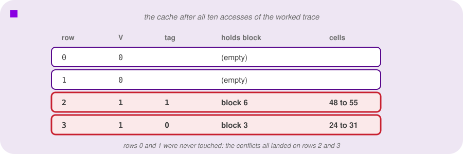
</p>
<p align=center><sub>Rows 0 and 1 were never touched. All the action, and all the damage, happened on rows 2 and 3.</sub></p>

Rows 0 and 1 were ghost towns. Every eviction and every conflict happened on rows 2 and 3, which makes the cache feel fragile: how well it does depends on exactly where things land in memory.

Make that concrete with two contrasting programs. First, a well-behaved one that walks memory in order: `50, 51, 52, ..., 69` (twenty accesses). It only misses when it crosses into a new block, at addresses 50, 56 and 64: three misses and seventeen hits, a hit ratio of **17/20**, from the very same hardware, because the access pattern matches the bet the cache makes.

Then the nightmare: `16, 80, 17, 81, 18, 82`. Addresses 16 to 18 are in block 2, and 80 to 82 in block 10, and `2 % 4 = 10 % 4 = 2`, so both blocks want row 2. Every access evicts the block the next access needs: six accesses, six misses, a hit ratio of **0**, while rows 0, 1 and 3 sit idle.

Is the cache broken? No. It did not fail because it was too small; it failed because of where two blocks happened to land. A program's speed can fall off a cliff just because two unrelated arrays sit a certain distance apart in RAM. Next lecture's associative caches exist to relax exactly that.

---

<a id="6"></a>

## Sizing a Cache

When the box says "128-byte L1 cache", you assume it holds 128 bytes of your data. It does, but the hardware inside is bigger, because the cache has to store more than data. We have to separate the **data capacity** (the bytes of your program it can hold) from the **total hardware size** (every transistor needed to make it work). The tags and valid bits are not free:

```
total size (bits) = numberOfRows × (1 + tagSizeInBits + blockSizeInBits)
                                     ↑          ↑              ↑
                                valid bit     the tag     the data, blockSize × 8 for byte-sized cells
```

Worked example: a system with 12-bit addresses, a cache with 8 rows, and 16-byte blocks. Sixteen bytes means `log2(16) = 4` offset bits, and 8 rows means `log2(8) = 3` index bits, so the tag gets `12 - 4 - 3 = 5` bits. One row is a valid bit (1), a tag (5) and a block of `16 × 8 = 128` bits of data: **134 bits**. The whole cache is `8 × 134 = 1072` bits, or 134 bytes.

But it only holds `8 × 16 = 128` bytes of data. The other 6 bytes are pure administration: about a **5 percent metadata tax** for the privilege of knowing where your data came from and whether it is valid.

Why not use tiny blocks, say one byte, so you never haul useless data? Now you can show why not. To keep the same 128 bytes of data with 1-byte blocks you need 128 rows, which means 128 valid bits and 128 tags instead of 8.

Each row costs `1 + 5 + 8 = 14` bits, so the cache is `128 × 14 = 1792` bits to hold 1024 bits of data: the tax jumps from about 5 percent to about 75 percent. Larger blocks let more data share the cost of one tag and one valid bit, which is one reason designers do not shrink blocks toward zero.

---

<a id="7"></a>

## What a Cache Is Worth: Hit Ratio and Average Time

After paying the silicon tax, what is the payoff? To find out, we need the protocol between the processor, the cache and memory. The standard convention: **every access checks the cache first**, hit or miss, so every access pays the cache's short time. Only on a miss does it pay the long trip to memory, on top of that. That gives:

```
average time = cache time + (1 - hit ratio) × memory time
```

Take a cache access of 2 ns and a memory trip of 60 ns (invented numbers, with the right shape). At a 90 percent hit ratio the average is `2 + 0.1 × 60 = 8 ns`. With no cache every access would cost 60 ns, so the cache made the average access **7.5 times faster.**

Now see how sensitive the formula is. Optimise your arrays to get the hit ratio up to 99 percent: `2 + 0.01 × 60 = 2.6 ns`, almost three times faster again. Or write slightly sloppy code and slip to 80 percent: `2 + 0.2 × 60 = 14 ns`.

A drop of only ten points of hit ratio nearly doubled the average. The trip to memory is so punishingly slow that even a small fraction of misses acts like an anchor on the whole system: the misses dominate the average.

This lands directly on the pipeline. A cache miss is a physical stall in the `MEM` stage: every `lw` that misses injects stall cycles, so a falling hit ratio makes CPI balloon, however fast the ALU is.

---

<a id="8"></a>

## Recap: The Cache That Got Towed

Four rows, a block size of 8, and a program that reads these addresses in order: `16, 80, 17, 81, 18, 82`. Addresses 16 to 18 sit in block 2, and 80 to 82 in block 10. Both blocks leave remainder 2 when divided by 4, so both belong in row 2.

Walk through it. 16 misses and block 2 loads into row 2. 80 misses, finds block 2 there with the wrong tag, and evicts it. 17 wants block 2 back: miss, and block 10 is evicted. And so on, six accesses, six misses, a hit ratio of zero, while rows 0, 1 and 3 never saw a single block.

We called this a **conflict**, and noted the cache did not fail because it was small. It failed because a direct-mapped cache gives every block exactly one place to live. If two blocks you need at the same time share that place, they take turns being thrown out.

The question now: what if a block had more than one place to go?

---

<a id="9"></a>

## Two Seats per Row: Set-Associative Caches

Take the same budget, four blocks of storage in total, and arrange it differently. Instead of four rows with one block each, make **two rows with two blocks each**. A block now maps to a row as before, but within that row it may sit in either of two seats.

A row that holds several blocks is called a **set**, and each seat in it is a **way**. This arrangement is a **2-way set-associative cache**. Direct-mapped is the special case of one seat per set, a 1-way cache.

<p align=center>
    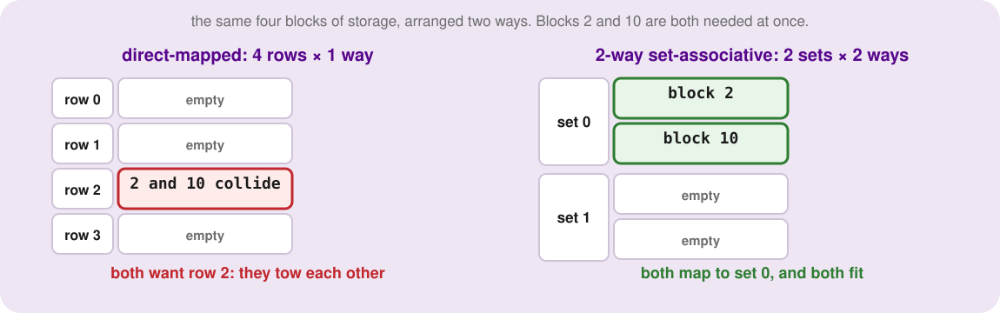
</p>
<p align=center><sub>The same four blocks of storage. Left: blocks 2 and 10 both map to row 2 and tow each other. Right: with two sets of two ways, both blocks map to set 0, and both fit.</sub></p>

The routing rule only changes in one place. The set comes from the block number: `set = block % numberOfSets`. With two sets, block 2 gives `2 % 2 = 0` and block 10 gives `10 % 2 = 0`. Both land in set 0, and that is fine, because set 0 has two seats.

Now a lookup has one extra step. Go to the set, then **compare the tag against every way in it** (in hardware, all at once). A hit is any way that is valid and whose tag matches. A miss means none did.

Redo the recap trace. 16 is block 2, set 0, tag 1: miss, goes in the first free way. 80 is block 10, set 0, tag 5: miss, and the other way is still free, so *nothing is evicted*. Now 17 asks for set 0, tag 1 and finds it: hit. 81 hits (tag 5), 18 hits, 82 hits.

<p align=center>
    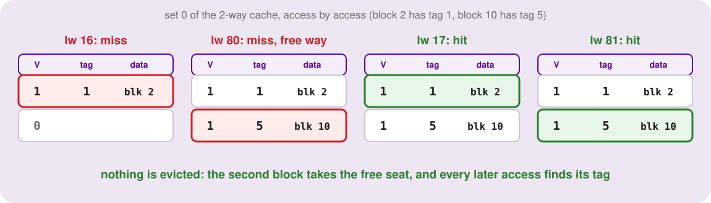
</p>
<p align=center><sub>Set 0 of the 2-way cache as the trace runs. Both blocks stay, so the last four accesses are hits.</sub></p>

Four hits out of six, from a cache with exactly the same number of blocks. We did not buy more storage. We only relaxed the rule about where a block may go.

---

<a id="10"></a>

## Who Gets Evicted? Replacement Policies

More seats per set creates a new problem. When a block arrives and every seat in its set is taken, someone has to go, and now there is a *choice*. A direct-mapped cache never had to decide: there was exactly one block to throw out.

There are a few reasonable policies:

- **Random:** pick a seat at random. Simple, and surprisingly not terrible.
- **FIFO** (first in, first out): evict the block that has been there longest, regardless of use.
- **LRU** (least recently used): evict the block whose last use is furthest in the past.

LRU is the usual choice because it bets on temporal locality, the same bet blocks make on spatial locality. If you have not touched a block in a while, you probably will not soon.

Here is where they disagree. Same 2-way cache, set 0, with a third block competing: `16, 80, 17, 144, 17`. Address 144 is block 18, set 0, tag 9. After 16 and 80 both seats are full (tags 1 and 5), and 17 refreshes the tag-1 block. Now 144 arrives.

- **LRU** looks at last use. Tag 1 was used at 17, tag 5 at 80, so tag 5 is the stale one. It evicts tag 5, and the final access to 17 hits.
- **FIFO** looks at arrival. Tag 1 came in first, so it goes, even though it was just used. The final access to 17 misses.

<p align=center>
    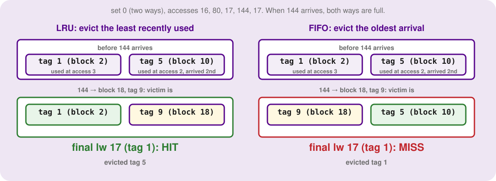
</p>
<p align=center><sub>Same accesses, same cache, different victims. LRU keeps the block the program just used.</sub></p>

Two hits against one, from nothing but the choice of victim. The price is bookkeeping: LRU has to remember the order of use in every set. For 2 ways that is a single bit per set, and for more ways it grows. On exams, unless told otherwise, assume LRU, and track it with a small list per set ordered from least to most recently used.

---

<a id="11"></a>

## Decoding an Address, Again

Earlier, an address split into offset, index and tag, and the golden rule was *write the block first*. That rule survives, and so does the whole recipe. The only word that changes is **index**: it now picks a *set*, not a row of one block.

| Step | Question | Formula |
|---|---|---|
| 1 | block | `address // blockSize` |
| 2 | offset | `address % blockSize` |
| 3 | set (index) | `block % numberOfSets` |
| 4 | tag | `block // numberOfSets` |

The number of index bits is `log2(numberOfSets)`, **not** the number of blocks. Fewer sets means fewer index bits, so more of the block number is left over for the tag. This is the trade: the tag gets longer.

Worked example, 12-bit addresses, a 4-way cache with 2 sets, block size 16. Offset: `log2(16) = 4` bits. Index: `log2(2) = 1` bit. Tag: `12 - 4 - 1 = 7` bits. Take address 1234: block `1234 // 16 = 77`, offset `1234 % 16 = 2`, set `77 % 2 = 1`, tag `77 // 2 = 38`.

And the size formula gets one factor:

```
total size (bits) = numberOfSets × ways × (1 + tagSizeInBits + blockSizeInBits)
```

(plus the LRU bookkeeping bits, which exam questions normally ignore unless they ask for them).

---

<a id="12"></a>

## A Dial, Not a Switch: From Direct-Mapped to Fully Associative

Fix the budget at four blocks of storage and block size 8, and turn one knob, the number of ways.

<p align=center>
    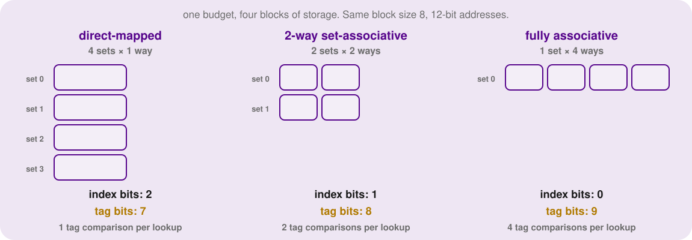
</p>
<p align=center><sub>One budget, three layouts. More ways means fewer sets, fewer index bits, and a longer tag.</sub></p>

| Layout | Name | Index bits | Tag bits (12-bit address, block 8) | Tag comparisons per lookup |
|---|---|---|---|---|
| 4 sets × 1 way | direct-mapped | 2 | 7 | 1 |
| 2 sets × 2 ways | 2-way set-associative | 1 | 8 | 2 |
| 1 set × 4 ways | **fully associative** | 0 | 9 | 4 |

At the far end, one set holds everything. A block may go in **any** seat, there are zero index bits, and the entire block number is the tag. That is a **fully associative cache**. It never suffers a conflict: the only reason to evict is that every seat is genuinely full.

So why is not everything fully associative? Because every lookup must compare the tag against *every* seat in parallel. Each comparison is a comparator circuit and a wire, and the comparisons all have to finish before the hit can be declared. More ways means more hardware, more energy and a slower hit. Direct-mapped is fast and cheap but conflict-prone; fully associative never conflicts but is slow and expensive. Real caches live in the middle, usually 2-way to 8-way.

---

<a id="13"></a>

## Tracing the Same Ten Accesses

Time to run the trace from section 5 again: `52, 53, 92, 55, 20, 54, 60, 53, 29, 28`, block size 8, four blocks of storage, starting empty. In section 5, direct-mapped got **4 hits**, and the miss at 54 was a conflict (block 2 had evicted block 6 from row 2). Here it is on the 2-way cache (2 sets), with `set = block % 2` and `tag = block // 2`:

| Address | Block | Set | Tag | Result | Why |
|---|---|---|---|---|---|
| 52 | 6 | 0 | 3 | MISS | set 0 is empty |
| 53 | 6 | 0 | 3 | HIT | same block as 52 |
| 92 | 11 | 1 | 5 | MISS | set 1 is empty |
| 55 | 6 | 0 | 3 | HIT | still there |
| 20 | 2 | 0 | 1 | MISS | set 0 has a free way: **no eviction** |
| 54 | 6 | 0 | 3 | **HIT** | block 6 is still in set 0 |
| 60 | 7 | 1 | 3 | MISS | set 1 has a free way |
| 53 | 6 | 0 | 3 | HIT | |
| 29 | 3 | 1 | 1 | MISS | set 1 is full (tags 5, 3): LRU evicts tag 5 (block 11) |
| 28 | 3 | 1 | 1 | HIT | same block as 29 |

That makes five hits in ten, one better than direct-mapped, and the extra hit is exactly 54, the conflict. The five misses are all first-time visits to a block. If you try the fully associative version (one set, four ways) you also get five hits: nothing more to gain, because the remaining misses were never about conflicts.

---

<a id="14"></a>

## Why Did It Miss? The Three Cs

That last observation deserves a name. Every cache miss falls into one of three categories, and associativity only helps with one of them:

1. **Compulsory** miss: the first time a block is touched. The cache cannot have it, because it has never seen it. A cold cache starts with all of these. Only bigger blocks (fetching neighbours early) reduce them.
2. **Capacity** miss: the program uses more blocks than the cache can hold, so earlier blocks fall out and then are needed again. Only a bigger cache helps.
3. **Conflict** miss: a block was evicted even though the cache as a whole had space, because of where blocks were allowed to go. Associativity cures these.

Classify the misses from section 5. 52, 92, 20, 60 and 29 were compulsory, because each was a block's first visit. The miss at 54 was a conflict: block 6 had been in the cache and got towed by block 2 with rows 0 and 1 empty. The 2-way cache removed that one and nothing else, which is why it went from four hits to five.

A practical rule for diagnosing a trace: if a *re-reference* to a block missed while some other row or way was empty, it was a conflict miss.

---

<a id="15"></a>

## Is It Worth It? Associativity Against Speed

Fewer misses are only half the story, because the extra comparators slow down every hit. Use the formula from section 7, `average time = cache time + (1 - hit ratio) × memory time`, with a memory trip of 60 ns.

Suppose a direct-mapped cache hits in 2 ns and gets an 80 percent hit ratio on some program: `2 + 0.2 × 60 = 14 ns`. A 4-way cache with the same total size takes 2.2 ns for a hit (the extra comparators and the mux) but reaches 90 percent: `2.2 + 0.1 × 60 = 8.2 ns`. The associative cache wins by a wide margin, because a miss is so much more expensive than a slightly slower hit.

It does not always win. If associativity only moved the hit ratio from 80 to 81 percent, the gain would be tiny: `2.2 + 0.19 × 60 = 13.6 ns` against `14 ns`, which a slightly slower hit time would wipe out entirely, and the chip is bigger on top. Designers measure real programs and stop adding ways when the returns shrink. That is why the practical range is 2 to 8 ways, not 64.

---

<a id="16"></a>

## Writes: When the Cache and Memory Disagree

Everything so far was about `lw`. Now the processor executes `sw`, and something awkward happens: the cache holds a *copy* of memory, and a store changes one of them.

Suppose a direct-mapped cache holds the block containing address 20, and the program runs:

```
movi $1, 5
movi $7, 20
sw   $1, 0($7)      # write 5 to address 20
```

If the `sw` updates **only the cache**, the cache says address 20 holds 5 and RAM still holds the old value. Nothing is wrong yet, because the processor reads the cache first. But now the block gets evicted by some other access, the cache lets it go, and RAM still has the stale value. The next `lw` of address 20 fetches the *old* number. The store has vanished.

Writing to the cache alone is therefore a bug waiting for an eviction. The cache and RAM have to be reconciled eventually, and the only question is *when*. There are two answers.

---

<a id="17"></a>

## Write-Through and Write-Back

With **write-through**, every store updates the cache and RAM immediately. RAM is never stale, so evictions are trivial: just drop the block. The price is that every `sw` pays a trip to memory, 100 ns, which is the very cost the cache was meant to avoid. (Real machines hide some of it with a small **write buffer** that lets the processor carry on while the write drains in the background.)

With **write-back**, a store updates only the cache, and the row is marked **dirty** with one extra bit, `D`. RAM is allowed to be stale, and only when a dirty block is evicted is it written back to RAM. Clean blocks are simply dropped.

<p align=center>
    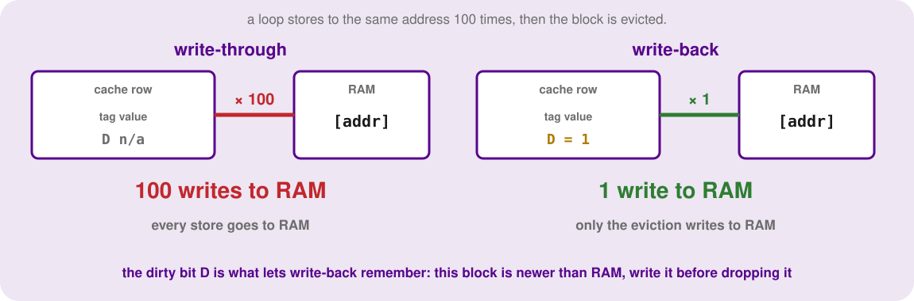
</p>
<p align=center><sub>A loop that stores to the same address a hundred times. Write-through pays the memory trip every time; write-back pays it once, at eviction.</sub></p>

The rule for a row is now `V` (is it real?), `D` (is it newer than RAM?), a tag and the data. In the hit/miss logic nothing changes: a hit still needs `V = 1` and matching tags. The dirty bit only matters on eviction:

| Policy | A store hit goes to | Extra bit | Evicting a block | Strength | Weakness |
|---|---|---|---|---|---|
| Write-through | cache and RAM | none | just drop it | simple, RAM always current | every store pays memory time |
| Write-back | cache only | dirty bit | if dirty, write it to RAM first | repeated stores are free | more logic, RAM can be stale |

Count the difference. A loop adds to a running total, updating the same address 100 times. Write-through makes 100 memory writes. Write-back makes **one**, when the block is finally evicted. That is why almost every real cache above L1 is write-back, and why dirty-bit bookkeeping is worth the complexity.

---

<a id="18"></a>

## What About a Write Miss?

One case left: the program stores to an address whose block is **not** in the cache. Two choices, independent of the write-hit policy above:

- **Write-allocate:** fetch the block into the cache first, then write to it as if it were a hit. It bets that you will read or write nearby soon (spatial locality again).
- **Write-around** (no-write-allocate): skip the cache and write straight to RAM. It bets the data will not be touched again soon.

They pair naturally with the hit policies:

| Hit policy | Usual partner for misses | Why |
|---|---|---|
| Write-back | write-allocate | the block has to come into the cache so the dirty bit can track it |
| Write-through | write-around | writing RAM anyway, so caching the block adds nothing |

So the full description of a cache's write behaviour has two parts, one for hits and one for misses, and exams will ask for both: "write-back with write-allocate" or "write-through with write-around".

A worked sequence: a 4-row direct-mapped cache with block size 1, write-back and write-allocate, starting empty. `lw $5, 0($7)` with `$7 = 20` loads address 20 into row 0. `sw $1, 0($7)` is a write hit: row 0 gets the new value and is marked dirty, and RAM is untouched. `lw $2, 0($7)` is a read hit and returns the new value. `lw $3, 4($7)` reads address 24, which also maps to row 0 (`24 % 4 = 0`): a miss, and the dirty block is **first written back to RAM**, then address 24 is loaded. A final `lw $2, 0($7)` misses and fetches the value from RAM, which is now the updated one. Nothing was lost.

---

<a id="19"></a>

## What Is Still Wrong: The Bridge to Virtual Memory

Taking stock. With caches the processor sees something close to a fast memory most of the time. But we have quietly assumed a few things that are not true.

First, that the memory is as big as the addresses. A 32-bit address can name 4 GiB of cells, and few machines have that much RAM. Second, that the program owns the memory. A real computer runs dozens of programs at once, and each is written as if its code and data start at the same low addresses. Two programs both storing to address 100 cannot share the same physical cell. Third, that nothing misbehaves: a program with a bug that writes to someone else's address can corrupt it.

And notice the thought we left hanging: what happens when two unrelated programs share one cache? Even the best cache cannot help with *which programs get which memory in the first place*.

The idea that solves all three problems is the same one this lecture used on blocks and rows, one level up: put a layer between the address a program uses and the cell it actually gets, and let that layer decide. That layer has a name: **virtual memory**. We will build it from the cache, one small step at a time.

---

<sub>**Previous: [Pipelining, Concluded](/lectures/10-pipelining)** || **Next: [Virtual Memory](/lectures/12-virtual-memory)**</sub>
