<h2 align=center>Week XI</h2>

<h1 align=center>Virtual Memory</h1>

---

## Sections

1. [**A Warm-Up: Splitting an Address, One More Time**](#1)
2. [**Virtual Addresses and the Page Table**](#2)
3. [**Two Programs, One Address**](#3)
4. [**Two Trips for Every Access, and the TLB**](#4)
5. [**When the Page Is Not in RAM**](#5)
6. [**Segfaults and the Protect Bit**](#6)
7. [**How Big Is the Page Table?**](#7)
8. [**The Whole Trip in One List**](#8)
9. [**What a Fault Costs**](#9)
10. [**Choosing a Victim: Page Replacement**](#10)
11. [**LRU on a Budget: The Clock**](#11)
12. [**Thrashing and the Working Set**](#12)
13. [**What the OS Does with Page Tables**](#13)
14. [**Switching Programs, and the TLB**](#14)
15. [**Practice: Exam-Style Problems**](#15)

---

The last lecture ended with a problem no cache can fix: programs need more memory than there is, and two programs both want address 100. Virtual memory fixes both, and it is built out of pieces you already have: address splitting, a cache, LRU and the dirty bit.

---

<a id="1"></a>

## A Warm-Up: Splitting an Address, One More Time

Before any new idea, one small task you already know how to do. The cache from earlier has 2 sets, 2 ways and a block size of 8 bytes. Split address **80** into a tag, a set and an offset.

Block number first: `80 // 8 = 10`. Offset is the remainder: `80 % 8 = 0`, so 80 is the very first byte of its block. Then the block number splits again: `set = 10 % 2 = 0` and `tag = 10 // 2 = 5`. Address **87** gives block 10 again, offset `87 % 8 = 7`, so the last byte of the same block.

A quick sanity check that catches a classic slip: with 8 bytes per block, an offset can only be 0 to 7. An "offset 9" means you forgot to divide first.

Now the same move with bigger numbers. Suppose memory is cut into **pages** of 4096 bytes instead of blocks of 8. Address **8200** splits like so:

- page number = `8200 // 4096 = 2`
- offset = `8200 % 4096 = 8`

<p align=center>
    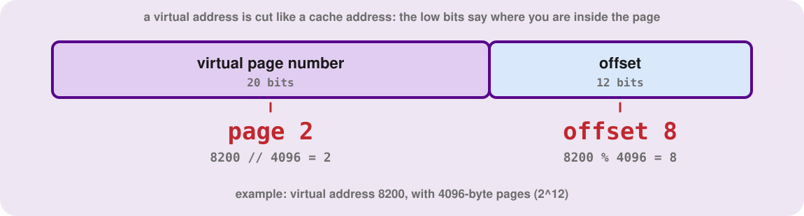
</p>
<p align=center><sub>A page is a block with a bigger size and a different job: the same quotient and remainder.</sub></p>

That is all a page is: a block with a bigger size and a different job. Everything below leans on this one piece of arithmetic.

---

<a id="2"></a>

## Virtual Addresses and the Page Table

Here is the new part. The address a program uses is a **virtual address**. It is not where the byte actually lives. Between the program and RAM sits a table, the **page table**, that says which **physical page** each virtual page really occupies. Here is a tiny one:

| virtual page | physical page |
|---|---|
| 0 | 7 |
| 1 | 3 |
| 2 | 5 |

The program asks for virtual address 8200. You already know that is virtual page 2, offset 8. The table sends page 2 to physical page 5, and the offset rides along unchanged:

```
physical address = 4096 * 5 + 8 = 20488
```

So the program asked for 8200 and the hardware read from 20488. Only the page number gets translated. The offset is never touched, for the same reason a block offset is never touched: it just says how far into the page you are.

<p align=center>
    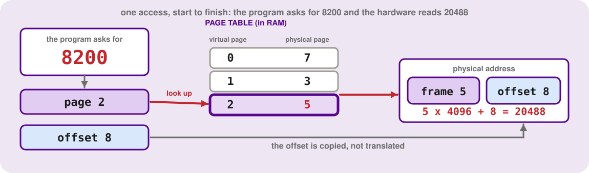
</p>
<p align=center><sub>Only the page number is translated. The offset is copied across.</sub></p>

Who writes the table? The operating system does. It builds one page table per program, keeps it in RAM, and the hardware looks things up in it on every access. The numbers in the example above are made up, but the process is exactly this.

---

<a id="3"></a>

## Two Programs, One Address

Now a second program runs. It also asks for virtual address 8200, but the OS gave it its own table, in which virtual page 2 maps to physical page 9. Where does it read from?

```
physical address = 4096 * 9 + 8 = 36872
```

20488 for the first program, 36872 for the second. Both programs used the same virtual address and they did not collide, because the OS handed each one a different table and so a different physical page. Each program believes it owns the whole address space, and none can reach another's memory unless the OS builds a table that lets it.

<p align=center>
    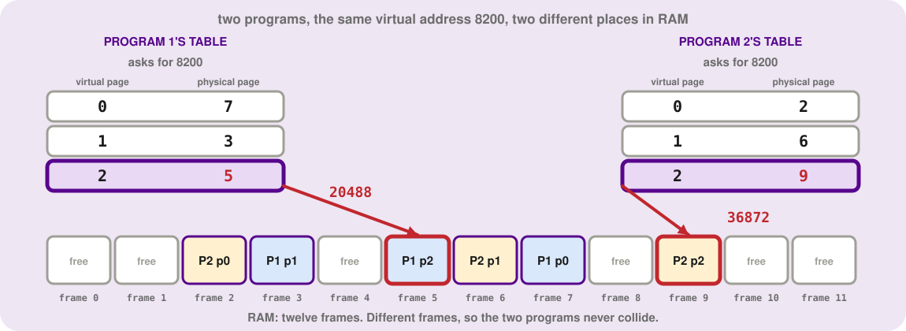
</p>
<p align=center><sub>Same virtual address, two tables, two different places in RAM.</sub></p>

That is the answer to the three problems from the last section. A program can use more addresses than there is RAM, because a page need not be in RAM at all (more on that below). Programs do not share cells by accident. And a buggy program can only scribble on pages its own table points to.

---

<a id="4"></a>

## Two Trips for Every Access, and the TLB

Count the cost. The page table lives in RAM. To read one byte at virtual address 8200, the hardware makes:

1. one trip to RAM to read the table entry for virtual page 2, which gives physical page 5
2. one trip to RAM to read the byte at physical address 20488

Two trips, so every memory access just got twice as slow. That is a terrible deal, and the fix will sound familiar. The same table entries get used over and over, so **cache them**. That cache is the **translation lookaside buffer**, or **TLB**: a small, fast cache of page table entries. Because any virtual page may sit in any TLB row, it is a small **fully associative** cache, the extreme end of the dial from earlier.

<p align=center>
    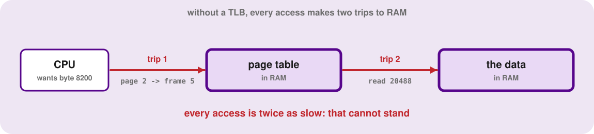
</p>
<p align=center><sub>Without a TLB, every access makes two trips to RAM.</sub></p>

The TLB is a small table of recent translations. Each row pairs a virtual page number with its frame number. A data cache is asked for an address, matches on the **tag**, and hands back the **data**. The TLB has the same shape, with different contents. The hardware already has the virtual address and wants the physical one, so the TLB is searched by virtual page number and hands back the frame number:

| | Data cache | TLB |
|---|---|---|
| Matches on | tag | virtual page number |
| Hands back | the data | the physical page number |

On a **TLB hit** for virtual page 2 you get physical page 5, attach the offset 8, and arrive at 20488 without ever visiting the page table. On a **TLB miss** the hardware reads the entry from the page table in RAM, saves it in the TLB so the next access to page 2 is fast, and then continues as above.

<p align=center>
    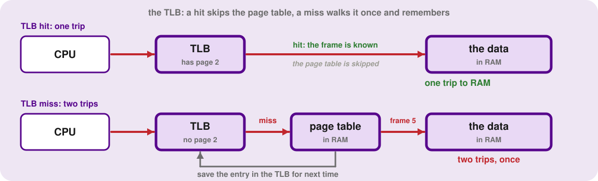
</p>
<p align=center><sub>A hit skips the page table. A miss walks it once and remembers the answer.</sub></p>

---

<a id="5"></a>

## When the Page Is Not in RAM

One more possibility. The page table entry for virtual page 2 can say that the page is **not in RAM**, because it is out on disk. (Each entry carries a valid bit for exactly this.) That is a **page fault**, and the program cannot have its byte until the OS has:

1. gone to disk and fetched the page, the slowest trip in the whole story
2. found a physical page to put it in

<p align=center>
    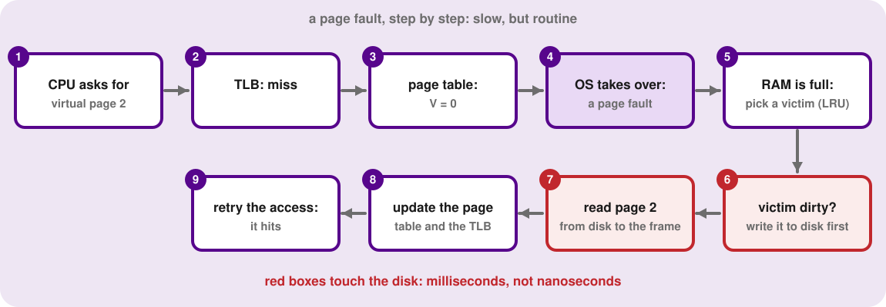
</p>
<p align=center><sub>A page fault, step by step. The two red boxes are the ones that touch the disk.</sub></p>

If RAM is full, step 2 means **evicting** another page. Which one? The same rule as in the cache: **LRU**, the least recently used (real systems approximate it, but the idea is identical). And one more thing from the write-back section carries over directly: if the page you are evicting was modified while it sat in RAM, the disk copy is stale. It has to be **written back to disk first**, and only then can its physical page be reused. Pages carry a dirty bit for the same reason cache rows do.

---

<a id="6"></a>

## Segfaults and the Protect Bit

Not every invalid entry means "go fetch it from disk". The valid bit only says the page is not in RAM. The hardware cannot tell why, so it raises a page fault and the OS checks its own records. There are three possibilities:

- The page is on disk, because the OS evicted it earlier. It is an ordinary page fault: the OS reads the page into a free frame, sets V to 1, and retries. The program never notices, except that the access was slow.
- The page is allocated but has never been touched, because the OS only wrote down that the program owns it. There is nothing on disk, so the OS fills a free frame with zeros, sets V to 1, and retries. No disk trip, so this one is quick. (Zeros, because the frame may have held another program's data a moment ago.)
- The page was never allocated, because the program touched an address it was never given (virtual page 3 in the toy table). There is nothing to load or create. The OS stops the program with a **segmentation fault**.

That is the segfault you have met in every C++ program. It is the page table telling you that you named an address that is not yours.

Entries also carry a **protect bit**. Pages that belong to the OS are marked so that a store from a user program is refused, with the same kind of fault. Between the per-program tables and this bit, a buggy program can wreck only itself.

<p align=center>
    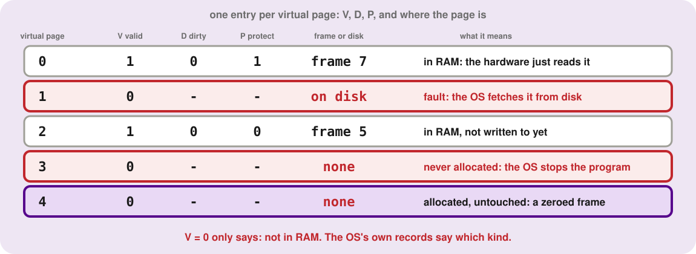
</p>
<p align=center><sub>One entry per virtual page. V = 0 can mean on disk or allocated but untouched (both page faults), or never allocated (a segmentation fault).</sub></p>

---

<a id="7"></a>

## How Big Is the Page Table?

The solution has a price, and it is time to count it. Take 32-bit addresses and 4 KB pages.

- 4 KB is 2^12 bytes, so the offset takes 12 bits and the other **20** bits are the page number.
- The table needs one entry per virtual page: 2^20, about a million entries.
- Each entry holds a frame number (up to 20 bits) plus the valid, dirty and protect bits, so about 23 bits.
- 2^20 entries of about 23 bits is roughly **3 MB**.

And that is for one program. Every process has its own table, and most of each table is empty, because a typical program uses a few small corners of a 4 GiB address space. We are paying for a million entries to describe a handful of pages.

The fix is the same trick we have used all lecture: split a number into pieces. Cut the 20-bit page number into **two 10-bit halves**. The top half indexes a small first-level table of 2^10 entries. Each of its entries points to a second-level table of 2^10 entries, and the second half of the page number indexes into that. This is a **two-level page table**, a table of tables.

The saving comes from the entries that point to nothing. If a whole region of the address space is unused, its top-level entry is simply marked invalid and no second-level table is ever built for it. An empty region costs one entry instead of a thousand. The price is one more trip to RAM on a walk through the table, which is another reason the TLB matters so much. Modern x86-64 uses the same idea with **four levels of 9 bits** each: 4 × 9 = 36 bits of page number plus a 12-bit offset gives 48-bit virtual addresses.

<p align=center>
    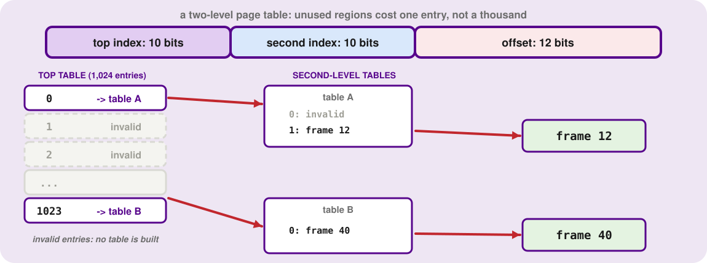
</p>
<p align=center><sub>A two-level page table. An unused region costs one invalid entry instead of a whole table.</sub></p>

---

<a id="8"></a>

## The Whole Trip in One List

For a virtual address, say 8200 (page 2, offset 8):

1. The CPU asks for virtual address 8200.
2. The TLB is checked for virtual page 2. On a hit, skip to step 6.
3. On a miss, read the page table in RAM.
4. If the entry says the page is on disk, take a page fault: evict a page by LRU, write it back to disk first if it is dirty, load the wanted page from disk, and update the page table. If the page was never allocated, the program gets a segmentation fault instead.
5. Save the entry in the TLB.
6. Physical address = physical page * 4096 + offset. For physical page 5, that is 20488.
7. Read the byte from there.

<p align=center>
    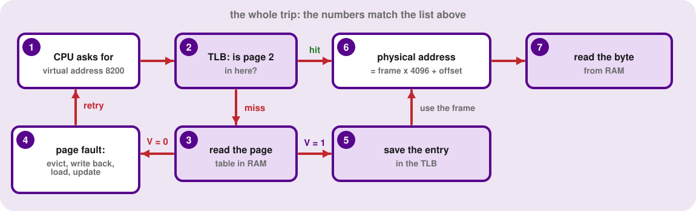
</p>
<p align=center><sub>The numbers match the list above.</sub></p>

Look at what this lecture did. Both halves are the same story at two scales: a small fast thing that holds copies of a big slow thing, a rule for where an item may go, a rule for who gets evicted, and a dirty bit so nothing is lost. The cache does it for blocks of RAM, and virtual memory does it for pages of disk: fully associative, write-back, with the disk behind it. Main memory is a cache of the disk.

---

<a id="9"></a>

## What a Fault Costs

A page fault is routine: the operating system fetches the page from disk, updates the table, and the program carries on. Routine is not the same as cheap.

| what | time | compared with RAM |
|---|---|---|
| a RAM access | 100 ns | 1 x |
| a page fault served from an SSD | 150,000 ns | 1,500 x |
| a page fault served from a hard disk | 8,000,000 ns | 80,000 x |

<p align=center>
    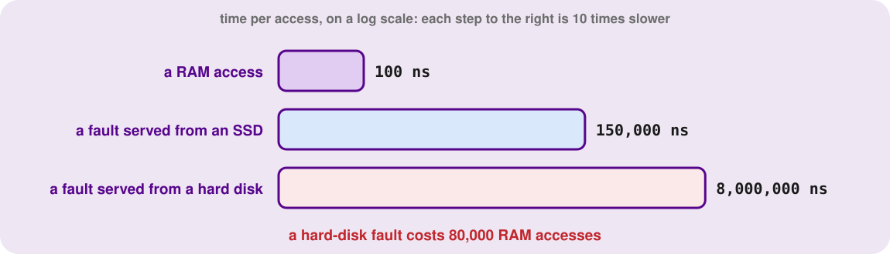
</p>
<p align=center><sub>A fault from a hard disk costs as much as 80,000 RAM accesses.</sub></p>

Let *p* be the fault rate: the fraction of memory accesses that fault. The average access time is the weighted mix:

```
average = (1 - p) * 100 ns + p * 8,000,000 ns
```

For *p* = 1 in 1,000 the average is 99.9 + 8,000, about 8,100 ns: memory is 81 times slower because of a fault that happens once in a thousand accesses.

| fault rate *p* | average access time | slowdown |
|---|---|---|
| none | 100 ns | 1 x |
| 1 in 1,000 | 8,100 ns | 81 x |
| 1 in 10,000 | 900 ns | 9 x |
| 1 in 1,000,000 | 108 ns | 1.08 x |

<p align=center>
    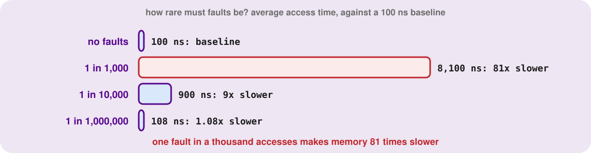
</p>
<p align=center><sub>One fault in a thousand accesses makes memory 81 times slower.</sub></p>

To lose only 8%, faults must happen once per million accesses. That is only possible because of locality, the same bet that made caches work. We cannot make the disk faster. What we can change is how often we fault, and that depends on which page the operating system evicts when RAM is full.

---

<a id="10"></a>

## Choosing a Victim: Page Replacement

When a page faults and every frame is taken, one resident page must leave. We compare policies on a **reference string** (the pages a program touches, in order) with a fixed number of frames, and count the faults. Fewer is better.

Take three frames and this reference string:

```
7 0 1 2 0 3 0 4 2 3 0 3 2
```

The first three references fill the empty frames, with three faults. Then 2 arrives and RAM is full. Which page does FIFO evict? FIFO evicts the oldest arrival, 7. Follow it to the end:

<p align=center>
    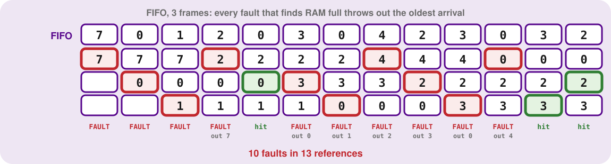
</p>
<p align=center><sub>FIFO with three frames: 10 faults. Red cells are faults, green cells are hits.</sub></p>

| reference | 7 | 0 | 1 | 2 | 0 | 3 | 0 | 4 | 2 | 3 | 0 | 3 | 2 |
|---|---|---|---|---|---|---|---|---|---|---|---|---|---|
| FIFO | F | F | F | F | hit | F | F | F | F | F | F | hit | hit |
| LRU | F | F | F | F | hit | F | hit | F | F | F | F | hit | hit |
| OPT | F | F | F | F | hit | F | hit | F | hit | hit | F | hit | hit |

FIFO takes 10 faults, LRU 9, and OPT 7. At reference 3, FIFO evicts 0 although 0 was used a moment ago, and LRU evicts 1, so LRU hits on the next 0.

<p align=center>
    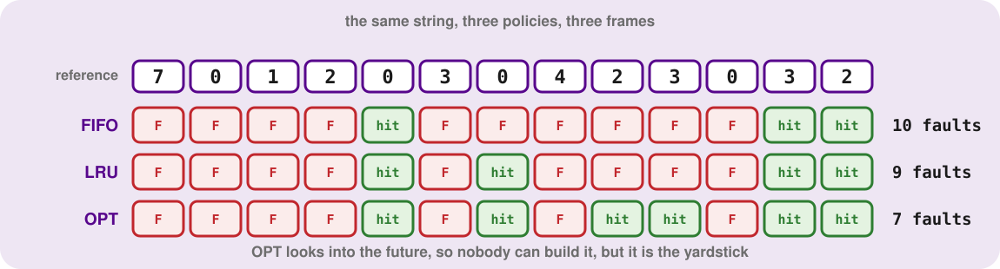
</p>
<p align=center><sub>The same string under three policies.</sub></p>

OPT is the optimal policy: evict the page whose next use is farthest in the future. It needs to see the future, so nobody can build it, but it is a perfect yardstick. No policy can beat 7 on this string. LRU lands close to it because the recent past really does predict the near future.

Surely more frames can only help? Take the string `1 2 3 4 1 2 5 1 2 3 4 5` under FIFO. With three frames it takes 9 faults. With four frames it takes 10. More memory made it worse. This is **Belady's anomaly**. It happens with FIFO, because FIFO ignores how pages are used. LRU and OPT can never do it: with more frames they always keep a superset of the pages they would have kept with fewer.

<p align=center>
    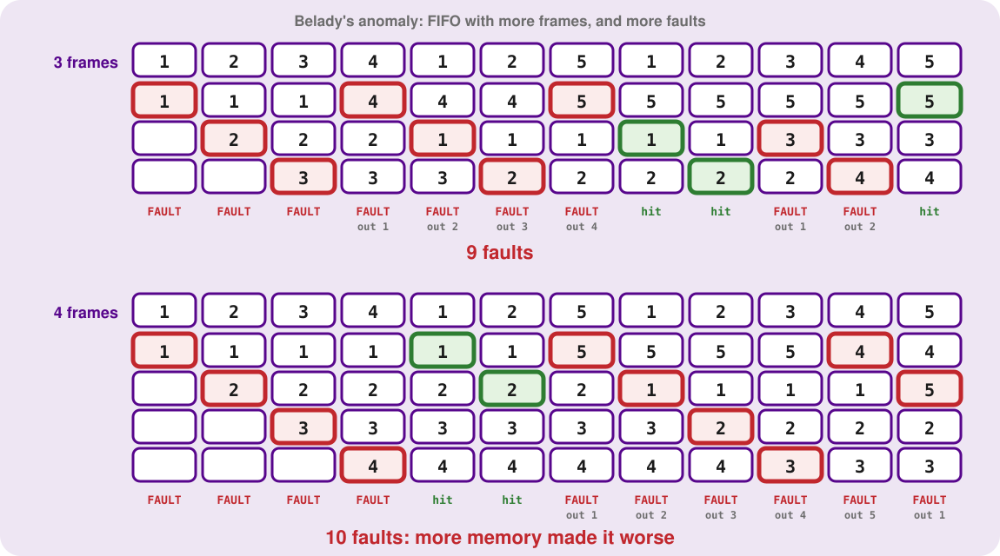
</p>
<p align=center><sub>Belady's anomaly: with FIFO, one more frame gave one more fault.</sub></p>

---

<a id="11"></a>

## LRU on a Budget: The Clock

True LRU needs a timestamp on every page, updated on every memory access. That would be a table write on every load and store, and no hardware does it. Real systems approximate LRU with one bit per page.

The **reference bit** R is set to 1 by the hardware whenever the page is used, which costs nothing extra because the hardware is already looking at the entry. The operating system clears it from time to time. So R = 0 means the page has not been used since the last clearing.

The **clock algorithm** arranges the frames in a circle with a hand pointing at one of them. When a victim is needed:

1. Look at the frame the hand points to.
2. If R = 1, the page was used recently. Clear the bit, move the hand on, and look at the next frame. This is the second chance.
3. If R = 0, this page is the victim. Put the new page here with R = 1, and move the hand on.

<p align=center>
    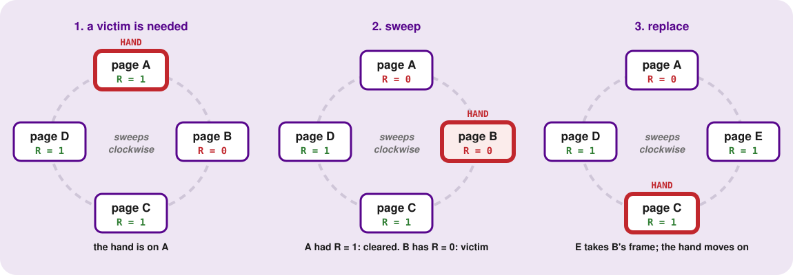
</p>
<p align=center><sub>The clock algorithm. The hand clears a set bit and moves on, and evicts the first page with R = 0.</sub></p>

A page in use keeps getting its bit set again, so the hand keeps skipping it. A page nobody touches loses its bit and is evicted the next time the hand arrives. That is LRU's behaviour for the price of one bit and a pointer.

Evicting a dirty page costs a disk write first, and a clean page can simply be dropped, so we prefer clean victims. Looking at R and D together gives four classes, and we evict from the lowest first:

| class | R D | meaning | evict |
|---|---|---|---|
| 1 | 0 0 | not used lately, clean | first choice |
| 2 | 0 1 | not used lately, dirty | second: pay a write-back |
| 3 | 1 0 | used lately, clean | third |
| 4 | 1 1 | used lately, dirty | last choice |

---

<a id="12"></a>

## Thrashing and the Working Set

A program does not touch all its pages all the time. At any moment it is using a small set of them, its **working set**, and that set changes slowly. If the working set fits in RAM, faults are rare. If it does not, they are not.

Here is the cliff. A loop cycles through four pages, `1 2 3 4 1 2 3 4 1 2 3 4`, but only three frames are available. LRU evicts the page used longest ago, which is exactly the page the loop will want next. Every access faults: twelve out of twelve. Give the same program a fourth frame and it faults only four times, the unavoidable first touches.

<p align=center>
    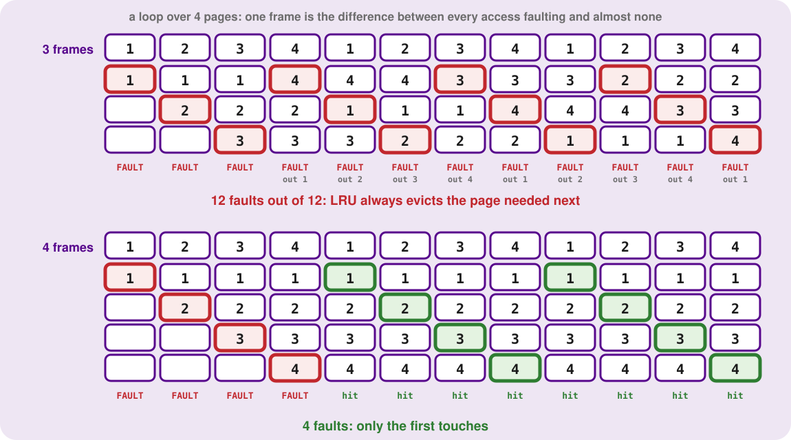
</p>
<p align=center><sub>A loop over four pages. One missing frame turns four faults into twelve.</sub></p>

Scale that up to a whole machine and you get **thrashing**: the working sets of the running programs together do not fit, every program faults constantly, and the processor sits idle waiting for the disk. There is a trap in this. The CPU looks idle, so a naive scheduler starts more programs. More programs means fewer frames each, more faults, and even more idle CPU.

There are four ways out:

1. Run fewer programs at once, suspending one entirely so the rest fit.
2. Make sure each running program gets at least its working set.
3. Add RAM.
4. Choose victims only from the faulting program's own pages, so one program cannot steal frames from another.

---

<a id="13"></a>

## What the OS Does with Page Tables

So far the page table has been a translator. The operating system also uses it to be lazy on purpose, and every trick comes down to the same few bits: valid, protect and dirty.

Demand paging means a program starts with almost nothing loaded. Each page is brought in the first time it is touched, which is a page fault. Even `malloc` works this way: it hands out addresses, but no RAM is used until a page is written. A brand-new page of heap or stack has no contents on disk, so the operating system picks a free frame, fills it with zeros, and points the table at it. That is a cheap fault, and it also means no program can read another program's old data.

Sharing: every program uses the C library, so why keep a hundred copies? Two page tables can point at the same frame. The programs may call it by different virtual page numbers, but the same physical frame sits behind both. The protect bit makes it read only. A program can only reach frames its own table points to, and only the operating system writes the table, so isolation and sharing come from the same mechanism.

**Copy-on-write** is the same idea applied to `fork`. A child needs a copy of all its parent's memory, but copying gigabytes is slow, and the child usually runs a different program straight away. So the operating system copies only the page table. Both tables point at the same frames, and every page is marked read-only.

When the parent writes to page 1, the store is refused by the protect bit and the operating system takes over. This fault is not an error: the operating system knows the page is a shared copy-on-write page. It copies just that one page into a new frame, points the parent's entry at the copy, marks it writable, and restarts the store. Only pages that are actually written are ever copied. Most pages are never written, so most of the copying never happens, and the usual `exec` after `fork` throws the rest away. It is the write-back idea again: do the expensive work late, and often never.

<p align=center>
    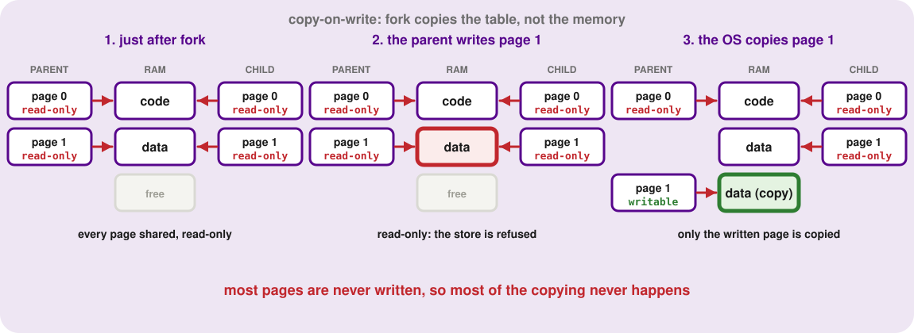
</p>
<p align=center><sub>Copy-on-write. Only the page that is written is ever copied.</sub></p>

A last use: a file can be mapped into the address space and then behaves like memory. Touching a page faults it in from the file, and a dirty page is written back to the file, exactly as a dirty page is written back to disk. Memory is a cache of the disk, and a file is part of the disk.

---

<a id="14"></a>

## Switching Programs, and the TLB

Every program has its own page table, and the hardware needs to know which one is active. A special register holds the address of the current table: on x86 it is `CR3`. To switch programs, the operating system saves the old program's registers and loads the new program's table address. That is a context switch.

Here is the problem. In program A, virtual page 2 lived in frame 5. In program B, virtual page 2 lived in frame 9. The TLB is a cache of translations, and it still holds A's entry: page 2, frame 5. If B asks for page 2 and the TLB hits, B reads A's memory. That is a correctness and a security failure. There are two fixes:

<p align=center>
    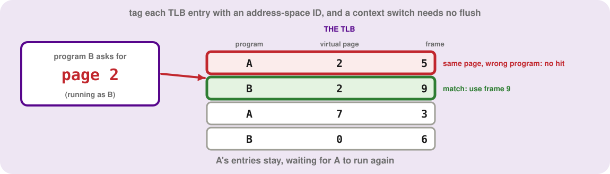
</p>
<p align=center><sub>With an address-space ID, a program only hits its own entries, so nothing has to be flushed.</sub></p>

1. Flush the TLB on every context switch: mark every entry invalid. It is simple and safe, but the new program starts with an empty TLB and pays a burst of misses.
2. Tag each TLB entry with an **address-space identifier**. A hit now needs the virtual page and the identifier to match. There is no flush, and A's entries can still be there when A runs again.

How much memory can a TLB cover? The **TLB reach** is the number of entries times the page size.

| page size | entries | TLB reach |
|---|---|---|
| 4 KB | 64 | 256 KB |
| 2 MB | 64 | 128 MB |
| 1 GB | 64 | 64 GB |

A working set bigger than the reach misses constantly. That is why systems offer huge pages: each TLB entry covers 512 times more memory, at the price of wasting space inside a mostly empty page.

Page size is a trade-off in general. Small pages waste little inside the last page of each region (about half a page on average), but they need many more table entries and give the TLB less reach. Large pages shrink the table and extend the reach but waste more space. 4 KB has been the default for decades because it sits in a comfortable middle.

---

<a id="15"></a>

## Practice: Exam-Style Problems

Problem 1. A 32-bit virtual address, 4 KB pages, and a two-level page table with 10 bits for the top index, 10 for the second, and 12 for the offset. Split `0x00403ABC`.

The offset is the last three hex digits, `0xABC`. Shifting the address right by twelve gives the page number `0x403`, which is `100 0000 0011` in binary. The low ten of those bits, `00 0000 0011`, are 3, and what sits above them is 1. So the top index is 1, the second index is 3, and the offset is `0xABC`.

<p align=center>
    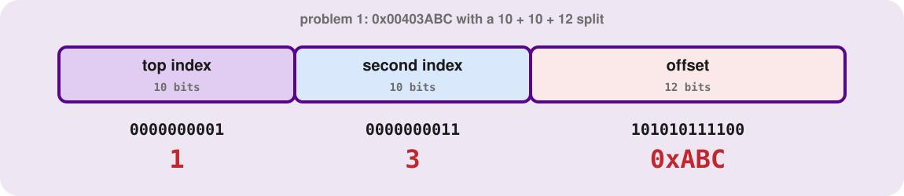
</p>
<p align=center><sub>Problem 1, split into 10 + 10 + 12 bits.</sub></p>

Problem 2. The TLB hits 98% of the time and takes 1 ns. RAM takes 100 ns. The page table has one level. What is the average access time?

A hit costs the TLB lookup plus the data access: 1 + 100 = 101 ns. A miss adds a walk of the page table: 1 + 100 + 100 = 201 ns. The average is 0.98 × 101 + 0.02 × 201 = 98.98 + 4.02 = 103 ns. The TLB has hidden almost all of the translation cost.

Problem 3. A page fault costs 8 ms to read the page from disk. 40% of the victims are dirty and need another 8 ms to be written first. What is the average cost of a fault?

Every fault pays 8 ms. Forty percent also pay 8 ms more, which averages 0.40 × 8 = 3.2 ms. The total is 11.2 ms.

Problem 4. A 48-bit virtual address, 4 KB pages, 8-byte entries, one single-level table. How big is the table?

48 - 12 = 36 bits of page number, so 2^36 entries × 8 bytes = 2^39 bytes = 512 GiB, for one program. That is why real systems use four levels of 9 bits, where only the parts of the table in use exist at all.

Problem 5. Page fault or segmentation fault?

1. A store to a read-only code page.
2. The first touch of a page returned by `malloc`.
3. A touch of a page that was swapped out to disk.
4. A touch of an address nobody allocated.

The test is whether the operating system has a legitimate page to put there. Case 2 is a page fault: the page is not yet materialised, so the system makes a zeroed frame. Case 3 is a page fault: the page is on disk, so the system reads it back. In case 1 the page is there but the program has no right to write it, and in case 4 there is nothing at that address at all. Cases 1 and 4 are segmentation faults, and they end the program.

Caching and virtual memory are one story. A virtual address arrives. The TLB checks it, the page table translates it, a fault goes to the operating system, a policy picks the victim, a dirty page is written back, and the page is loaded. Every step is a cache decision: where does it go, who leaves, and when does the other copy find out.

---

<sub>**Previous: [Caching: Direct-Mapped, Associative & Writes](/lectures/11-caching)** || **Next: [Intel x86 Architecture](/lectures/13-x86-architecture)**</sub>
