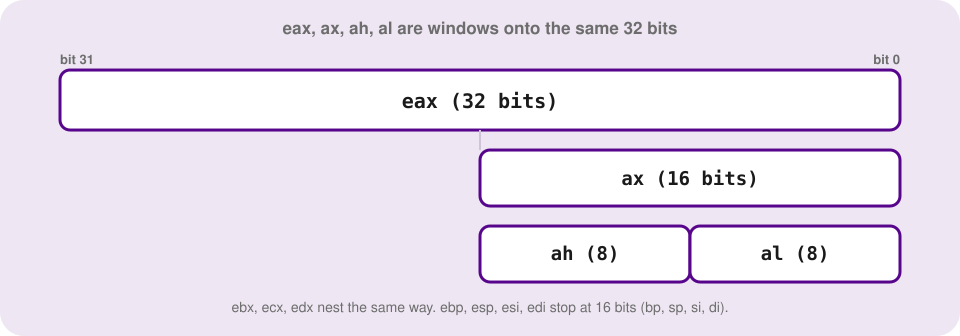
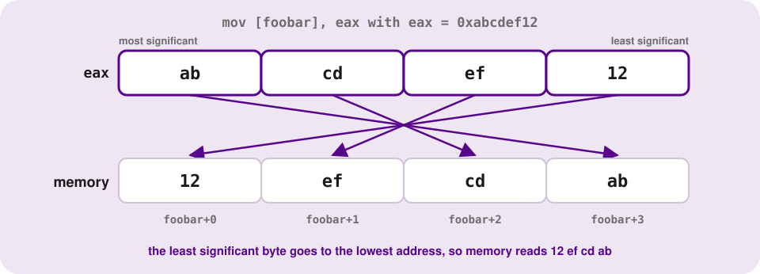

<h2 align=center>Week XI</h2>

<h1 align=center>Meet the Machine in Your Laptop: Intel x86 Architecture</h1>

---

## Sections

1. [**Recap: Three Machines, One Idea**](#1)
2. [**E15, E20, and the Real Thing**](#2)
3. [**From Text to a Running Program**](#3)
4. [**Registers: Eight Boxes with Nested Names**](#4)
5. [**Reading an Instruction**](#5)
6. [**Memory Operands: What the Brackets Mean**](#6)
7. [**Bytes, Words, and Which End Comes First**](#7)
8. [**Sections and Directives: Laying Out Data**](#8)
9. [**Arrays and Strings**](#9)
10. [**Where This Is Going**](#10)

---

For ten weeks we have been designing processors small enough to hold in your head. E15 had four registers and no data memory. E20 had eight registers and a clean, regular instruction set. Today we meet a processor that has been shipping, in one form or another, since 1978, and that is probably doing something for you right now.

Sections 1 to 3 place x86 next to what you know and show how a program gets from a text file to a running process. Sections 4 to 7 are the architecture itself: registers, operands, memory, and byte order. Sections 8 and 9 are how you lay out data. Section 10 is what comes next week.

This lecture is deliberately about *reading* x86. Next week we write it.

---

<a id="1"></a>

## Recap: Three Machines, One Idea

Every processor we have met does the same loop: fetch an instruction, decode it, execute it, move on. What changes from machine to machine is how much is packed into each step.

| | E15 | E20 | Pipelined E20 |
|---|---|---|---|
| Gave us | the fetch-decode-execute loop | registers, memory, branches | overlapping instructions |

Intel x86 is the same loop with forty-odd years of additions. Almost everything that looks strange about it has a historical reason, and when something looks strange today the useful question is usually "what was it compatible with?".

---

<a id="2"></a>

## E15, E20, and the Real Thing

The architecture we will use is called **IA-32**: Intel Architecture, 32-bit. You will also see it called **x86** or **x86-32**. Programs written for the 8086 in 1978 still run on a modern x86 chip, and that promise of backward compatibility is the reason the instruction set is so large.

| | E15 | E20 | IA-32 |
|---|---|---|---|
| Memory | sixteen 12-bit cells of instruction ROM, no data memory | 8192 16-bit cells of mixed instruction and data RAM | up to 4 GB of mixed instruction and data RAM |
| Registers | four 4-bit registers | seven general-purpose 16-bit registers | eight 32-bit general-purpose, eight 80-bit floating point, six segment registers, plus vector, debug, and system registers |
| Instructions | 11 mnemonics | 13 instructions and 3 pseudo-instructions | about 981 mnemonics, more once you count operand variants |
| Real-world use | none | none | probably in your computer right now |

We will use a small fraction of this: eight general-purpose registers, a few dozen instructions, and none of the floating point, vector, or segment machinery. The segment registers (`CS`, `SS`, `DS`, `ES`, `FS`, `GS`) are set up by the operating system and we will leave them alone.

One thing worth saying out loud: "32-bit" means the registers are 32 bits wide and an address is 32 bits, so 2<sup>32</sup> bytes = 4 GB is the most memory a program can name. Your laptop is almost certainly running the 64-bit descendant, x86-64, which widens everything but keeps the 32-bit instructions working. We learn the 32-bit one because it is the smaller of the two.

---

<a id="3"></a>

## From Text to a Running Program

In E20 we wrote assembly, ran it through a simulator, and that was that. With x86 there is a real toolchain between your text file and a running process, and every stage has a file type.

<p align=center>
    
</p>
<p align=center><sub>Two tools, three files.</sub></p>

The two commands:

```
nasm -f elf -gstabs foo.asm
ld -o foo -m elf_i386 foo.o
```

`nasm` is the **assembler**: it turns each instruction into its machine-language bytes. `ld` is the **linker**: it takes one or more object files, decides where everything will live in memory, and produces the executable. We do not care much about the object file in this class, but we will care about the difference between what the assembler produces and what the linker produces.

Here is one tiny program, a loop that doubles `eax` until it reaches 100:

```asm
mov eax, 2
L1:
cmp eax, 100
jge L2
imul eax, 2
jmp L1
L2:
```

Disassembling the object file gives:

```
 0:  b8 02 00 00 00     mov   eax,0x2
 5:  83 f8 64           cmp   eax,0x64
 8:  7d 05              jge   0xf
 a:  6b c0 02           imul  eax,0x2
 d:  eb f6              jmp   0x5
```

No labels, and the addresses start at zero, because the assembler does not know where the program will end up. Disassembling the linked executable gives:

```
48060:  b8 02 00 00 00  mov   eax, 2
48065 <L1>:
48065:  83 f8 64        cmp   eax, 100
48068:  7d 05           jge   4806f <L2>
4806a:  6b c0 02        imul  eax, 2
4806d:  eb f6           jmp   48065 <L1>
4806f <L2>:
```

Now the addresses are real. Notice that the machine-code bytes themselves are identical: `jge` is `7d 05` in both, a *relative* jump of 5 bytes forward. Relative jumps survive being moved around. That is the trick.

### Why a linker at all?

Because programs come in pieces. If `main.asm` says `call helper_function` and `helper_function` is defined in `helper.asm`, the assembler of `main.asm` has no idea where it is. It emits a `call` with a blank target (the disassembly of `main.o` shows a `call` to a meaningless address) and leaves a note saying "someone fill this in". Two directives let the pieces find each other:

- `global helper_function` in `helper.asm`: this symbol is visible to other files.
- `extern helper_function` in `main.asm`: this symbol is defined somewhere else.

The tool `nm` lists an object file's symbols: `T` for an exported code symbol defined here, `U` for undefined here, `d` for a non-exported data symbol. After `ld` joins the two files the placeholder becomes `e8 1b 00 00 00`, a call 0x1b bytes ahead, landing on `helper_function`.

The same machinery is how your C and assembly can be linked together: `gcc -o demo2 demo2.c demo1.o -m32` links a C `main` against an assembly `helper_function`.

---

<a id="4"></a>

## Registers: Eight Boxes with Nested Names

The eight general-purpose 32-bit registers:

| `eax` | `ebx` | `ecx` | `edx` | `ebp` | `esp` | `esi` | `edi` |
|---|---|---|---|---|---|---|---|

The `e` stands for "extended", as in extended from 16 to 32 bits. Two others exist but you cannot name them like the rest: `eip` (the program counter, which only changes through jumps) and `eflags` (the flags register, which holds things like the zero flag that `cmp` sets).

Here is the part that has no counterpart in E20: the registers have **nested names**. The lower half of `eax` is its own 16-bit register called `ax`, and `ax` splits further into two 8-bit halves, `ah` (high) and `al` (low).

<p align=center>
    
</p>
<p align=center><sub>The nested register names.</sub></p>

`ebx`, `ecx`, and `edx` work the same way (`bx`, `bh`, `bl`, and so on). `ebp`, `esp`, `esi`, and `edi` have 16-bit versions (`bp`, `sp`, `si`, `di`) but no 8-bit ones.

These are not separate registers. They are windows onto the same bits, so writing one changes the others:

```asm
mov eax, 0xf0f0f0f0   ; eax = 0xf0f0f0f0
mov ax,  0xabab       ; eax = 0xf0f0abab   (only the low 16 bits changed)
add eax, 1            ; eax = 0xf0f0abac

mov eax, 0xabababab
mov al,  0xff         ; eax = 0xabababff
add eax, 1            ; eax = 0xababac00   (the carry rippled up)

mov eax, 0xabababab
mov al,  0xff
add al,  1            ; eax = 0xababab00   (al wrapped to 00 and the carry went nowhere)
```

The last two examples differ by one letter and give different answers. `add eax, 1` is a 32-bit addition, so the carry out of the low byte lands in the next byte. `add al, 1` is an 8-bit addition, so `ff + 1 = 00` and the carry is simply dropped.

---

<a id="5"></a>

## Reading an Instruction

The shape of an x86 instruction is an opcode, then operands separated by commas, with the **destination on the left**:

```asm
mov eax, 53        ; eax = 53
mov eax, ebx       ; eax = ebx
add eax, ebx       ; eax = eax + ebx
```

A few syntax rules that catch people the first time:

- Comments start with `;` and run to the end of the line.
- Numeric literals must begin with a digit. Decimal is `53`, hex is `0x53` or `53h`, binary is `010101b`. A hex number that starts with a letter needs a leading zero: `0ffh` or `0xff`, never `ffh`, which the assembler reads as a label.
- Compare `mov bh, ah` (copy the register `ah` into `bh`) with `mov bh, 0ah` (put the number ten into `bh`). One letter again.

Unlike E20, one x86 opcode accepts several *kinds* of operand. `mov` alone covers what E20 split across `movi`, `lw`, `sw`, and a register copy. Here is the same idea in both languages:

| E20 | IA-32 |
|---|---|
| `movi $1, 20` | `mov eax, 20` |
| `addi $1, $1, 1` | `inc eax` or `add eax, 1` |
| `add $1, $1, $2` | `add eax, ebx` |
| `jeq $1, $2, foobar` | `cmp eax, ebx` then `je foobar` |
| `lw $1, 20($0)` | `mov eax, [20]` |
| `lw $1, 0($2)` | `mov eax, [ebx]` |
| `lw $1, 20($2)` | `mov eax, [ebx+20]` |
| `sw $1, 20($0)` | `mov [20], eax` |
| `lw`, `addi`, `sw` to bump a memory cell | `inc dword [20]` |

Two things to notice. First, x86 can do arithmetic straight on memory, which E20 could not: a three-instruction load-modify-store becomes one. Second, `jeq` compared and jumped in one instruction, while x86 splits it: `cmp` sets flags, and a separate conditional jump reads them.

---

<a id="6"></a>

## Memory Operands: What the Brackets Mean

Square brackets always mean "go to memory". No brackets means the value itself.

```asm
mov eax, 5            ; immediate: eax = 5
mov eax, ebx          ; register:  eax = ebx
mov eax, [5]          ; memory: eax = the 32-bit value starting at address 5
mov eax, [some_label] ; same, with a name for the address
mov eax, [ebx]        ; eax = the value at the address held in ebx
```

That last form is a pointer dereference. `ebx` holds an address, and the brackets follow it.

A memory operand can also add an offset or a scaled register: `[ebx+20]`, `[some_string+ebx]`, `[some_array+ebx*4]`.

Two rules that follow from the hardware:

1. You cannot move into an immediate: `mov 53, eax` is meaningless.
2. At most one memory operand per instruction: `mov [eax], [ebx]` is illegal. Go through a register:

```asm
mov ecx, [ebx]
mov [eax], ecx
```

### How big is the access?

The size of a memory access comes from the other operand. If it is `eax`, the access is 4 bytes; `ax`, 2 bytes; `ah`, 1 byte:

```asm
mov eax, [ebx]   ; read a DWORD
mov ax,  [ebx]   ; read a WORD
mov ah,  [ebx]   ; read a BYTE
```

Whichever size, the *pointer* is always a 32-bit register, because it is an address.

When no register is involved, nothing says how much you mean:

```asm
mov [my_data], 53h      ; error: operation size not specified
mov dword [my_data], 53h   ; four bytes: 00 00 00 53
mov word  [my_data], 53h   ; two bytes:  00 53
mov byte  [my_data], 53h   ; one byte:   53
```

The assembler refuses to guess, which is a kindness: a wrong guess here would silently overwrite neighbouring bytes.

---

<a id="7"></a>

## Bytes, Words, and Which End Comes First

E20 had 16-bit cells: one address, one value. x86 memory is made of **bytes**: every address holds 8 bits. A 32-bit register therefore occupies four consecutive addresses, and we have to decide in what order the four bytes go.

Intel's answer is **little-endian**: the least-significant byte goes at the lowest address.

If `eax = 0xabcdef12` and we run `mov [foobar], eax`:

| address | `foobar+0` | `foobar+1` | `foobar+2` | `foobar+3` |
|---|---|---|---|---|
| byte | `12` | `ef` | `cd` | `ab` |

<p align=center>
    
</p>
<p align=center><sub>Little-endian: the byte order flips on the way to memory.</sub></p>

It looks backwards on the page, but it is consistent: reading with `mov ebx, [foobar]` collects the four bytes in the same order and gives back `0xabcdef12`.

The same rule holds for smaller sizes. With `ax = 0xabcd`, `mov [foobar], ax` writes `cd` at `foobar+0` and `ab` at `foobar+1`. With `ah` or `al`, one byte, so there is nothing to reorder.

### Mixing sizes

Little-endian becomes visible when you read back with a different size from what you wrote:

```asm
mov eax, 0x12345678
mov [foobar], eax       ; foobar+0..3 = 78 56 34 12
mov bx, [foobar]        ; bx = 0x5678
mov ch, [foobar]        ; ch = 0x78
```

Both reads start at `foobar` and take the lowest-addressed bytes, which are the *least* significant ones.

### Try this one

```asm
mov eax, 0xabcdef       ; eax = 0x00abcdef
mov [foobar], eax
mov [foobar+2], eax
mov [foobar+4], ah
```

What does the six-byte array starting at `foobar` look like at the end?

The first store gives `ef cd ab 00`. The second starts two bytes later, so it overwrites `foobar+2` and `foobar+3` and extends the array to `foobar+5`, giving `ef cd ef cd ab 00`. The third writes `ah = 0xcd` to `foobar+4`, replacing `ab`. Final: `ef cd ef cd cd 00`.

---

<a id="8"></a>

## Sections and Directives: Laying Out Data

An x86 program is divided into **sections**, and you tell the assembler which one you are writing into:

| section | what goes there |
|---|---|
| `.text` | your code |
| `.data` | global data that starts with a value |
| `.bss` | global data that starts uninitialised (just reserved space) |

```asm
section .data
my_favorite_string: db "Here is an initialized value."
some_number: dd 42

section .bss
uninitialized_32byte_buffer: resb 32

section .text
global _start
_start:                      ; the first instruction to run
    mov [uninitialized_32byte_buffer], ah
```

Two kinds of line appear in there, and the difference matters.

**Instructions** (`mov`, `add`, `jmp`) are translated by the assembler into machine-code bytes. **Directives** (`section`, `db`, `global`, `equ`) are instructions *to the assembler*. They shape the output but are not themselves executed.

| directive | meaning |
|---|---|
| `section` | the following lines go into this section |
| `db`, `dw`, `dd`, `dq` | put initialised bytes, words, dwords, qwords into memory |
| `resb`, `resw`, `resd`, `resq` | reserve space, with no initial value |
| `global` | make this symbol visible to the linker |
| `equ` | define a constant at assembly time |

The size names, which you will see everywhere:

| name | size | directive | register example |
|---|---|---|---|
| byte | 8 bits | `db` | `ah`, `al` |
| word | 16 bits | `dw` | `ax`, `bx` |
| dword | 32 bits | `dd` | `eax`, `ebx` |
| qword | 64 bits | `dq` | `rax` (x86-64 only) |

A label's value is the address of the line it names. So after `age: dd 0`, writing `mov ebx, age` puts the *address* in `ebx`, and `mov eax, [age]` puts the *value stored there* in `eax`. The brackets are the entire difference again.

Several values in one directive are laid out back to back:

```
morestuff: dd 96, 42, 99     ; at morestuff, morestuff+4, morestuff+8
stuffstuff: dw 96, 42, 99    ; at +0, +2, +4
bytestuff: db 96, 42, 99     ; at +0, +1, +2
```

---

<a id="9"></a>

## Arrays and Strings

An array is consecutive elements of equal size, so element *n* of an array of *s*-byte elements lives at

> address = base + *n* × *s*

and x86 has an operand form that computes that in one go:

```
mov eax, [arr + ebx*4]     ; eax = arr[ebx], for an array of dwords
```

Here `arr` is the base address, `ebx` is the index, and the `*4` is the element size (the hardware allows scale factors 1, 2, 4, or 8). Compare with E20, where you would shift or add in a loop to build that address by hand.

### Strings

There is no single way to store a string. Every representation has to answer two questions: how are characters encoded, and how do we know where the string ends?

**C-style** strings end with a zero byte:

```
mystring: db "Hello", 0       ; 48 65 6c 6c 6f 00
```

Easy to write, and any length is allowed, but finding the length means walking the whole string, and the body cannot contain a zero byte.

**Pascal-style** strings carry their length in front:

```
mystring: db 5, "Hello"       ; 05 48 65 6c 6c 6f
```

Length is instant and the body can hold any byte, but a one-byte length caps the string at 255 characters.

**Multi-byte encodings** such as UTF-16 use two or more bytes per character, so they can hold other alphabets and emoji, but indexing and length are harder. How the string is *encoded* and how its length is *marked* are independent choices.

---

<a id="10"></a>

## Where This Is Going

You can now read a line like

```
mov ah, [some_string+ebx]
```

and say which register is written, how many bytes are read, from where, and in what order they are combined. That is most of what an x86 *architecture* is.

Next week is the instruction set: arithmetic and logic, `cmp` and the conditional jumps, and how a `for` loop or an `if` in C turns into x86. After that, the stack, `call` and `ret`, and the one instruction that gets a program out of its own sandbox, `int 0x80`, which asks Linux to do something on its behalf.

Here is a preview of that last one, since it is the first program you will actually *run*:

```asm
section .data
hello_text: db "Hello, world", 10
hello_text_len equ $-hello_text

section .text
global _start
_start:
    mov eax, 4              ; system call number 4: write
    mov ebx, 1              ; file descriptor 1: standard output
    mov ecx, hello_text     ; address of the bytes to write
    mov edx, hello_text_len ; how many bytes
    int 80h                 ; ask the kernel
    mov eax, 1              ; system call number 1: exit
    mov ebx, 0              ; exit code 0
    int 80h
```

Every line should now be readable, even if you cannot yet write it from scratch. Notice `ecx` holds an *address* (no brackets) because `write` wants a pointer to the bytes, and `$-hello_text` is the assembler subtracting the label's address from "here" to get the string length: 13 bytes, 12 characters plus the newline.
